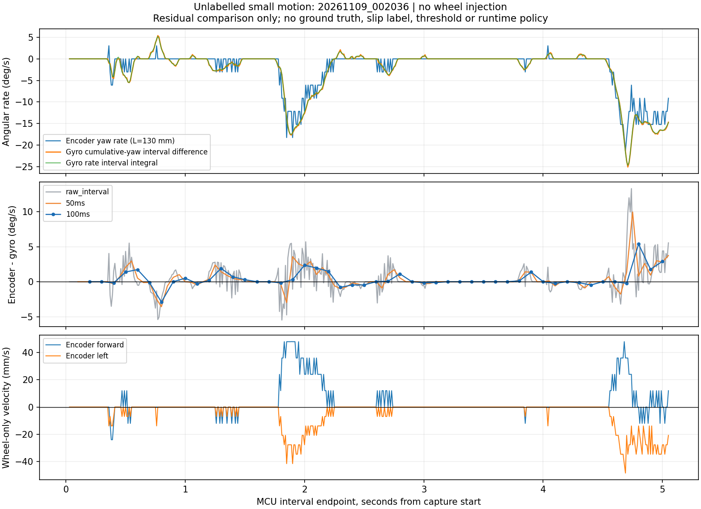

# 三轮编码器＋主gyro轮滑检测：离线分析与试验

日期：2026-11-09。范围：分析和显式离线试验，**未接入定位仲裁、SDK注入开关或比赛控制**，未启动设备/电机，未修改原始日志和安装参数。

## 结论先行

用户提出的“编码器角速度与主gyro比较”有价值，计算量很小，适合作为**轮地无滑模型不一致**的一个证据。但它只增加一个约束：

- 严格只有一只轮出现额外转速误差时，通常会产生可检出的角速度残差。
- 抵住安全区仍按直线比例空转，可以产生**完全为零的角速度残差，同时平移里程计完全错误**。前进、后退、横移都存在这个盲区。
- 即使检出异常，也不能单独确定哪只轮架空，更不能唯一恢复真实XY速度。
- 残差小不能证明轮速可信，不能用它撤销既有安全区慢速阶段排除轮式影响的策略。残差大也不能直接证明某只轮打滑：几何误差、坡面/抬轮和gyro动态误差也可能造成不一致。

建议先把它作为离线证据，查看正常运动和已知架空/受阻场景的表现，再决定阈值及来源切换。本轮没有把建议变成运行逻辑，没有新增年龄门、握手、停车或下位机任务。

## 1. 本车当前公式和实际证据

上位机复核基线为`codex/gamepad-teleop@dc5337d`，保留工作区用户ROI、`vision/456`及“雷达与融合”资料。下位机GitHub `main`核对到`3b1da3836fdf20533d49f8b94cc5977d7b331cd0`；相关`DebugTelemetry.c`、`motor.c`、`encoder_f405.c`、`imu_uart.c`与`14b2a3a`对应blob一致。**这不证明实板dirty构建与任一干净提交逐字相同**；实板身份单独读取日志。

本车X前/Y左/Z上，逆时针为正。这里的轮速采用**07帧原始delta的符号**：

\[
k=\frac{\pi D}{N}=0.000207215788803\;\mathrm{m/count},\quad
D=0.070\mathrm{m},\ N=1061.268\mathrm{count/rev},\quad
u_i=\frac{k\Delta n_i}{\Delta t}.
\]

下位机已经按实际轮计数发布：

\[
v_{x,e}=\frac{u_1-u_2}{\sqrt3},\qquad
v_{y,e}=\frac{u_1+u_2-2u_3}{3}.
\]

理想120°、等臂布局的完整关系为：

\[
\begin{bmatrix}u_1\\u_2\\u_3\end{bmatrix}=
\begin{bmatrix}\sqrt3/2&1/2&L\\-\sqrt3/2&1/2&L\\0&-1&L\end{bmatrix}
\begin{bmatrix}v_x\\v_y\\\omega\end{bmatrix},\qquad
\omega_e=\frac{u_1+u_2+u_3}{3L}.
\]

**L先取代码中的0.130m控制模型值，并非已机械测量的三轮有效力臂。** L是轮驱动方向对应的旋转力臂；轮不严格切向时不等于简单的中心到轮心直线距离。当前配置中的`wheel_center_radius_m=0`用于旧路径禁用轮式yaw，不能拿来作这里的除数。

旧Python helper先令`wheel=-k·delta`，再写`-sum(wheel)/(3L)`，与这里相同。不能把负号再施加一次，也不能修改gyro正方向。主gyro角度来自IMU串口实际角度包，角速度来自另一类IMU实测包，均逆时针正，不是TURN目标或编码器生成的航向。

**下位机已上传主gyro实测角速度，本轮已直接使用，不需要新增接口。** 旧`0x1F`有角速度，版本化`08`有`rate_mdps`（0.001°/s）、`rate_receive_us`和`rate_source_id`。`rate_mdps/1000`得到°/s，再乘`pi/180`得到rad/s。比较用现有08主gyro角速度在轮区间的积分；累计yaw端点差另列核对。当前07直接发布的是前向/左向实测速度，未直接发布编码器角速度，后者按三轮计数推算。

代码依据：

- [F405实测速度发布](https://github.com/kkkkkkkkkkkkkkkk222222/F407-Rescue-Robot/blob/3b1da3836fdf20533d49f8b94cc5977d7b331cd0/Main/Src/DebugTelemetry.c#L115)：07使用真实计数差及相邻快照区间；速度公式在149～157行。
- [F405参数和符号](https://github.com/kkkkkkkkkkkkkkkk222222/F407-Rescue-Robot/blob/3b1da3836fdf20533d49f8b94cc5977d7b331cd0/Main/Inc/app_config.h#L64)：130mm控制模型；轮径/计数在172～178行，符号在234～239、268～284、347～357行。
- [IMU角度/角速度来源](https://github.com/kkkkkkkkkkkkkkkk222222/F407-Rescue-Robot/blob/3b1da3836fdf20533d49f8b94cc5977d7b331cd0/Main/Src/imu_uart.c#L59)：实际数据及独立源接收时刻。
- 上位机`localization/src/f405_wheel_measurements.cpp`、`localization/tools/f405_timed_measurements.py`采用同一F405平移公式；本轮未改这些运行代码。

通用模型参考[Modern Robotics官方讲解](https://modernrobotics.northwestern.edu/nu-gm-book-resource/13-2-omnidirectional-wheeled-mobile-robots-part-1-of-2/)：omni轮驱动方向无滑、滚子方向自由运动，三轮底盘的轮速/车体速度矩阵可逆。下文针对本车的残差和反例是按当前代码自行推导，不是照搬四轮麦轮公式。

## 2. 能检测什么：只有一个独立冗余

令`e_i`为每只轮实测切向速度减去真实车体运动应产生的轮速。三轮关系写为：

\[
u=A v+L\omega\mathbf1+e,\qquad
A=\begin{bmatrix}\sqrt3/2&1/2\\-\sqrt3/2&1/2\\0&-1\end{bmatrix}.
\]

本节先假设gyro等于真实角速度、几何及换算准确。因为三轮平移系数每列之和均为0：

\[
q=\sum_i u_i-3L\omega_g=\sum_i e_i,\qquad
r_\omega=\omega_e-\omega_g=\frac{q}{3L}.
\]

这只能观察三轮误差之和。所有满足`e1+e2+e3=0`的误差都不可见，构成二维盲区，恰好可以生成任意虚假平移。三轮模型自身没有轮速冗余；gyro只补了一个约束，不会凭空提供独立XY测量。

若gyro有误差，完整形式为`q=sum(e)+3L·(omega_true−omega_g)`；后文的几何/动态误差也会进入残差。因此“残差非零”本身不唯一指向轮滑。

把当前编码器算出的`vx/vy`和gyro回代到三只轮也无助于选轮：三只回代残差恰好都为`q/3`。所以不能用“回代后残差最大的轮就是架空轮”这个办法。

经典轮滑残差研究同样指出，保持运动学一致的滑移可能不被残差检测发现；这里只采用这个边界，并不移植论文的四轮算法。[Muir与Neuman原论文，第5.2节](https://publications.ri.cmu.edu/storage/publications/pub_files/1991/3/01087767-1.pdf)

## 3. 两个重点场景：明确反例及可检出条件

以下均为**数学构造/离线检查，不是实车结果**，L=0.130m。

### 3.1 安全区受阻直线空转

| 场景 | 编码器轮速(u1,u2,u3)，m/s | 编码器(vx,vy)，m/s | 实际运动/gyro | 角速度残差 |
| --- | --- | --- | --- | --- |
| 抵墙仍前推 | (0.259808,−0.259808,0) | (0.300,0) | 车不动，gyro=0 | **0** |
| 抵墙仍后退 | (−0.259808,0.259808,0) | (−0.300,0) | 车不动，gyro=0 | **0** |
| 左移受阻 | (0.150,0.150,−0.300) | (0,0.300) | 车不动，gyro=0 | **0** |
| 右移受阻 | (−0.150,−0.150,0.300) | (0,−0.300) | 车不动，gyro=0 | **0** |

正常直行也能产生完全相同的轮计数和gyro。仅凭这两路数据，数学上无法分辨“真的前进”和“原地平移空转”。转向控制若让车头始终稳定，甚至可能让角残差更接近0。减速、延长窗口、调小阈值、换C++均不能消除这个可观测性盲区。

安全区阶段已有排除轮式影响的策略因此仍有必要；该策略利用业务条件，不依赖这个残差是否触发。本轮不改其范围。

### 3.2 一只轮额外空转

若其它两轮确实无滑、主gyro及几何模型正确，某一轮额外误差为`+0.300m/s`，则：

| 出错轮 | vx误差，m/s | vy误差，m/s | 编码器−gyro角速度误差 |
| --- | ---: | ---: | ---: |
| 1 | +0.173205 | +0.100000 | +44.0737°/s |
| 2 | −0.173205 | +0.100000 | +44.0737°/s |
| 3 | 0 | −0.200000 | +44.0737°/s |

反向误差全部反号。因此**有额外转速误差的单轮架空通常能被提示**，但三个轮的角残差相同，不能据此认轮。物理上架空却刚好转在运动学期望速度、误差太小或窗口内正负抵消时，仍可能无残差；“架空”本身不等于“编码器一定多转”。抬轮造成的倾斜还可能破坏平面模型。

### 3.3 为什么不能检出后直接删一只轮

令`q=sum(u)−3L·omega_g`。在“只有第j轮坏”的假设下，把那只轮改成`u_j−q`即可得到三个候选：

\[
v^{(1)}=v_e-q(1/\sqrt3,1/3),\quad
v^{(2)}=v_e-q(-1/\sqrt3,1/3),\quad
v^{(3)}=v_e-q(0,-2/3).
\]

例：实测`u=(0.300,0,0)`、gyro=0。三候选分别为`(0,0)`、`(0.346410,0)`、`(0.173205,0.300)`m/s，**都满足gyro=0**。其中哪个正确，需要独立位置/运动证据或明确知道是哪只轮离地。

把三只轮平均减去`q/3`也不修复XY：这只改变三轮的共同旋转分量，而平移公式会抵消共同项。当前导航本来就用主yaw，单纯用gyro替换轮式yaw不能解决已被污染的轮式平移。

## 4. 比较方法：同一运动区间，不加运行门控

主对照用**收到的gyro实测角速度**积分到同一个轮区间；累计yaw差另作核对：

\[
\Delta\psi_e=\frac{k(\Delta n_1+\Delta n_2+\Delta n_3)}{3L},\quad
\Delta\psi_g=\int_{t_0}^{t_1}\omega_g(t)\,dt,\quad
r_\omega=\frac{\Delta\psi_e-\Delta\psi_g}{t_1-t_0}.
\]

离线实现只读已有07/08：

1. 同boot/reference分段，按轮measurement ID和gyro各自source ID去重。yaw是累计角，不作±180°折返。不能跨参考复位累计。
2. 按`rate_receive_us`对已传实测角速度作分段线性梯形积分；另使用主gyro的`yaw_receive_us`，线性插值累计角到轮区间`t0_us/t1_us`，求`yaw(t1)−yaw(t0)`。yaw与rate分别计算，不能按相同SEQ认为同时采样。
3. 两路时刻共用MCU微秒时钟，不需要新增RDK时钟握手。它们仍是MCU采集/接收事件；IMU内部采样与滤波延迟未标定，不能声称完全物理同步。
4. 没有区间端点覆盖时不外推制造对照；记录“离线比较无覆盖”。这是这次分析无法求差的说明，**没有改运行时数据接收/注入/VALID行为**，未知时间质量仍不会阻止收到的真实反馈。
5. 同时保留约10ms原区间和约50/100ms非重叠连续累计。缺轮区间不跨越；尾部不足窗口独立标记。窗口只用于观察量化和持续性，本轮没有设在线阈值、资格等待或恢复门。07标志中的“slip未知”不当作已滑或无滑的真值标签。

以L=0.130m计算，轮和差一个计数对应0.0304425°。在10/50/100ms内分别相当于3.0443/0.6089/0.3044°/s。三轮计数量化会叠加，这些是一个计数的等效步级，不是测量总误差上界。若直接用很小的单10ms阈值，低速正常运动也可能抖动。

累计角与角速度来自同一主gyro，不能把两者互相一致称为独立准确性验证。若二者明显不一致，优先保留该事实，不能随便挑一条让轮式看起来正确。

若以后接入，三轮求和、gyro区间积分和少量累计都可复用现有native配对，以常数规模更新，不需要F405新中断或额外遥测。100Hz计算也不等于每10ms都能可靠识别打滑；更长证据窗口会牺牲一部分识别响应，本轮不预设必须等满窗口才处理，也未作任何运行接线。

## 5. 实际离线数据与限制

本节数值由新增显式离线入口产生；原日志保留。分析结果见`docs/reports/wheel_gyro_slip_20261109/`。完整逐区间CSV保存在RDK的独立分析输出目录，复现命令见后文。

现存模块日志中，仅找到`20261109_002036_interactive`包含非零版本化轮增量：506条07、505条08，122条轮区间非零。实际身份`14b2a3a/dirty1`、MotionDebug、921600，`wheel_input_requested=false`。但会话用途记录为不发运动指令的生命周期检查，无动作请求/独立真值，**不能确定是手推、转台、离地空转或正常地面运动**。只能称“有轮/姿态变化、动作未知”，不能当作已标注轮滑实验。

`20261109_115931_interactive`用于静止基线；有真实轮/gyro及SDK调用，但历史雷达为PTY回放，不是物理墙位置证据。现存正式会话仅预热/WAIT_START，未找到可复算安全区顶墙/抬轮的版本化原始运动记录，不能从这些数据报告检出率、误报率或安全区检出成功。

| 项目 | 动作未知的小运动002036 | 静止115931 |
| --- | ---: | ---: |
| 07/08原始条数 | 506 / 505 | 2442 / 2442 |
| 轮区间累计覆盖时长 | 5.060001s | 24.420000s |
| 非零计数区间 | 122 | 0 |
| 轮ID/时刻连续块 | 1（无断段） | 1（无断段） |
| 可比较的原轮区间 | 503 / 506 | 2441 / 2442 |
| 重复ID/坏JSON/无效值标志 | 均0 | 均0 |
| 实际固件/模式/波特率 | 14b2a3a，dirty1，MotionDebug，921600 | 同左 |
| metadata请求SDK轮速输入 | false | true |

首尾缺gyro端点支撑的3/1个原轮区间保留在CSV，标为`outside_source_coverage`，未外推，不参与残差统计；没有删除原记录。当前接口未知时间质量未被用来排除真实反馈。

下表采用**非尾部不足窗**，P95为残差绝对值的95百分位，RMS/P95单位均°/s。yaw差和rate积分是同一主gyro的两种对照，不是两次独立真值。

| 002036比较区间 | 可比较数量 | 编码器−yaw差 RMS / P95 | 编码器−rate积分 RMS / P95 |
| --- | ---: | ---: | ---: |
| 原约10ms | 503 | 1.908 / 4.391 | 1.855 / 4.281 |
| 约50ms连续累计 | 100 | 1.573 / 2.984 | 1.523 / 2.900 |
| 约100ms连续累计 | 49 | 1.237 / 2.685 | 1.189 / 2.556 |

静止115931对应2441/487/243个可比较非尾窗，yaw/rate残差均为0，原轮增量也全0。这只表明这段已量化静态数据一致，不证明动态精度、无打滑或真实噪声为0。

002036的503个共同覆盖原区间（ID806361～806863、5.030001s）中，编码器累计−10.715774°，gyro累计yaw差−12.791809°，gyro rate积分−12.697982°。转动主要正负方向基本对应；累计差约2.076°，不能仅据此认定打滑、漏计或把L改小。全部506轮区间的累计计数为`[−101,−253,−2]`，对应轮式角−10.837544°，其时段与gyro原始首尾不完全相同，不能直接当作同区间角差。

全部区间含静止时段，因此上表不能冒充“持续运动残差分布”。另按**计数非零**筛选，有覆盖的121个原区间，yaw残差RMS3.413°/s、P95绝对值5.488°/s；该筛选仅说明计数活动，不是接地/无滑标签，完整区间仍全部保留。原区间最大绝对yaw残差13.314°/s，100ms窗最大5.382°/s。这些只能作为观察值，尚不能区分正常动态、几何偏差和真实滑移。



图中原轮式角速度呈计数台阶，累计yaw差与实测rate曲线接近；较长窗口降低了该记录中的残差波动，但未消除偏差，也不修复平移盲区。这里没有拟合L、时延或删除峰值。

## 6. 为什么仍会误报，以及哪些参数暂不改

- **L/轮径/轮安装误差。** 假如真实有效L=0.140m、仍用0.130m，在真实90°/s转动时，仅模型差异就会产生+6.923°/s残差。不能一见转动残差就认定打滑。三轮半径不等而方向仍理想时，共同旋转项应使用`L1+L2+L3`；实际轮向不对称还会让平移项不再抵消。需要实际几何证据，不能让自由拟合把滑移吸收到L里。
- **加减速和IMU响应。** 理想同区间积分下，加速本身不破坏约束；区间平均轮速减去瞬时gyro端点，以及未知的IMU滤波/接收滞后会制造加速相关残差。当前离线比较减少前者，不声称消除后者。
- **量化/低速。** 稀疏计数的单10ms波动不等于打滑。观察更长累计残差能降低量化敏感性，也会增加实际识别所需运动区间，不能同时承诺无延迟和极低误报。
- **坡面、颠簸、抬轮。** 平面模型可能失效；单轴yaw无法完整描述roll/pitch引起的投影变化。不能仅凭此残差区分打滑、轮悬空和车体倾斜。
- **IMU误差。** 角度可作为本车重要旋转参考，但它的动态延迟、偏置和分辨率仍有物理限制，不能视为每个10ms区间无误差真值。

本轮**不修改L、轮径/计数换算、T265安装外参、比例、gyro正号或现有定位公式**，也不拟合时延/比例以压低残差。正常原地正反转且有接触确认的数据，才适合以后单独核实有效L。

不等臂布局还会把旋转误算成平移。若轮方向仍理想，真实力臂为`L1,L2,L3`，仅在原地旋转时也有：

\[
\delta v_x=(L_1-L_2)\omega/\sqrt3,\qquad
\delta v_y=(L_1+L_2-2L_3)\omega/3.
\]

例如力臂140/120/130mm、真实转速90°/s，平均仍为130mm，**角残差为0，却会算出18.138mm/s假前进**。这不是本车已测得的不等臂，而是说明必须核实几何、不能把所有XY误差都叫打滑。

一般布局为`u_i=a_i^T v+L_i omega+e_i`。轮向有偏差时`sum(a_i)`可能不为0，正常平移也会产生轮和残差；应使用真实几何矩阵的左零空间向量`h^T A=0`构造`h^T u−h^T L omega_g`。在几何正确且矩阵满秩时，仍只有一个旋转一致性约束，平移滑移的二维盲区仍存在。本轮没有测量这些几何量或替换当前F405模型。

## 7. 打滑处理应怎样利用这条证据（候选，未接入）

| 可用证据 | 可以支持的结论/处理方向 | 不能做的推断 |
| --- | --- | --- |
| 仅轮＋gyro残差明显 | 提示“轮地/平面模型不一致”，保留三坏轮候选；gyro继续给旋转参考 | 自动选出坏轮、确定XY、全车停机 |
| 残差很小 | 当前旋转共同分量一致 | 轮式平移可靠、安全区不再打滑、恢复SDK注入资格 |
| 双方向有效墙位移＋gyro | 用可观XY运动比较轮式/各坏轮候选；可为轮式错误提供额外位置证据 | 把单次错误墙匹配或墙角对称解当真值 |
| 只有一面墙 | 检查/修正墙法向的位移与候选差异 | 认定沿墙方向也可靠；三个候选投影相同时强行选轮 |
| 可用T265增量 | 与轮式候选比较，作为辅助证据 | 忽略官方轮速已输入SDK的相关性，把一致当独立确认 |
| 无可用墙，T265也异常/受轮速影响 | 残差仍有局部价值，但真实平移可能不可辨 | 声称换个权重就能恢复准确XY |
| 已知安全区慢速受阻阶段 | 保留既有业务阶段排除，不因残差小撤销 | 将阶段策略说成全场单轮架空已经解决 |

若后续独立运动证据足以判定轮式错、T265可用，候选方向是继续T265＋主yaw＋可观测雷达，并暂停新轮速进入SDK；**暂停不能立即清除SDK过去已经吸收的轮速影响**。这与“用gyro残差就立即停注入”是不同取舍。本轮不新增该触发条件，也不改变既有仲裁阈值/恢复链。

有明确单轮身份、另外两轮确实接地无滑时，可由gyro＋另两轮解出XY；没有这些前提，保留三候选及未知。候选比较以后可以利用独立墙位移，但不需要为了本轮分析让F405增加电流传感器、更多中断或新握手。

## 8. 最少后续实物观察，先看效果再决定接入

不恢复旧MotionDebug整套排期，不把它作为正式比赛前置。本轮未执行下列运动；后续用户同意且场地允许时，复用现有入口/日志即可：

1. **正常基线：** 短距离前后、横移及正反慢转，分别保留静止端点；用地面标线确认实际移动、是否倾斜和三轮接地。先知道正常残差范围，不能只测异常。
2. **已知平移空转：** 安全区实际受阻/抵墙阶段保留轮、gyro及独立位置观察，验证“车基本不动但轮式前进、角残差可能仍小”的漏检；不再为这项自动发顶墙命令。
3. **已知一轮架空：** 标明哪只轮离地及实际车身是否移动，保留正/反轮变化。确认残差的符号、幅度及三个XY候选；对称几何下不必把三只轮全部重复一整套，但至少要有可辨轮身份的实际样本。

这些观察回答检出/漏检和动作影响；阈值、连续证据长度、是否暂停注入以及如何恢复都等结果后再决定。本轮离线入口只输出残差，没有把“50/100ms窗口”变成控制等待。

## 9. 交付与复现

实现文件：`localization/tools/t265_f407_debug.py`的显式离线分支、纯离线库`localization/tools/wheel_gyro_residual.py`，直接相关检查复用`localization/tools/test_f407_motion_protocol.py`。原有捕获/地图/比赛调用未挂接这条分析；原实时数据路径没有新增计算/日志/门控。无下位机接口变化。

```bash
cd /home/sunrise/RDK_X5/shijue_fangan
python3 localization/tools/t265_f407_debug.py \
  --wheel-gyro-residual rescue_map/runtime/history/t265_f407_motion_map/20261109_002036_interactive \
  --wheel-gyro-output rescue_map/runtime/analysis/wheel_gyro_slip_20261109/002036
python3 localization/tools/t265_f407_debug.py \
  --wheel-gyro-residual rescue_map/runtime/history/t265_f407_motion_map/20261109_115931_interactive \
  --wheel-gyro-output rescue_map/runtime/analysis/wheel_gyro_slip_20261109/115931
```

省略输出参数时只打印JSON。`--wheel-arm-m`仅指定离线有效旋转力臂，不是35mm轮半径，不写回配置。明确输出也禁止写入原会话或覆盖其已有文件；分析源、metadata和完整标记记录SHA。现有旧`--analyze`行为不在本轮修改范围，仍可能覆盖会话`analysis.json`，本次未使用。

必要检查：原检查文件中单项`test_offline_wheel_gyro_residual`通过，覆盖符号、单轮误差、受阻平移零残差、同epoch插值/积分、缺覆盖、跨epoch/ID/区间断段及导出保护。另保存16个纯数学正反例于`synthetic_cases.json`，明确标注非硬件；三坏轮候选均可满足gyro，不能据此选真解。两个真实日志CLI离线运行成功，原输入/metadata/identity/complete/analysis.json前后SHA一致，原有分析没有覆盖。

结果：`docs/reports/wheel_gyro_slip_20261109/002036_summary.json`和`115931_summary.json`保留数值、原文件SHA、actual身份、窗口覆盖/不足和模型假设；逐区间JSON/CSV位于`rescue_map/runtime/analysis/wheel_gyro_slip_20261109/002036/`、`115931/`。复现应选择新的输出目录，现有结果不会自动覆盖。提交另含本报告及STATUS/TODO更新，准确commit/push见交付回执。

未完成：没有受控架空/安全区受阻标签，不能确定检测准确率及最佳阈值；L尚未机械标定；IMU内部动态延迟尚未知；**基于本次残差的自动来源仲裁及恢复未接入**。已有双轴墙判滑/T265-轮式仲裁及恢复链保留，单墙/无墙下的架空边界仍未解决。当前成果是可复算的证据和边界分析，不是已完成的全场轮滑保护。
