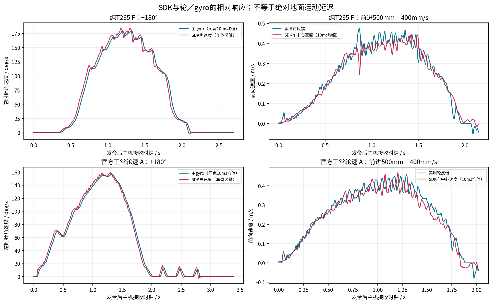
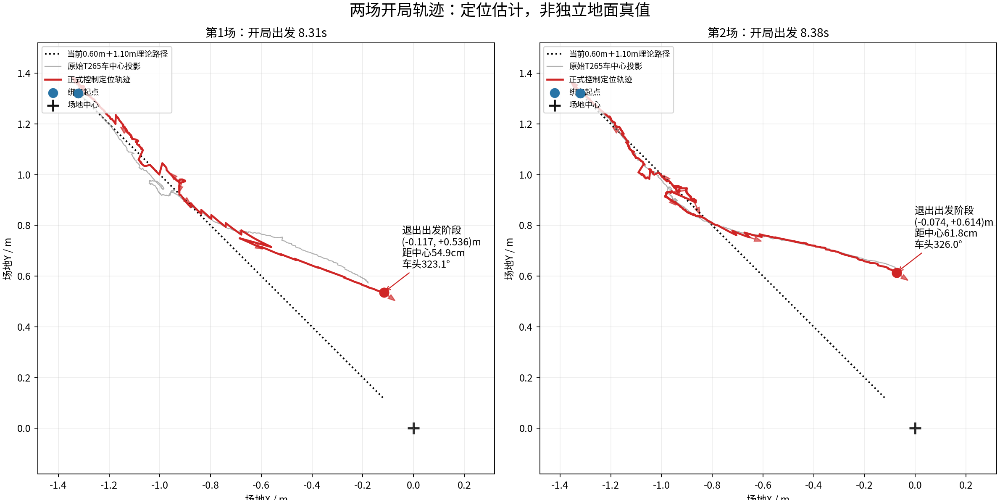
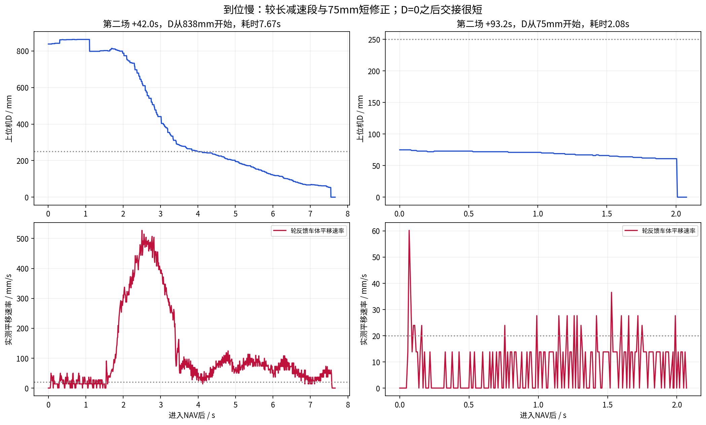
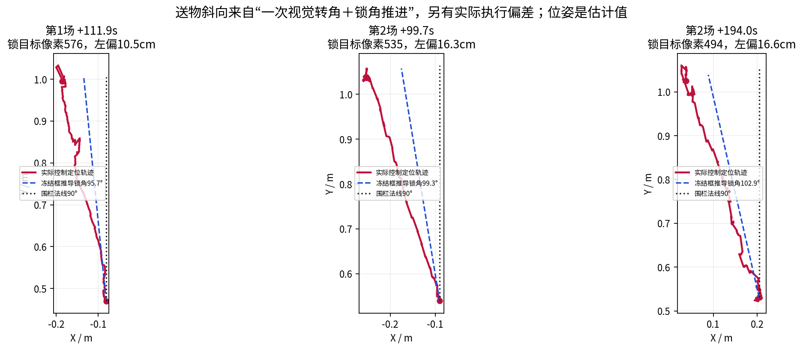
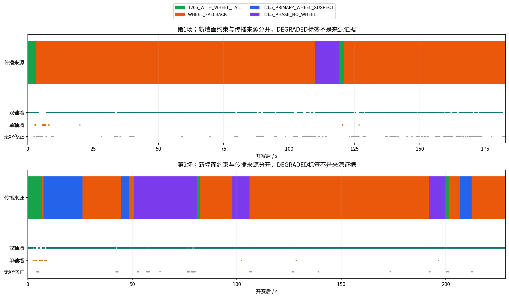

# 2026-11-09 MotionDebug与两场正式比赛联合分析

本轮只做原始日志分析、轨迹导出和当前状态更新，没有修改运行算法、安装参数、比例或下位机，没有启动设备、电机或清理原始日志。轨迹交接之后继续完成了本报告。机器可读数据见[evidence_summary.json](evidence_summary.json)，97个已发动作见[motion_actions.csv](motion_actions.csv)。

## 结论与推荐顺序

1. **秒级到位慢调主要落在下位机末段运动策略和低速执行。** 第二场75mm请求耗时2.08s，约91%的采样车体平移速度低于20mm/s；另两次末段250mm耗时约3.67/3.71s。D=0之后交接通常只有约0.06～0.12s，不能把这几秒全归为上位机握手或雷达积压。
2. **开局存在理论距离不足和实际航向偏移两件事。** 当前0.60m后退＋掉头＋1.10m前进即使完美执行，也比正式起点到中心短16.8cm；两场前进时主yaw曾到333.8°/343.4°，目标315°，不能只把前进距离加长。阶段结束的定位估计距中心54.9/61.8cm，没有独立地面端点测量。
3. **送物的斜向并非随机锁角。** 原代码把一次视觉像素修正后的航向沿用到ENTER。三次按代码重建的锁角约95.7°/99.3°/102.9°，并非围栏法线90°；另有航向执行偏差。对应车中心估计向左移动10.5/16.3/16.6cm，不能据此称物块真实偏移已测准。
4. **100Hz传播已实际运行，低延迟与可靠来源仲裁仍未验收完成。** 正式两场不同轮端点约99.95/99.39Hz，T265约199.58Hz；但雷达扫描参考到结果P95为102/130ms，第二场最坏471ms。轮式降级时间占比92.3%/63.0%；第二场已出现“轮式可疑后T265又跳变”仍回轮式的边界。
5. **MotionDebug没有证明轮速注入让T265增加了秒级响应延迟。** 同宽窗口的平移50%响应差中位数，纯T265与正常注入均约+20ms；离散很大，不能变成固定时间补偿。相对主gyro的SDK角速度约提前20～40ms，也不是绝对地面延迟。

建议先审查F405已提交的后轮微小航向修正改法，再单独决定末段速度曲线；上位机继续优化雷达低频长尾和双异常仲裁。保持角残差诊断与来源选择分开。安全区侧绕、最终按90°法线推进及T265传播基础属于重要行为取舍，本报告提供选项，不自动实施。

## 证据归属与边界

| 数据 | 实际身份/会话 | 范围 |
| --- | --- | --- |
| MotionDebug | F405 ac61480cf44e24c314988f2be4ff3996d9b1ee93 / dirty1；service1，921600 | 19:07～19:44，97个已发动作；纯T265 F与正常注入A使用不同SDK会话 |
| 正式第一场 | F405 9434608a8c395d8506b36accf1753b9bf92dad24 / dirty1；NormalRun/TASK service2 | 定位`competition_wheel_input/20261109_195243_competition_wheel`，业务`20261109_195756_competition` |
| 正式第二场 | 同一F405实际身份，协议1.3，921600 | 定位`competition_wheel_input/20261109_195756_competition_wheel`，业务`20000101_080033_competition_04` |
| 实跑上位机 | 4cfaba937ac4c05c8e258b88849da5b4410b9b7a | 后续导出/报告提交不是实跑代码 |
| 下位机新代码，未作为本批实跑效果 | b980c6a570f13fedba1417146028b1e06b5bb59a | 已只读审查；未读取到本批实跑为该版本，不把源码提交说成已烧录验证 |

原始目录都在`rescue_map/runtime/history/`。两场round token分别为`f3de7b41601c78d39b6a0f4cc80831dc`和`5b8e70f8ac6ec99505f74fc4f68ba28d`；开赛同一boot单调时间3607.563808458s、3921.009062803s。第二场业务目录日期来自后续重启、网络校时前的归档命名，不是2000年的数据。按token、事件及单调时间配对，不能按目录同名拼接。

第一场记录182.83s，结束于GRAB、delivery_count=1；第二场228.61s，结束于CAPTURE_AUDIT、delivery_count=2，均由退出信号结束。未出现全局FAULT，不等于全部任务成功完成，更不代表计分已核实。dirty1使干净Git源码只能解释候选行为，无法证明镜像逐字一致。

用户本轮未做卷尺/独立地面角度测量，旋转时车体中心是否横移也未看清。DONE、指令距离、主gyro、SDK轮速依赖、雷达墙残差均不能当独立地面真值。原始T265、补偿车中心、融合控制输出分别保留，当前安装六参数及比例1.000未改变。

## MotionDebug：实际执行、响应与时间

97个动作均有实际发送或发送后匹配的动作回执，94 reported_done、3 reported_fault；没有把未发请求计为实车运动。0x1A旧回执按收后SEQ/opcode及动作ID尽力配对，不伪称有逐动作boot-proof。完整ID/SEQ/请求/起止/回执见CSV。

| 会话 | 动作数 | DONE / FAULT | SDK Pose频率 | 说明 |
| --- | ---: | ---: | ---: | --- |
| 190754 | 3 | 2 / 1 | 无SDK | +360°回执fault5，进度356.7° |
| 190954 | 10 | 10 / 0 | 199.60Hz | F：纯T265，无实际轮速API调用，帧号无缺口 |
| 191242 | 10 | 10 / 0 | 199.58Hz | A：正常官方输入，整个SDK会话22166次API true/0 false，帧号无缺口 |
| 191736 / 191910 / 192105 | 6 / 10 / 8 | 均DONE | 199.58 / 196.11 / 199.44Hz | 后两者分别4/2个帧号缺口；192105含输入实验 |
| 192329 | 5 | 4 / 1 | 198.69Hz | +360°fault5，进度358.9°；4个缺口 |
| 192531 | 4 | 4 / 0 | **无Pose** | USB IO/NO_DEVICE；动作包络内1236次API true也不能称融合有效 |
| 192842 | 14 | 14 / 0 | 198.87Hz | 正常动态雷达/100Hz联合数据；1个缺口 |
| 193147 | 8 | 8 / 0 | 195.58Hz | 停送、偏置等实验＋雷达；4个缺口 |
| 194149 | 19 | 18 / 1 | 199.22Hz | 后退50mm/120mm/s耗时6.69s，fault4、回执进度−43mm；1个缺口 |

帧号缺口表示原始连续性异常的计数，不把置信度2/3当精度证明。最后一组接近电池不足，且MotionDebug与NormalRun的执行分支不同，不能直接把故障码归结为正式比赛同一根因。其50mm前进3.90s、后退6.69s故障及+10°耗时4.40s等不对称，支持继续检查低速摩擦/输出与转角收敛。

### 输入与控制通路延迟（毫秒）

以下P50/P95/最大值从原始attempt/result、UART收包和独立控制接收记录重算。`配齐RX`指wheel及区间gyro支持都到达；`wheel RX`还包含等待该区间gyro的时间。API返回为主机调用完成，不是设备逐样本融合ACK。

| 会话/范围 | 配齐RX→API返回 P50 / P95 / 最大 | wheel RX→API返回 P50 / P95 / 最大 |
| --- | --- | --- |
| 191242正常A，动作包络 | 1.01 / 1.51 / 12.42 | 5.93 / 9.89 / 20.84 |
| 192842正常动态，动作包络 | 1.04 / 2.41 / 23.34 | 6.00 / 10.32 / 27.10 |
| 正式第一场 | 1.23 / 3.51 / 22.47 | 6.48 / 11.19 / 28.29 |
| 正式第二场 | 1.35 / 4.43 / 25.93 | 6.61 / 12.42 / 25.96 |

192842独立控制接收器按不同wheel sample ID首次到达统计约99.987Hz；运动样本的UART host RX→接收端P50 2.92、P95 6.44、P99 9.92、最大17.00ms。193147为3.49/7.84/12.89/41.10ms，194149为1.98/5.71/10.04/20.99ms。它们是沿用正式控制模板的被动接收实验，没有把0x16实际发给MotionDebug或证明F405执行延迟。

当前正式日志`control_pose.timestamp_monotonic_ns`是样本时间，不是逐包发出时间；不能用它声称实际0x16全部10ms内送达。MCU映射及SDK capture age仍有估计误差：194149存在−0.426ms差值，F/A启动阶段SDK capture age也有长尾；没有据此丢数据、改qualified或添加时间门。可使用同主机记录比较已观测通路，但不能给物理端到端硬截止保证。

### T265相对轮/gyro响应

直接用原SDK速度、四元数和既有杆臂变换计算车中心速度，无IIR。对照真实轮区间平均量，把两路都积分到同宽10ms窗口；同主机接收时钟上，以稳定连续越过参考幅值P90的20%/50%识别起动。正负方向统一后比较，没有用速度目标作参考。

| SDK相对参考（SDK更晚为正） | F纯T265 | A正常官方轮速 |
| --- | --- | --- |
| 平移50%起动，6段 | 中位+20ms，−20～+115ms | 中位+20ms，−30～+95ms |
| 平移20%起动，6段 | 中位+57.5ms，+25～+270ms | 中位+52.5ms，+5～+360ms |
| 转动50%起动，4段，相对主gyro | 中位−25ms，−25～−20ms | 中位−27.5ms，−40～−25ms |

整段波形相关峰很宽，平移约120～155ms、角速度约90～100ms，不能从某个最高相关点取一个固定偏移写回算法。低幅起动受轮量化、起步摩擦、打滑与各传感器滤波/预测影响明显。结果没有支持“正常官方注入额外拖后数百毫秒或几秒”的说法，也没有证明SDK对真实地面运动只有20ms延迟。



### 停送/错误输入及原地转动

192105/193147只改SDK输入实验副本，原始轮/gyro仍保留。两次约1s移动停送窗实际API=0、Pose约200Hz连续，原相机3D仍移动约0.27/0.22m；停送没有等价成显式零速/冻结平移。前向+0.2m/s偏置实际映射为C轴约(+0.173205,0,+0.100000)m/s并真实调用API；zero和hold是继续发送错误值，不能标成“未注入”。

这些短段没有独立真值、没有足够重复，不能定量宣布错误注入、零速、停送哪一种精度最好，或旧输入影响多久清除。同一SDK停送/恢复不是新的纯T265会话。当前样本至少否定“停送就必然停车/停止Pose”的假设。

按当前未改外参，估计停稳窗口取命令前−0.20～0s及DONE后+0.12～+0.32s中位值。F四次±180°车中心起终变化2.85～12.93cm、中位4.64cm；A四次4.13～6.27cm、中位4.21cm。194149八次±90°范围0.81～13.72cm。用户未确认真实中心静止，不能把这些位移全拟合成安装杆臂，也不能用几毫米改动解释厘米级外扩。原相机偏心69.221mm，旋转时本来应有圆弧；判断对象应是校正车中心，不是要求原相机不动。

### 有效轮臂与角速度诊断

按F405实际原始轮计数符号，令`k=π×0.070/1061.268 m/count`、真实区间`dt=t1−t0`：

```text
v_forward = k(Δ1−Δ2)/(sqrt(3)dt)
v_left    = k(Δ1+Δ2−2Δ3)/(3dt)
ω_ccw     = +k(Δ1+Δ2+Δ3)/(3Ldt)
```

保留主gyro逆时针正，最后一式不能再额外反号。gyro在同一MCU时钟、同boot/reference的轮区间上积分，不以0x15/0x1F相同SEQ当同步。

仅用纯F四次±180°拟合，相对主gyro得到有效`L=0.114727m`，实用候选`0.115m`。未参与拟合的26次已完成转动交叉验证：

| L | 编码器角度相对主gyro的绝对误差中位 | RMS | 最大 |
| --- | ---: | ---: | ---: |
| 当前0.130m | 20.13° | 16.90° | 24.22° |
| 拟合0.114727m | 0.46° | 0.87° | 3.41° |
| 候选0.115m | 0.30° | 0.85° | 3.83° |

这是**相对主gyro的有效运动学值**，不是独立地面整圈校准或真实机械轮臂测量；本轮没有改正式运动学。SDK杆臂修正的ω本来取主gyro，不应拿此结果修改T265杆臂/轴向。

使用L=0.115m时，正常A转动的10ms角速度残差RMS5.73°/s、绝对P95 11.47°/s；100ms汇总为4.14/8.82°/s。平移100ms为2.32/4.85°/s。因此不能直接用1°/s阈值便宣判轮滑。三轮＋单轴gyro只多出一个旋转一致性约束：能发现部分单轮误差，但不能唯一识别坏轮/还原XY；抵墙同向空转或相互抵消的轮误差可以零残差。本批没有已标注单轮架空/抵墙样本，检出率/误报率未知，诊断仍不接入来源控制。

### 雷达＋100Hz链在MotionDebug的实跑结果

192842的1498条实际雷达结果中1488条提供双轴约束，处理约9.99Hz、墙残差P95约8.58mm、计算墙钟P95约54.71ms；100Hz不同轮端点的被动接收结果见上。正常方形段控制轨迹闭合约3.67cm，不是地面绝对精度，也不是整轮所有动作闭合；该轮全部14动作前后净偏约16.78cm，不能只挑方形闭合宣布所有误差都已解决。

实际发生过少量帧缺口、拟合请求合并或扫描丢弃，原记录保留；100Hz控制更新不等于100Hz独立雷达测量。后续两场正式比赛提供了更完整的有墙、投送、来源切换联合负载证据如下。

## 正式比赛：开局偏在哪里



正式1号参考为(-1.321102,+1.321102)m、135°，到中心直线1.868m。Task_START按当前配置先后退0.60m、转180°、前进1.10m，理论终点(-0.119,+0.119)m；“总计1.70m”本身没有到中心。图中首个有效输出可能已包含绑定后的初始修正，黑点线使用配置参考，二者不应混为独立起点测量。

| 阶段 | 第一场 | 第二场 |
| --- | --- | --- |
| 后退轮反馈积分（前/左） | −0.590 / −0.018m | −0.589 / −0.021m |
| 掉头主yaw（场地参考） | 131.99→318.31° | 136.88→317.98° |
| 前进轮反馈积分（前/左） | +1.091 / +0.055m | +1.092 / +0.063m |
| 前进主yaw起→终 / 过程峰值 | 317.61→323.72° / 333.8° | 318.46→326.08° / 343.4° |
| 退出出发阶段 | +8.309s，(-0.117,+0.536)m、323.08° | +8.382s，(-0.074,+0.614)m、326.02° |
| 距中心（定位估计） | 54.9cm | 61.8cm |

轮＋主gyro单独按当前轮式模型积分的端点也偏，约(+0.042,+0.370)m、(+0.104,+0.489)m，说明不是仅地图画错；但轮已经参与SDK且可能打滑，不能据此认定全部误差属于底盘。开局约7.3s时前进目标315°，实际主yaw过大，几何不足16.8cm只解释其中一部分。先处理方向跟随，再讨论距离或出发后接原闭环NAV到中心，不能仅加距离。

下位机新提交b980c6a已增加0.5mm/s后轮微小航向修正分支，用于START_FORWARD、部分运输粗段及安全区推进；没有改变前进1.10m、倒退0.60m，也没有改变FINE的120mm/s和1/s增益。此改法针对直行时微小后轮补偿被旧零速阈值抹掉，方向合理；其地面效果未在本批日志验证，不重复要求“再实现同一个死区修复”。

## 正式比赛：末段为何慢



实际9434608的`nav_follow_coarse`行为：新请求D≤600mm直接跳过粗段；长段在剩余250mm附近停止，执行原Motor_Stop六个10ms制动周期后进入FINE。预备点FINE请求`v=min(120mm/s, D×1/s)`，速度随误差线性趋小；回中另有至少120mm/s的分支，不能把所有NAV当相同策略。粗段还会先转向，部分回中纯转动本身约1.7～2.2s。

| 第二场片段，相对开赛 | 总耗时 | D≤250mm之后 | D=0后交接 |
| --- | ---: | ---: | ---: |
| +42.01s，D838→0 | 7.67s | 3.67s | 0.116s |
| +93.23s，D75→0 | 2.08s | 全段 | 0.070s |
| +173.04s，D651→0 | 7.60s | 3.71s | 0.061s |

75mm段定位从(-0.0757,+0.5404)m到(-0.0897,+0.5371)m，横向只改约14mm便进入现有目标x=−0.15±0.06m容差；所以不是必须真实走完整75mm。车体平移低于20mm/s占91%，三个原始轮增量同时零占50.5%，主gyro最大约4.03°/s，不能用“正在原地大角度掉头”解释这2秒。

这说明末段低速曲线与实际摩擦/输出需要一起处理。FINE原本已有0.5mm/s单轮零速阈值及助推项，不能把新b980c6a的非FINE后轮死区修复当作FINE问题已解决；遥测没有逐轮目标/PWM，无法仅凭当前日志判定具体PID/助推是否足够。

建议F405先提出一个局部末段改法：用真实可制动的速度曲线替代长距离120mm/s封顶＋临近误差的过低请求，制动上界可按`v²≤2a×剩余可制动距离`设计，原D=0到位及任务配对保留。末段上限200～250mm/s仅可作为讨论初值，不是已测安全值；不盲目抬全局最低速度、放宽到位容差或新增停稳确认/握手。是否减少回中前完整掉头，应另说明夹持载荷与全向平移代价，由人决定。

## 正式比赛：送物为何斜



本轮北侧预备点先按90°姿态对齐。上位机冻结安全区目标像素，下位机以`−atan((target_x−640)/640)`得到视觉转角，限幅±15°，只加一次；ENTER后将`safe_align_target_deg`锁到`nav_locked_heading_deg`，`safe_enter_follow`继续按此航向推进。`H`平移方向不能替代该内部车头锁角。

| 场次/开赛后 | 冻结目标像素 | 按代码重建锁角 | 实际主yaw起→终 | 车中心估计ΔX / ΔY |
| --- | ---: | ---: | --- | --- |
| 1 / +111.95s | 576 | 95.71° | 94.44→92.63° | −10.46 / +52.49cm |
| 2 / +99.66s | 535 | 99.32° | 101.34→94.35° | −16.33 / +49.89cm |
| 2 / +193.98s | 494 | 102.85° | 104.30→98.51° | −16.64 / +49.40cm |

内部锁角没有由当前0x17直接遥测，上表明确是代码重建；实际主yaw和位姿来自日志。轨迹方向比重建锁角还偏，说明另有执行/接触影响，不能宣称改掉一次锁角就能消除全部偏差。安全区已按既定策略排除轮式新注入/传播，雷达可观轴仍修正，不代表物块在爪内的运动被直接测到。

可选：保留现有视觉转向锁角并校准瞄准及执行，改动最小但推进仍可能斜；或把视觉用于选择入口横向位置，全向移到入口后对准90°法线再推进，方向更明确但改变业务轨迹。推荐后者作为下一步讨论，不能在ENTER里直接强置90°而遗漏横移对准。

## 来源降级：雷达有X/Y为何仍经常轮式



| 时间占比 | 第一场 | 第二场 |
| --- | ---: | ---: |
| T265_WITH_WHEEL_TAIL | 2.7% | 4.5% |
| WHEEL_FALLBACK | 92.3% | 63.0% |
| T265_PRIMARY_WHEEL_SUSPECT | 0 | 12.2% |
| T265_PHASE_NO_WHEEL | 5.1% | 20.3% |

安全区T265_PHASE_NO_WHEEL是主动排除轮式，不是异常降级。第一场开赛+3.188s已有约51mm轮/VIO位移冲突而降级，早于+44.925s那次confidence=3、5ms跳0.523m；不能把整场降级都归到后面这一次跳变。第二场37次原SDK位置不连续事件也发生在confidence=3。

雷达约10Hz对可观测位置施加历史校正；WHEEL_FALLBACK描述扫描之间的传播来源。因此“轮式＋雷达X/Y”本身不矛盾，也不等于只信编码器累计。显示保留的axes/锚定前缀不代表每个100Hz包都是新激光观测。

现有恢复要求有足够连续运动一致性（0.5m、残差≤25mm）和两次双轴墙支持，新的冲突会重置累计。持续能看墙不自动证明T265恢复，所以第一场长时间仍为轮式。第二场+7.547s等处墙支持T265时确实切为T265并暂停注入，说明双向链不是完全没接通。

**未解决的具体边界：** 第二场+206.91s已将轮式判可疑、选T265；+212.33s T265又出现约0.21m跳变，原生`pose()`转WHEEL_FALLBACK，随后处理待配对Pose把原始跳变原因覆盖成一般位移冲突。不是“恢复条件漏看wheel_suspect”的证据，而是双方都可疑时仍回已可疑轮式、且首因显示不足。应完善该边界，不应简单把阈值加大或关闭pose jumping。

下一步应先定义双方冲突时每个可观测分量怎么处理：两墙/单墙/无墙分别保留原有墙位置约束，主yaw保持；证据不足时不能宣称轮式或T265真实。角速度残差只是证据之一，不能单独裁决平移空转。是否采用短时T265速度增量、上次可用源或仅墙约束，涉及真实定位结果，需比较代价后由人决定，不在分析任务里偷偷切源/停机。

## 正式雷达性能与剩余延迟

| 指标 | 第一场 | 第二场 |
| --- | ---: | ---: |
| 实际结果数 / 处理频率 | 1827 / 9.99Hz | 2278 / 9.97Hz |
| 双轴 / 单轴 / 无位置约束 | 1485 / 23 / 319 | 2172 / 34 / 72 |
| 有位置约束占比 | 82.54% | 96.84% |
| 双轴新观测频率 | 8.12Hz | 9.50Hz |
| 任一可观位置最长间隔 / 完整XY最长间隔 | 1.70 / 3.20s | 1.00 / 1.40s |
| 接受墙面残差中位 / P95 | 27.1 / 33.6mm | 6.9 / 25.5mm |
| 计算墙钟P50 / P95 / 最大 | 54.3 / 74.5 / 175.7ms | 59.0 / 83.4 / 148.9ms |
| 扫描参考→计算结束P50 / P95 / 最大 | 73.6 / 102.1 / 192.5ms | 84.0 / 130.5 / 470.7ms |

墙残差是内部拟合一致性，不是实际场地定位精度。第二场比第一场墙约束完整，仍没有独立轨迹真值。两场各一次固定yaw围栏重获，修正约13.0/10.7cm，说明跨局部位置限制的重获实际发生；单墙没有伪造完整XY。

第一场扫描队列丢弃0，第二场1；原生控制输出统计有少量丢弃，不能写全链零丢包。两场原始轮measurement ID缺口计数均0，正式控制不同轮端点样本频率约99.95/99.39Hz；正式0x16实际发送尾延迟未逐包记录，不能因此保证每10ms送达。

第二场最坏471ms在+144.20s的APPROACH，最大计算前等待约396ms；第一场最坏192ms在+40.70s的APPROACH。最坏值并非上述75mm短修正当时，不能只拿全场最大数解释全部到位慢调。

当前提线已经使用C++ `liblidar_geometry.so`，后端`cpp_v1_numpy_rng_sort_tls`；不是尚未迁移的纯Python逐点提线。计算进程还保留Python去畸变/约束组织、NumPy随机/排序和既有TLS支持。两场中位拆分：

| 现有记录 | 第一场 | 第二场 |
| --- | ---: | ---: |
| 主进程当前线程CPU | 17.15ms | 17.69ms |
| 几何进程CPU | 18.14ms | 17.29ms |
| 几何往返墙钟 | 35.65ms | 38.28ms |
| 历史窗口快照墙钟 | 6.13ms | 6.74ms |
| 去畸变墙钟 | 4.21ms | 4.60ms |
| 提线墙钟 | 19.51ms | 19.82ms |

这些计时作用域有包含关系，不能把各P95直接相加；往返减CPU的差值也不能全称为IPC时间，包含其他执行和调度。当前扫描只请求包围该扫描的历史窗口，**没有证据证明每帧都复制4096点完整历史**，不能再以此作为已发现瓶颈。

优化重点是同一现有链的等待/拷贝/调用组织及去畸变、提线热点，先复用本批日志拆清计算前等待长尾，再按等输入对照缩短数值路径；不再靠增UART波特率或新增MCU计时诊断解决低频几何。历史后验按扫描参考时刻校正再传播到当前，130ms结果延迟不能直接等同当前控制位姿也陈旧130ms；历史补偿也不能消除错误运动先验，必须和轮滑/T265仲裁一起评估。

当前为普通6.1.83 PREEMPT，运动/控制关键线程实际FIFO10及共享锁PI；不是PREEMPT_RT，也没有硬实时最坏截止验收。本轮未重启切内核，不把“开实时了”当问题已解决。

## T265传播/去畸变与侧绕的后续取舍

T265基础重新评估保留P1 T265-BASE-01。此次相对响应不支持仅因“官方注入必然很慢”就全部换源；但轮式受阻先验会污染去畸变及SDK，直接用SDK位置差又会受pose jumping影响。Intel v2.50.0文档说明pose jumping影响平移位置、不影响旋转/速度/加速度；因此可以离线比较SDK速度积分与现轮式基础，并原样保留跳变降级/历史后验/围栏重获。速度本身仍依赖官方轮速输入，停送不立刻清除相关性，不能称独立观测或直接反复融合。

安全区前≥2个物块不等于侧边一定可通行。连续斜移＋转弯通常更快，但圆弧底盘/爪外廓及载荷的扫掠更大，当前组合运动线上接口也不能凭内部C函数视为已可用；分段全向平移到侧入口、再对正推进更容易限定不把障碍推入区内，但多停转会慢。推荐先算同一实际净空下两种路径和载荷扫掠，若连续路径没有明确净空就采用少段平移。当前不擅选绕路、不新增识别到两个物块即自动转向的规则。

## 交付、检查与未完成项

- 已导出完整两场32文件ZIP，7.8MiB，CRC检查通过；GitHub另附开局10Hz CSV、97动作CSV、证据JSON及五张分析图。
- 复用现有协议解析、SDK到车中心变换及离线残差入口，原始日志只读；没有新增独立运行/测试程序。
- 已核对动作计数、会话token、实际身份和派生数据一致性；必要文档/CSV/JSON检查见提交回执。原始SDK/融合控制/轮式参考标签分开。
- AGENTS只保留不漏欠项的协作规则，当前数字/结论在本报告及STATUS/TODO，不把本轮方案永久固化。
- 未完成：FINE与开局新方案的实现/部署/地面效果；送物法线入口取舍；全场双异常仲裁及角残差的真实架空/抵墙效果；雷达长尾继续压缩、实际正式0x16端到端测量；T265基础比较；侧绕路径选择。没有把上述待办写成已完成，也没有向F405附加测试代码、握手、时间门或FAULT要求。

官方核对依据：[librealsense v2.50.0 T265说明](https://github.com/realsenseai/librealsense/blob/v2.50.0/doc/t265.md)、[同版本wheel odometry C API](https://github.com/realsenseai/librealsense/blob/v2.50.0/include/librealsense2/h/rs_sensor.h)。逐样本API提供sensor ID、递增frame number、速度；frame number不是采集时间戳，无逐样本时间/协方差参数，API true不能证明融合精度。
