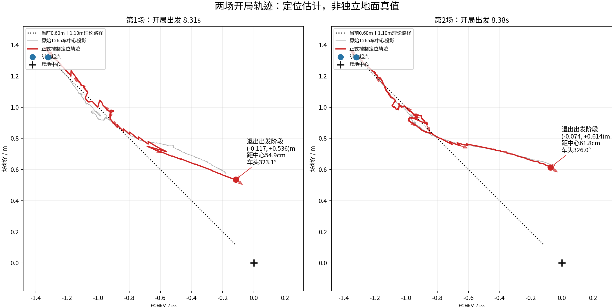

# 两场正式比赛轨迹初步导出

2026-11-09，基于RDK实际日志。这里只是轨迹交接，完整MotionDebug/比赛延迟及到位问题仍在分析；不表示下位机改法已审核或获准实施。



- 实跑上位机4cfaba9；两场F405均自报9434608a8c395d8506b36accf1753b9bf92dad24、dirty1、NormalRun/TASK、921600、协议1.3。dirty不能当干净源码一致性证明。
- 图中红色为正式控制定位输出，灰色为原T265补偿车中心投影；包含SDK轮速/主yaw/雷达依赖，均不是独立地面真值。黑点线仅为现配置0.60m后退、转180°、前进1.10m的理论直线路径。
- 出发阶段结束时第一场约(-0.117,+0.536)m、323.08°，第二场(-0.074,+0.614)m、326.02°；距中心约55/62cm。不能只据此把全部偏差归给底盘或加长距离。
- `race*_opening_10hz.csv`是为GitHub阅读降采样的开局位姿/原T265/来源；时间单位秒，角度逆时针正，场地X右/Y上。
- `export_context.json`保留原日志位置、round token与时间。第一场定位195243配业务195756_competition；第二场定位195756配业务20000101_080033_competition_04。后者是重启校时前归档名，数据采于本轮，不能按同名或文件日期拼接会话。

完整32文件ZIP在RDK：

```text
/home/sunrise/下载/RDK_正式比赛轨迹_20261109_两场_初步.zip
```

含完整控制轨迹、100Hz实测07轮反馈、08主gyro、原H/D导航观察、正式0x17/0x1E状态、10Hz雷达修正、业务事件与原metadata/config/身份副本。初步包约7.8MiB，ZIP CRC检查通过；原始日志未改动。主gyroCSV保留本地累计角，不能直接与场地绝对角相减；H是平移方向，不等同车体应朝向。

F405先核对`Task.c::task_process_start`出发三段、`nav_follow_coarse`的600mm/FINE切换及`min(120,D×1.0)`mm/s末段、视觉ALIGN到ENTER的航向来源。先讲清具体证据和影响再提最小改法，不因此新增握手、时间门、永久FAULT或测试程序。完整分析后另更新结论，不将初步疑点写成已证根因。
