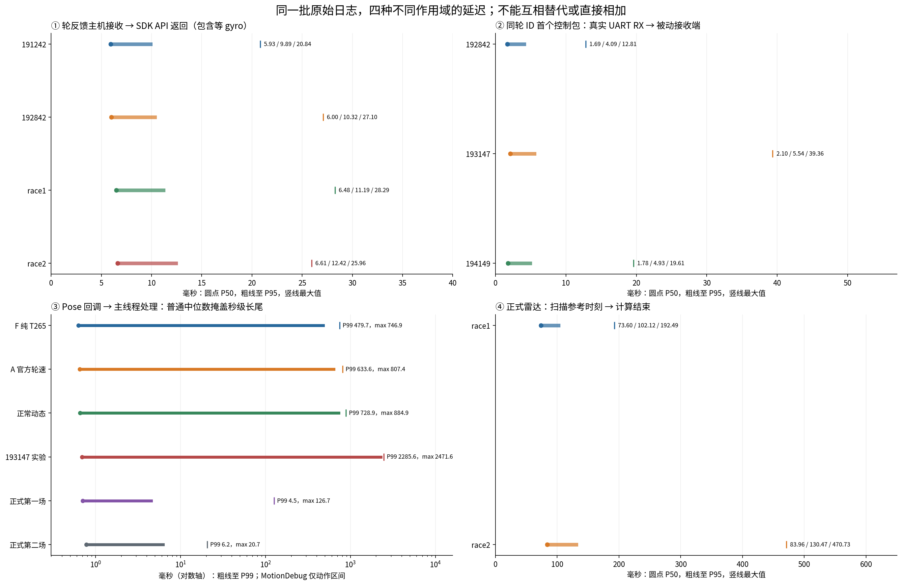
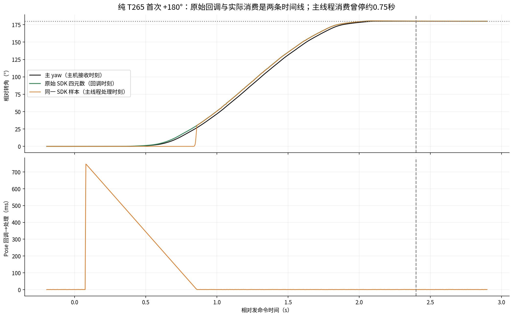
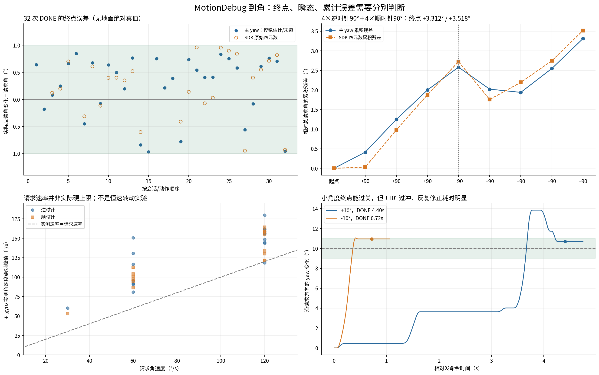

# MotionDebug延迟与到角深化分析

2026-11-09。以MotionDebug建立受控响应/运动学依据，两场NormalRun只作联合负载参考。本轮只读取已有日志和源码、生成派生表图；没有启动SDK/UART/电机、改运行代码/参数或清理日志。

## 主要结论

1. **正常官方轮速输入没有测到秒级积压，但T265的主机消费另有秒级长尾。** 正常A轮RX→API返回P95 9.89ms；正常动态10.32ms。另一方面MotionDebug动作区间Pose回调→处理最大0.75～2.47s，不能把“SDK相对轮反馈起动约20ms”写成导航端到端20ms。
2. **32次DONE按主yaw终点基本在±1°，不等于全程无过冲或多次闭合。** 31次有停稳窗口的绝对误差中位0.610°/P95 0.897°/最大0.967°；另一次缺后窗，末包误差+0.846°。四次+90°再四次−90°，主yaw残余+3.312°、SDK四元数+3.518°。正号为逆时针。
3. **两次整圈FAULT是转动收敛问题的证据。** 主yaw停在356.715°/358.995°，FAULT=5(MOTOR)，不是外层10秒超时码4；日志未带电机内部失败原因，不能指定某条子分支已被证明。
4. **正式比赛没有同样的秒级Pose消费堵塞。** 两场Pose回调→处理P95 2.13/3.05ms，最大126.67/20.69ms；雷达扫描参考→结果P95 102.12/130.47ms、最大192.49/470.73ms。它仍是100Hz传播＋约10Hz历史墙修正，不能把130ms直接等同当前控制位姿陈旧130ms。
5. 当前证据不支持写入固定“SDK延迟补偿”、改T265安装/比例，或直接把轮/gyro角残差接入判滑。下一步先处理测试Pose输出长尾，再讨论能否用因果gyro配对省约5ms及转角控制收敛，具体行为改法由人决定。

## 数据与时间边界

- 11个MotionDebug运动会话：190754、190954、191242、191736、191910、192105、192329、192531、192842、193147、194149，完整路径前缀为`rescue_map/runtime/history/t265_f407_motion_map/20261109_`，后缀为`_interactive/`。97动作=94 DONE＋3 FAULT；本报告34个转动=32 DONE＋2 FAULT，另有63个平移。
- 实板自报MotionDebug为`ac61480cf44e24c314988f2be4ff3996d9b1ee93/dirty1`、service1；两场正式为`9434608a8c395d8506b36accf1753b9bf92dad24/dirty1`、service2。均F405/mode5、协议1.3、921600。dirty差异未取得，源码用于解释对应基线，不冒充逐字镜像证明。
- F=190954纯T265、A=191242正常官方输入，两个不同SDK会话。192842正常动态；193147等含停送/偏置实验，不混称全是正常输入。192531四动作无Pose（USB IO/NO_DEVICE），其API true不能作为T265响应或精度证据。190754没有SDK数据。
- 正式第一场定位目录`competition_wheel_input/20261109_195243_competition_wheel`，业务`20261109_195756_competition`；第二场定位`competition_wheel_input/20261109_195756_competition_wheel`，业务`20000101_080033_competition_04`。按round token及同boot单调时间配对，后一个2000目录不是旧场。实际开赛单调区间分别[3607.563808458,3790.390141941]s与[3921.009062803,4149.617645242]s。
- 主gyro是下位机到角控制自身依赖；T265又可能依赖轮速/gyro输入，二者都不是独立地面角度真值。本批无卷尺/地面角度记录，不能验收绝对转角/位移精度。
- 主机RX→主机处理使用同一单调时钟；MCU映射、SDK global timestamp与真实曝光/物理运动间仍有误差。相等SEQ不作同步，yaw/rate按各自source_id去重并使用各自采样时刻；积分在同一MCU时钟完成。

## 延迟一：轮速进入SDK

轮反馈是约10ms区间平均量，gyro按相同区间积分后做既有B→C换算；没有用目标速度或T265速度充当轮反馈。以下是**动作包络**（首条运动发出至末条终止，含动作间空闲）内真实成功API样本；正式只取真实开赛区间。API返回不等于设备逐样本融合ACK。

| 范围 | 样本数 | wheel RX→gyro配齐 P50/P95/max ms | 配齐→API返回 P50/P95/max ms | wheel RX→API返回 P50/P95/max ms |
| --- | ---: | --- | --- | --- |
| A 191242 | 6738 | 4.85 / 8.77 / 19.70 | 1.01 / 1.51 / 12.42 | 5.93 / 9.89 / 20.84 |
| 正常动态192842 | 8530 | 4.74 / 8.82 / 25.82 | 1.04 / 2.41 / 23.34 | 6.00 / 10.32 / 27.10 |
| 正式第一场 | 17269 | 4.94 / 8.98 / 20.33 | 1.23 / 3.51 / 22.47 | 6.48 / 11.19 / 28.29 |
| 正式第二场 | 13733 | 4.92 / 9.28 / 24.72 | 1.35 / 4.43 / 25.93 | 6.61 / 12.42 / 25.96 |

分位数不可直接相加。SDK配齐后等待调用的中位仅约0.56～0.61ms，剩余还有API自身及调度；等待区间gyro是常见约5ms的主要固定来源。第二场API次数较少包含主动停注入，不是直接丢了同等数量的轮反馈；原始轮ID没有缺口。

理论上，921600/8N1传一个95字节07或08包约1.031ms，100Hz各一路约占MCU发送方向20.62%，另加既有状态。15字节0x16约0.163ms，反方向全双工。这些是线速预算，不是物理端到端实测。

10ms区间平均速度的代表时刻在中点，比末端早约5ms；为线性插值完整覆盖区间，需要等右端gyro，100Hz的相位差还可带来0～约10ms等待。正常A映射中点→API中位12.30/P95 16.66ms，正常动态12.34/17.02ms（映射估计）。所以“100Hz更新”与“从信息代表时刻起每样本均<10ms”不是同一指标；仅优化C++约1ms处理或再加波特率，不能去掉平均区间与等右端gyro。

若今后要去掉这约5ms等待，可讨论用已到gyro做因果区间近似；优点是立即注入，代价是角加速时杆臂项误差，不应默默替换现有完整区间积分。此为方案分析，**本轮不改配对、不扩时限、不新增年龄门**。

## 延迟二：控制接收与上一报告更正

上一报告把“映射后的轮采样端点→接收端”误标为“UART收到→接收端”。本轮按原始07 measurement_id和首个生产control packet_id重新连接，分别列出。使用首个生产包，未改成挑后续同ID快照掩盖丢包；表格仅运动动作区间，按轮RX归属。

| 会话 | 匹配轮ID数 | **真实host UART RX→被动接收端** P50/P95/P99/max ms | 映射采样端点→接收端 P50/P95/max ms |
| --- | ---: | --- | --- |
| 192842 | 3188 | **1.69 / 4.09 / 6.80 / 12.81** | 2.92 / 6.45 / 17.00 |
| 193147 | 2094 | **2.10 / 5.54 / 10.39 / 39.36** | 3.49 / 7.84 / 41.10 |
| 194149 | 3599 | **1.78 / 4.93 / 8.33 / 19.61** | 1.98 / 5.72 / 20.99 |

这些是沿用正式控制模板的被动接收实验，没有把0x16发给MotionDebug。194149映射端点→UART RX最小−1.524ms，说明映射不是精确物理时间。正式日志的`control_pose.timestamp_monotonic_ns`也是样本时间，不是逐包发送/接收时刻，**本批无法给出正式RX→0x16实际到达的P95/最坏值**；不能用上述被动接收端代替正式实发延迟。

## 延迟三：新发现的Pose消费长尾

直接比较`t265_raw_pose.csv`同一行`receive_monotonic_ns`（SDK回调）与`processing_monotonic_ns`（主线程取得数据后、投影前）。以下MotionDebug仅按回调落在真实已发动作起止内统计，保留长尾，不随意剔除“异常”帧；正式用真实开赛区间。

| 范围 | 样本数 | 回调→处理 P50/P95/P99/max ms |
| --- | ---: | --- |
| F 190954纯T265 | 5555 | 0.63 / 1.13 / **479.73 / 746.87** |
| A 191242官方输入 | 5864 | 0.65 / 2.53 / **633.63 / 807.39** |
| 192842正常动态 | 6377 | 0.66 / 3.70 / **728.89 / 884.87** |
| 193147实验 | 4080 | 0.69 / **1559.58 / 2285.61 / 2471.61** |
| 194149末组 | 7208 | 0.71 / **378.73 / 801.00 / 1009.47** |
| 正式第一场 | 36487 | 0.70 / 2.13 / 4.50 / 126.67 |
| 正式第二场 | 45625 | 0.77 / 3.05 / 6.24 / 20.69 |

全会话（含动作间静止）192842最大1881.79ms、194149最大1480.07ms，不能与上表动作内最大值混用。193147不是正常A/B输入组，不能用它证明正常注入额外延迟2.47s。

**阻塞范围证据：** 九个有Pose的MotionDebug会话共119个主线程相邻处理间隔>100ms，119个的上一帧`localization_debug.csv.elapsed_s`都与一条20Hz `POSE t=`输出相符（stdout三位小数精度内）。处理前→同帧CSV时间戳P95仅0.06～1.00ms，长停顿集中在这之后到下一帧处理之间；例如F首个+180°间隙751.38ms时，SDK捕获间隔仍5.01ms、回调间隔5.12ms，期间记录150次回调。它首先是主机消费阻塞证据，不能算作设备解算了750ms。

**代码对照：** 当前`main.cpp`与实跑4cfaba9在该路径一致。MotionDebug只传`--debug-pose-socket`，没有`--dynamic-pose-socket`；因此`write_atomic_json()`仍在Pose主线程20Hz执行open/write/close/rename。正式路径传后者，使用已有`AsyncLatestFile`。测试stdout直接重定向到普通`localizer.log`文件，不是GUI管道；CSV/原始Pose日志本身已有独立写盘线程。不能把问题笼统归为“所有日志同步”或“GUI没读管道”。

目前最强定位为**测试主线程低频快照/输出尾段**，同步文件操作是首要嫌疑；没有历史syscall/调度跟踪，不能进一步断言某个rename、磁盘回写或抢占独占全部秒数。部分长组同时有真实SDK帧缺口（例如193147最大捕获间隔约1.027s），与消费排队分开记录。队列drop计数为0也不能证明消费及时。

建议下一小步复用已有异步快照/日志能力，把测试路径这段同步输出移出Pose消费线程；不改定位公式、不丢原始证据、不加时间准入。先解决已实证数百毫秒/秒级长尾，再考虑省几毫秒配对开销。本轮仅提出，不修改运行代码或安排新一轮动作。

## T265相对响应：能支持什么

沿用上一轮从原始SDK速度/四元数重算的结果：两路使用同宽10ms积分窗口，按实际波形稳定跨过参考P90的20%/50%比较，不用目标速度；SDK按主机回调、轮/gyro按主机RX。

| 相对起动（SDK更晚为正） | F纯T265 | A官方轮速 |
| --- | --- | --- |
| 平移50%，各6段 | 中位+20ms，−20～+115ms | 中位+20ms，−30～+95ms |
| 平移20%，各6段 | 中位+57.5ms，+25～+270ms | 中位+52.5ms，+5～+360ms |
| 转动50%，各4段 | 中位−25ms，−25～−20ms | 中位−27.5ms，−40～−25ms |

这些是“已收到的两个传感器输出”的相对响应。SDK比主gyro先越阈值不代表负物理延迟，包含gyro输出/滤波、发布、采样代表时刻及SDK本身输出差异；没有独立硬件基准不能拆开。整段相关峰很宽（平移约120～155ms、角速度约90～100ms），不能取峰值写死为设备延迟。新发现的消费长尾还表明：回调侧看着响应快，主线程可能很晚才实际使用。

由此不能宣称“注入使T265必然慢数百毫秒”，也不能宣称它绝对比轮式只慢20ms。尚无证据支持统一平移SDK时间轴、仅因相对响应改去畸变源，或关闭pose jumping隐藏异常。正常输入、错误输入、停送各会话分别保留，停送并不建立新的纯SDK会话。

## 到角：终点、过冲、累积

34个转动全部在[turn_angles.csv](turn_angles.csv)。基线取动作前−0.20～−0.02s中位；末包取结束前80ms中位；“停稳估计”取结束后+0.15～+0.35s，遇下个动作提前50ms截断。它是连续数据窗口估计，不是人工冻结端点。190954最后−180°缺后窗，不补造值。SDK航向直接以当前forward/up和原始四元数计算并展开，无IIR、无地图初始朝向改动。

| DONE项目 | 数量 | 主yaw绝对终点误差中位/P95/max |
| --- | ---: | --- |
| 90° | 12 | 0.572 / 0.795 / 0.835° |
| 180°（有后窗） | 17 | 0.637 / 0.866 / 0.967° |
| 10° | 2 | 0.830 / 0.941 / 0.953° |
| 以上合计 | 31 | 0.610 / 0.897 / 0.967° |

另一个−180°末包误差+0.846°。25个DONE有SDK后窗可比，SDK−主yaw差的绝对值中位0.148°/P95 0.484°/最大0.596°。这对终点一致性有支持，但SDK输入相关、主yaw又是控制反馈，不等于独立地面精度过关。

四次+90°实际主yaw变化为90.412、90.835、90.752、90.583°，合计362.582°；随后四次−90°为−90.561、−90.082、−89.390、−89.237°，合计−359.270°。共同基线到最后残余+3.312°，SDK同段+3.518°。相对TURN每次从新的实际yaw重建目标，容差误差可以累积；不需先假设gyro自己漂了3.3°，也不应据此旋转T265安装参数。

过程上，32个DONE的目标方向最大过冲P95 3.030°、最大3.848°；+10°@30°/s需4.404s，曾到13.848°再修回10.706°。−10°同速只需0.717s，终点−10.953°。终点在容差内不等于运动顺畅，低速/反向修正的显著不对称是真问题；当时电池将低，不能认定所有正式载荷工况都相同。

请求角速度也不是实测硬上限：30°/s两次峰值52.978～60.241°/s；60°/s十三次80.749～150.451°/s；120°/s十九次118.469～179.809°/s。不能按名义角速度×时间生成“真角度”或据恒速模型标定延迟。

## 整圈FAULT与实际控制代码

| 会话/动作 | 请求 | 耗时 | 停稳主yaw变化 / 欠角 | SDK变化 | 回执 |
| --- | --- | ---: | --- | --- | --- |
| 190754 / :3，SEQ239 | +360°@60°/s | 7.764s | 356.715° / 3.285° | 无SDK | FAULT5，进度356.7° |
| 192329 / :5，SEQ231 | +360°@120°/s | 5.800s | 358.995° / 1.005° | 357.232° | FAULT5，进度358.9° |

两次末2秒|gyro rate|<1°/s占80.4%/82.5%，说明尾段很长时间几乎不转。第二次恰在1°门槛外约0.005°，与“尾段没再推进到容差内”的问题相符，不是已被证明的T265跳变FAULT。

只读核对实际`ac61480`基线：`Debug.c`把应用逆时针正的角度转成旧TURN顺时针正；gyro本身未反号。速度经130mm轮臂在Debug和motor两端换算，单位路径一致。F405专用MotionDebug主行程按位置/制动包络给轮速，**主行程没有gyro角速度反馈制动，最终修角才启用**。原低速静摩擦/助推与轮速环会影响峰值及尾段，不能只靠改上位机延迟解释。

该分支完成条件为|yaw误差|≤1°、三轮实测零速、|gyro|≤3°/s并连续150ms；另有至多8次无进度助推及最多3次换向修正等内部失败路径。外层`Debug.h`4是TIMEOUT、5是MOTOR；本批0x1A没有内部MotorTurnFailReason，**不能声称已查实是哪一项预算触发**。

34转动的host命令→首个匹配RUNNING回执中位9.96/P95 20.03/最大21.73ms，是状态观察延迟，不是精确起动时刻。31次有native物理UART写前戳，提交→写前中位0.98/P95 4.71/最大5.17ms；其余3次仅host submit。主gyro连续3点超过3°/s的起动中位约74.8ms，存在395/504ms长起步；既含机械响应也含gyro测量/发布，不当作纯通信延迟。

建议F405先用自己当前代码核对上述MotionDebug主行程速率与尾段收敛，再提出局部改法，不直接要求放宽到角容差、删FAULT、增遥测/ISR/测试代码。MotionDebug与NormalRun编译分支不同，不能拿该控制分支替代正式实际行为。当前对端固定入口已记录后续正式开局、FINE及安全区航向修改，不能照旧报告回退或重复施工。

## 主gyro角速度与累计yaw：不是完全相同的测量

在同一MCU时钟上、按各自真实source时刻积分主gyro rate，再与累计yaw在停稳窗口的变化比较。31个|请求|≥90°样本，积分角/累计yaw中位**0.994732**，范围0.994590～0.995030：速率积分系统性约少0.52%，180°约0.9°、360°约1.8°。起终速率近零，单纯固定平移时间轴不能充分解释整段面积差。

实际`imu_uart.c`分别把角度counts按180000/32768转毫度、rate按2000000/32768转毫度/秒并沿同一符号；未发现上位机额外反号。此结果是两种输出的相对标度/滤波差异证据，不能自动给gyro乘补偿。它也解释为什么轮/gyro角速度判滑先要有正常残差基线，不能把每次约0.5%差都当打滑。

上一轮纯F四次±180°拟合的有效轮臂0.114727m、候选0.115m，在26次留出转动相对主yaw角误差RMS约0.85°（原0.130m约16.90°）；这是相对gyro运动学，仍未改机械参数。三轮＋单轴gyro只多一个旋转一致性约束，抵墙平移空转可能没有角残差；不能据此恢复唯一XY或判定坏轮。既有安装、比例与判滑接入状态保持。

## 正式两场：联合负载参考

| 指标 | 第一场 | 第二场 |
| --- | ---: | ---: |
| 不同轮端点样本频率 | 99.95Hz | 99.39Hz |
| 原始SDK Pose约 | 199.58Hz | 199.58Hz |
| Pose回调→处理 P95/max | 2.13 / 126.67ms | 3.05 / 20.69ms |
| gyro配齐→API P95/max | 3.51 / 22.47ms | 4.43 / 25.93ms |
| 雷达计算 P50/P95/max | 54.30 / 74.52 / 175.73ms | 58.95 / 83.41 / 148.88ms |
| 扫描参考→结果 P50/P95/max | 73.60 / 102.12 / 192.49ms | 83.96 / 130.47 / 470.73ms |
| 真正双轴墙观测频率 | 8.12Hz | 9.50Hz |

第二场最大计算前等待约395.62ms，发生开赛+144.20s的APPROACH；不是75mm末段慢调时。该75mm段仍花2.08s，91%采样平移<20mm/s，D=0后仅约0.07s交接；另外两段最后250mm花3.67/3.71s。现有数据支持“末段低速请求/执行”是秒级慢调的重要原因，**不支持把所有等候都归给雷达计算**。

雷达已C++提线，不是全Python。参考→结果延迟还含扫描剩余跨度、组织/排队、几何计算；P95项相互包含不能简单相加。墙校正作用于扫描参考历史，再传播当前，故结果晚130ms不等于控制位置原封不动落后130ms；运动先验若打滑或T265跳变，历史补偿仍可能出错。

本批两场原始轮ID无缺口、100Hz样本时间序列稳定，只能证明采样和传播链。没有正式逐包发出/接收戳，无法证明0x16每10ms到达。第一场当前参考经常轮式＋墙，第二场出现双方异常边界；这属于来源可信度，不能用优化几毫秒替代仲裁，也不能把控制频率等同地面精度。

本批使用普通PREEMPT内核及既有FIFO10/PI，不是切换PREEMPT_RT后的对照；本轮没有重启或测内核差异，不能据此量化硬实时收益。

## 下一步与交付边界

1. **延迟首项：** 统一测试的Pose异步快照/输出，消除本批119个已定位输出尾段停顿；不改传感器模型或加准入门。正式雷达再按当前已记录的排队/历史窗口/几何拆分优化，保现有算法等输入对照。
2. **到角首项：** F405审实际MotionDebug主行程速率包络、低速输出/助推和修角收敛，保原应用角度正方向。相对角命令误差会累计；是否提供/改用已有绝对yaw目标是行为/接口取舍，不在本轮暗改或编造线上opcode。
3. **测得的数不能乱写回：** 平移+20ms仅相对阈值响应；相关峰不是固定物理延迟；L=0.115m仅相对gyro候选；rate与yaw约0.52%差也不是标定值。保持T265当前安装与比例、pose jumping、SDK源T/W=0及原输入/输出各一次杆臂。
4. 正式末段、开局和锁角已有更新源码，地面效果尚未验证；本批旧实跑只能作参考。双异常仲裁、角残差判滑、T265基础/去畸变比较等原待办继续保留，不以本报告当已实现。

附[时序/角度数据清单](README.md)、[34转动CSV](turn_angles.csv)、[角度摘要](angle_summary.json)、[MotionDebug分层统计](motion_timings.json)、[正式分层统计](competition_timings.json)、[原始文件摘要](source_manifest.json)。必要检查只核对原始计数/配对、角度重算、时间作用域、派生文件及哈希；没有新运行测试程序、没有运动复测，也没有日志清理。

复核结果见[validation.json](validation.json)：34转动/97动作与派生统计一致，119处长停顿逐项与输出帧对照；77份选取原始文件共317466824字节SHA256一致，8个相关源码指纹一致，三图已人工查看。仅证明本次离线数据/文档一致性，不是实车精度或硬截止通过。

代码依据为本地实跑相关版本及F405实际基线：[Debug.c](https://github.com/kkkkkkkkkkkkkkkk222222/F407-Rescue-Robot/blob/ac61480cf44e24c314988f2be4ff3996d9b1ee93/Main/Src/Debug.c)、[motor.c](https://github.com/kkkkkkkkkkkkkkkk222222/F407-Rescue-Robot/blob/ac61480cf44e24c314988f2be4ff3996d9b1ee93/Main/Src/motor.c)、[app_config.h](https://github.com/kkkkkkkkkkkkkkkk222222/F407-Rescue-Robot/blob/ac61480cf44e24c314988f2be4ff3996d9b1ee93/Main/Inc/app_config.h)、[imu_uart.c](https://github.com/kkkkkkkkkkkkkkkk222222/F407-Rescue-Robot/blob/ac61480cf44e24c314988f2be4ff3996d9b1ee93/Main/Src/imu_uart.c)。实际dirty差异未取得的限制始终保留。
