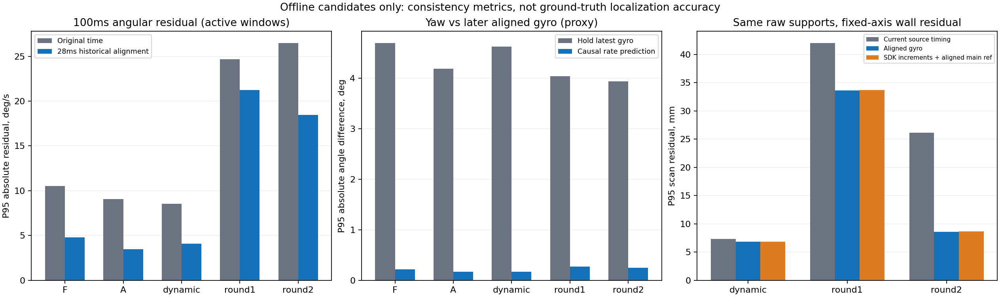

# 最高优先级欠项：候选已经做完，运行采用另议

2026-11-10，代码起点1ec0838。用户已删除goal，本轮不重建；性能优化继续暂缓。以下只处理当前任务表中的欠项，不恢复旧补丁或旧实验单。下位机窗口只读，不启动设备、电机或清日志。

本候选批次完成：轮滑可观测性与双异常边界、gyro历史对齐/因果预测、T265传播/去畸变候选的同输入离线对照；以及[新版F405到位、开局、投送、爪等待的实际代码审查](LOWER_AUDIT.md)。正式选源算法未更换。本批运行修正为**保留进入轮式降级时的第一条原因**，不再被后续通用冲突覆盖；不改变坐标、传播、阈值、SDK暂停策略或恢复条件。同轮其他P0收尾见[纯T265直接输出回执](../../T265_DIRECT_OUTPUT_POLICY_20261110.md)及统一TODO，不与本候选是否采用混为一谈。

## 数据与可复核入口

| 分组 | 原始会话 | 100ms转动窗口数 | 原始雷达扫描 / 共同覆盖扫描 |
| --- | --- | ---: | ---: |
| F：未请求注入 | 20261109_190954_interactive | 160 | 无雷达 |
| A：正常官方输入 | 20261109_191242_interactive | 168 | 无雷达 |
| 动态联合 | 20261109_192842_interactive | 147 | 1669 / 1667 |
| 正式第一场 | 20261109_195243_competition_wheel | 754 | 1864 / 1856 |
| 正式第二场 | 20261109_195756_competition_wheel | 1081 | 2323 / 2316 |

共5856原始扫描，5839具有所有候选的相同支持；其余17个因会话首尾/源覆盖不足不能作共同对照，明确计数，原始数据未删除。转动窗口按轮式或对齐后gyro的角速度幅值≥5°/s定义，只用于本离线分组；完整会话含静止统计也同时保留，不能混报。F405实跑身份仍以原chassis_identity为准：MotionDebug ac61480/dirty1，正式9434608/dirty1；新的b56bc80源码不是这些日志的实烧版本。

已有`t265_f407_debug.py`增加离线分支，不新增独立测试系统或设备拥有者：

```text
python3 localization/tools/t265_f407_debug.py \
  --motion-source-review 原始会话目录 \
  --motion-source-output 会话外的新目录

可选 --review-gyro-phase-ms 28 --wheel-arm-m 0.115
```

28ms、115mm均为此前分析的固定候选，本批没有重新拟合比例、安装角、偏置、时延或轮臂。输出默认不覆盖文件，并拒绝写入原会话、其子目录或祖先；不写原analysis.json。保存的外参和1.000比例原样使用，保留pose jumping。

SDK输出的capture_age在消费线程计算，不能用callback RX减它。缺少pose_motion的F/A按processing_monotonic_ns减capture_age重建；有pose_motion优先使用实际发布的映射时刻。A有一条非单调映射，单列并断开比较支持，不编造连续采样。MCU跨主机用median(RX−publish)估计固定偏移，**不是物理时钟标定或qualified=true**。

每组JSON、窗口CSV和扫描CSV见同名子目录；[manifest.json](manifest.json)保留原文件SHA、方法源码指纹、库指纹及检查范围。SDK速度按完整四元数计算`v_B^W=v_C^W−ω^W×R_WB r_BC`，投到与C++相同的固定XZ平面，未用平面yaw代替倾斜姿态；F/A与C++输出体速逐行最大差约5×10⁻¹⁰m/s，是数值核对，不是精度验收。

## SENSOR-ALIGN-01：先修时间关系，不能先靠阈值判滑

| 有转动的100ms窗口 | 原轮/gyro角残差P95 | 对齐候选P95 | 保持最近gyro与后续对齐gyro的角差P95 | 仅用已收到rate预测后的角差P95 |
| --- | ---: | ---: | ---: | ---: |
| F | 10.53°/s | 4.81°/s | 4.70° | 0.216° |
| A | 9.06°/s | 3.47°/s | 4.19° | 0.168° |
| 动态联合 | 8.55°/s | 4.07°/s | 4.63° | 0.167° |
| 正式第一场 | 24.68°/s | 21.22°/s | 4.05° | 0.271° |
| 正式第二场 | 26.46°/s | 18.45°/s | 3.94° | 0.249° |

预测公式是`yaw_latest + rate_latest × (查询时刻 − (gyro事件映射时刻−28ms))`。每次只取轮反馈到达前已经收到的gyro包，未偷看后包；后续gyro仅作比较代理。正常实际预测跨度约33ms，正式两场最大约39.54/41.44ms。数据支持它能减少相位差，**不证明真实场地航向误差只有0.2°**；gyro内部滤波/误差、轮地关系和映射误差仍存在。未知缺包时长不能由这份正常记录证明预测可靠。

历史对齐可用已到的后续gyro，不需要新等待。当前导航是因果问题，不能简单查询未来，也不能把gyro时间戳全局减28ms，让官方SDK配对反而多等28ms。候选只在离线入口，当前运行时标/注入配对没改。

建议讨论的两个实际方案：

| 方案 | 能得到什么 | 代价与限制 |
| --- | --- | --- |
| 先只试历史对齐 | 改善雷达扫描时刻/点时刻关系，改动较小；保原主yaw场地参考 | 当前控制yaw仍有相位差，不能宣称高频导航航向已修好 |
| 历史对齐＋当前因果预测 | 同时处理雷达历史与当前航向；离线代理角差明显下降，没有新增等待 | 固定28ms并非所有状态的标定值；rate错误或缺包时预测可能错，需人决定采用范围和必要实测 |

推荐先在现有测试入口比较第二种，正式接入由人决定；不改变gyro正方向，不加年龄拒绝或握手，不要求F405增加计时/ISR。

## WHEEL-ARBITRATION-02：角速度检测能看见什么

当前F405原始三轮增量遵循：

`vx=k(d1−d2)/(√3 dt)`，`vy=k(d1+d2−2d3)/(3dt)`，`ω_enc=k(d1+d2+d3)/(3L dt)`，`k=π×0.070/1061.268`。

07已经提供实测前/左速度，本批未提供独立的编码器角速度字段；08的rate是主gyro。候选传播优先用07实测速度，**角残差另由原始计数复算ω_enc**，不能拿08的gyro既当轮式角速度又作参考。

以下是可解析算出的反例，不是实车测试。令三轮等效速度误差为q，假设车体实际未动、主gyro为0：

| q1/q2/q3，m/s | 里程计虚假平移 | 虚假ω（L=115mm） | 单一角差能否发现 |
| --- | --- | --- | --- |
| +0.5 / 0 / 0 | 前+0.289、左+0.167m/s | +83.04°/s | 这种未抵消的单轮架空很明显，但还不能确定坏哪一轮 |
| +0.5 / −0.5 / 0 | 前+0.577m/s | 0 | 完全漏检；可对应抵墙前进空转 |
| +0.5 / +0.5 / −1 | 左+1.000m/s | 0 | 完全漏检；可对应横移受阻的组合误差 |

角残差只增加一个约束，存在二维平移误差的零空间。单轮悬空后航向控制器让其他轮补偿，也可能抵消角差。因此“只要角差小就恢复轮式”不可行；同样不能从角差唯一修复真实XY。正式残差明显大于正常MotionDebug，也不允许据此自动把所有差值标为打滑。115mm尚非独立机械标定，SDK在注入后又依赖轮/gyro，不能让它们重复投票成独立真值。

### 双异常的真实留出片段

第二场开赛约+212.33s，已有wheel_suspect后T265再次跳变。以跳变前最后一次完整XY墙观测为起点，**固定取之后前两次完整XY观测**，没有挑最优端点：

| 窗口跨度 | 轮式/墙位移残差 | 对齐轮式/墙 | SDK位置/墙 | SDK速度积分/墙 |
| --- | ---: | ---: | ---: | ---: |
| 100.25ms | 14.39mm | 14.44mm | 172.95mm | 35.83mm |
| 500ms（含下一次跳变） | 36.84mm | 36.58mm | 63.94mm | 79.94mm |

墙观测仍依赖原选源、去畸变和局部先验，且残差不是地面真值；这两行不是轮式精度证明。但它们明确**不支持双异常后无条件切SDK速度**。角差检测、停SDK新输入和替换传播源是三件事，不应绑成一个盲目开关。

当前第一条原因覆盖bug已修；仍保原降级选择，未把“已做候选”写成双异常仲裁已经实车完善。建议的候选规则与现有行为对照如下，运行采用待讨论：

| 情况 | 已有行为 / 候选 |
| --- | --- |
| 两路运动一致 | 保既有T265锚点＋真实轮尾段、主yaw、历史雷达修正 |
| 双轴墙明确支持T265，轮式可疑 | 既有选择T265并暂停SDK新轮输入；本轮未增加判断 |
| 双轴墙明确支持轮式 | 既有回到轮式＋主yaw；重新接收真实SDK输入，不重放停送数据 |
| 轮式已可疑，T265位置又跳 | 已准备SDK速度积分的离线候选，但本批反例不支持默认替换；当前先保留原策略及可见的首因，由人决定是否开展受控候选验证 |
| 单墙 / 无墙，双方可疑 | 单墙只约束法向，切向缺证据；无墙不存在能保证完整XY的算法。保估计与真实来源标签，不伪造可观测性或精度，不新增永久停车 |

## T265-BASE-01：不建议全局把100Hz基础直接换SDK

[Intel本机SDK版本说明](https://github.com/realsenseai/librealsense/blob/v2.50.0/doc/t265.md)明确pose jumping目前改变平移位置，不改变旋转、速度或加速度。这支持**评估短时速度/旋转增量**，并不保证视觉退化、轮滑影响下的速度准确；停止轮速发送也不会马上清除估计器已有影响。

同一组原始光束，先在RAW坐标中选一次直线支持，所有候选使用相同物理点。TLS只看直线性；固定轴残差还受场地yaw影响，每条线的平移偏置自由，不能当XY精度。

| 固定轴残差P95（全部共同覆盖扫描） | 动态联合 | 正式第一场 | 正式第二场 |
| --- | ---: | ---: | ---: |
| 现轮式＋原gyro关系 | 7.32mm | 41.97mm | 26.15mm |
| 轮式＋28ms历史gyro对齐 | 6.84mm | 33.59mm | 8.62mm |
| 轮式＋SDK扫描内旋转增量，保原主yaw参考 | 7.32mm | 41.51mm | 26.25mm |
| 轮式＋SDK增量，主yaw参考也历史对齐 | 6.83mm | 33.66mm | 8.62mm |
| SDK速度积分＋SDK增量＋对齐主yaw参考 | 6.82mm | 33.71mm | 8.83mm |

**只换SDK扫描内增量无法修正主yaw场地参考的整体相位**。在此支持上，SDK增量没有比历史对齐gyro提供一致净收益；第一场剩余偏差仍大，不能靠改外参或初始地图航向硬拟合。完整采用SDK绝对航向虽改善第一场，却恶化第二场，表中已坚持相同主yaw参考，完整八候选均保留在CSV/JSON，未藏掉不利结果。

98个非重叠、至少一候选位移达到250mm的双墙空间窗口中，轮式/SDK位置/SDK速度积分相对墙位移的RMS分别为：

| 数据 | 轮式 | SDK位置 | SDK速度积分 |
| --- | ---: | ---: | ---: |
| 动态联合（17窗） | 22.77mm | 23.03mm | 27.80mm |
| 正式第一场（29窗） | 39.78mm | 77.06mm | 80.49mm |
| 正式第二场（52窗） | 36.89mm | 353.14mm | 179.04mm |

这些窗口只取**被现有定位接受的墙观测**，对原运动先验有选择偏倚，无法证明轮式总比SDK准确；却足以驳回“轮速注入后的T265速度天然无误”或“全局更换肯定更好”。建议保留现100Hz传播/跳变降级/围栏重获结构，先讨论历史相位和独立的轮滑证据，不大改成另一个位置加权融合器。



## 必要检查与尚未完成

已有协议测试文件增量覆盖：倾斜姿态完整杆臂速度抵消、缺帧区间、原会话写保护、离线CLI不进入设备路径、SDK启动角只作增量时不改变主yaw参考；3项相关检查通过。原来源仲裁/原生逐输入对照通过，含轮式可疑后SDK跳变及下一轮轮反馈配对仍保首因；C++ motion_runtime重编成功。没有跑无关整套测试。

候选模块只由显式离线CLI导入；不新增UART/SDK进程、在线统计、时间门、握手或停车。原始记录与用户ROI/资料不动，外参/比例/SDK噪声/pose jumping不改；候选没有同步到正式比赛。

仍欠的是**人选择后运行接入、真实架空/抵墙标签和独立地面验证**，不能标“仲裁/精度全通过”。物理T265启动异常、真实0x16整链及新版F405地面效果也没有被本次回放解决。一次只采用一个可检验改法，优先复用现有入口和已有遥测，不给F405夹带测试代码或新检测框架。
