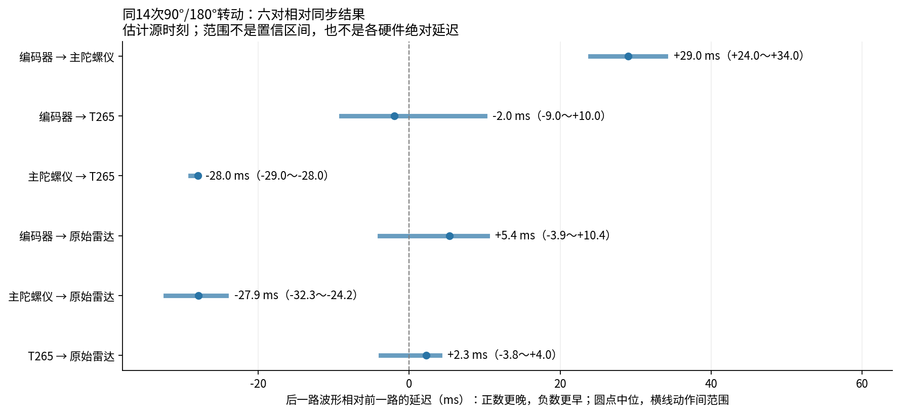
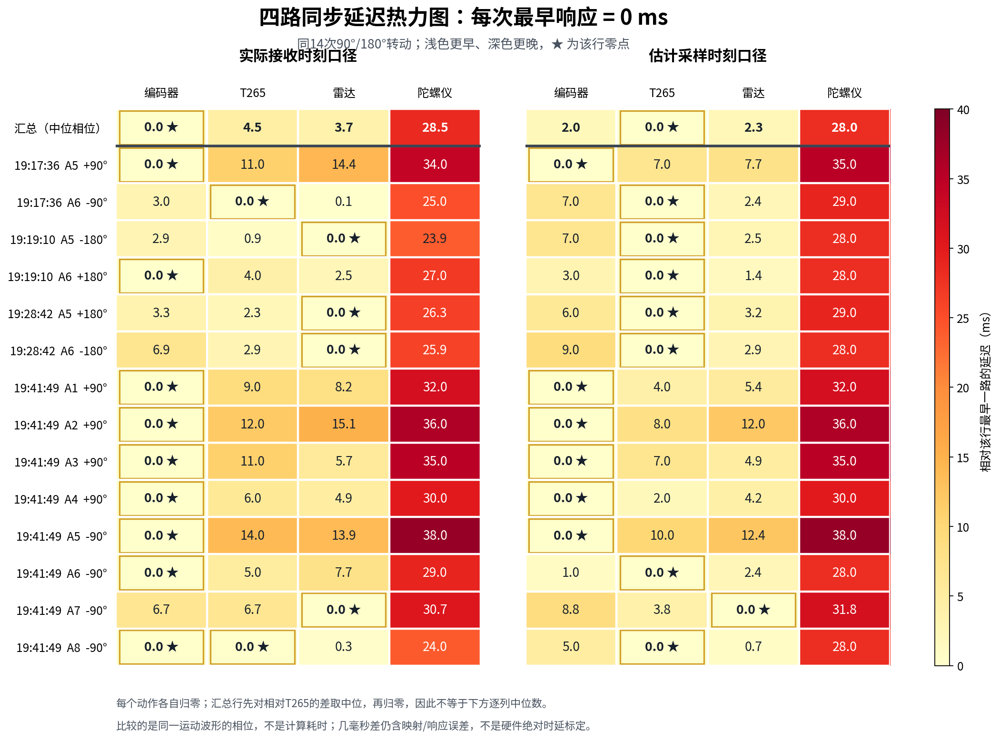
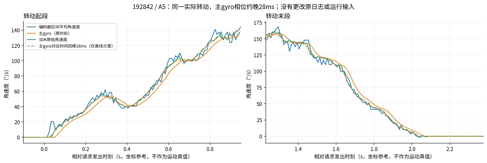
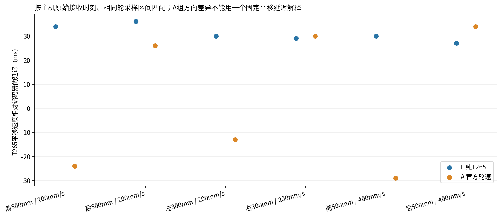
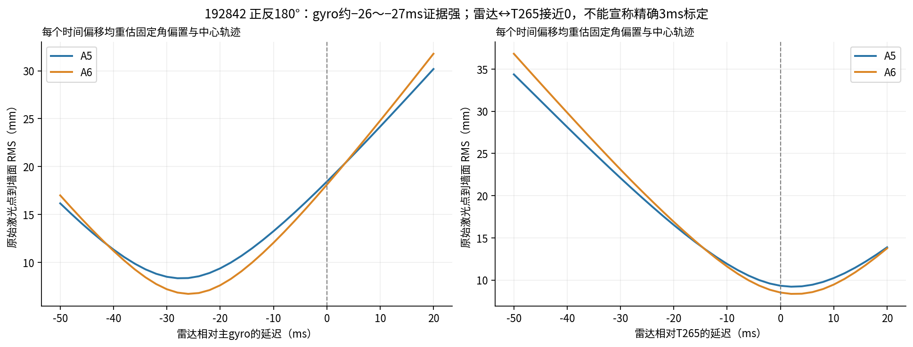

# 四路传感器的相对同步延迟：补算回执

2026-11-09，分析基线 `codex/gamepad-teleop@41c4bbc`。本轮只读原始日志、生成离线派生结果和文档；没有启动SDK、UART、电机或比赛，没有修改运行代码、外参、比例、下位机或原始日志，没有清理日志。

## 先给结论

上一轮给出了API/队列/计算耗时，**没有完整回答传感器之间的同步延迟**。本轮补齐四路的六对转动相位，并单列平移响应和数据到达长尾。

**最稳定的差异是主gyro相对于T265与原始雷达约晚28ms。** 这在纯T265、官方轮速输入、正反转和两场正式比赛中都存在。编码器↔T265的平移相位并不恒定，不能给整套Pose简单加减一个固定时间。以下是日志内的观测相位差，不是经外部触发标定过的绝对硬件延迟。

统一符号：`A → B` 的正数表示 **B的同一运动特征比A晚**，负数表示B早。主表用估计源时刻，后文另列主机RX基准；不要将二者混合。

同一批14个正常90°/180°动作（191736×2、191910×2、192842×2、194149×8），六对独立拟合结果：

| A → B | 中位差 ms | 动作间范围 ms |
| --- | ---: | ---: |
| 编码器 → 主陀螺仪 | +29.0 | +24.0 ～ +34.0 |
| 编码器 → T265 | -2.0 | -9.0 ～ +10.0 |
| 主陀螺仪 → T265 | -28.0 | -29.0 ～ -28.0 |
| 编码器 → 原始雷达 | +5.4 | -3.9 ～ +10.4 |
| 主陀螺仪 → 原始雷达 | -27.9 | -32.3 ～ -24.2 |
| T265 → 原始雷达 | +2.3 | -3.8 ～ +4.0 |

这14段是为了六对都具有原始雷达支持而选的共同样本，不是挑选拟合好看的结果。另有360° FAULT、注入实验及±10°小角段，全部保留在CSV，分组见后文。每对各自拟合、各取中位数，编码器又受到实际轮地关系影响；表格不能相加当作一组严格闭合的时钟偏置。

## 2026-11-10：以最早一路为零的热力图

按用户要求，将同14个动作绘成热力图，每动作最早响应的一路为0ms。左图使用实际接收时间轴，右图保留估计源时刻时间轴；数值是运动响应相位，不是计算耗时或外部标定的绝对硬件延迟。

统一展示时，先以T265为临时参考，用编码器↔T265、gyro↔T265、雷达↔T265三对直接结果组成同一行，再减去该行最小值；不将不完全闭合的六对中位数强行累加。汇总行先对相对T265的各通道时间差取中位再归零，因此不是下方逐列中位数。并列最早时均标★；几毫秒差含映射/波形误差，不能证明哪个硬件物理采样更早。

接收口径的编码器/gyro使用已有原始UART RX波形，T265使用SDK callback RX。雷达重新以原点的packet_id字节偏移找到包末字节所在RX批次，将该包各点置于该批次接收时刻；复用原始墙面模型、固定角参考及自由中心轨迹拟合到SDK callback时间轴，未采用已融合航向。14段均收敛、未命中时间边界，墙面RMS约4.47～9.33mm；这仍是带接收抖动的相位估计，不是曝光到收包的逐样本直接测量。

按上述汇总方式，接收时间轴：编码器0、雷达3.66、T2654.50、gyro28.50ms；估计源时间轴：T2650、编码器2.00、雷达2.27、gyro28.00ms。完整逐行动作值、输入时间口径和本轮雷达接收拟合见earliest_zero_heatmap_20261110.csv及同名JSON，下载目录另有PNG/CSV/JSON副本。本次只新增派生图表，不改变既有测量结论、运行程序、外参或原始日志。

## 时间基准和实际数据

- MotionDebug实际F405为 `ac61480cf44e24c314988f2be4ff3996d9b1ee93 / source_dirty=1 / service1`；两场正式为 `9434608a8c395d8506b36accf1753b9bf92dad24 / source_dirty=1 / service2 TASK`，均921600、协议1.3。新main和expected都不替代实跑身份。
- MotionDebug日志根目录：`rescue_map/runtime/history/t265_f407_motion_map/20261109_{HHMMSS}_interactive/`。F=190954纯T265、A=191242正常官方输入；原97动作中34个转动，27个有SDK原始波形可做当前三路比较，另7个不能编造SDK延迟。
- 正式两场定位会话：`competition_wheel_input/20261109_195243_competition_wheel/`、`20261109_195756_competition_wheel/`。仅分析各自比赛区间，第二场业务目录的2000年名称不代表旧日志。
- 编码器用真实07采样区间 `[t0,t1]`、原始三轮delta和新F405公式。gyro用08中分别去重的rate/yaw源ID；事件时刻是 **F405收到IMU报文的时刻**，不是内部物理采样戳。没有拿命令、DONE或进度当真值。
- 编码器↔gyro直接使用同一个MCU时钟。跨SDK/MCU用本会话 `median(host_RX − MCU_publish)` 估计常数偏移，不把传输中位值或时钟映射当已标定。
- SDK源时刻按现有实现的 `host_monotonic − capture_age` 重建；使用原始SDK四元数/角速度/速度，不用融合后地图坐标。这个system/global-time到host映射仍有误差。主机RX对照完全不扣除上述采样年龄。
- 没有共同外部触发、卷尺/地面角真值或IMU内部时间戳。**可以确定重复的相对相位，不能分离IMU内部滤波、测量延迟、接收事件定义与时钟映射各占几毫秒。小于几毫秒的差只宜称接近同步。**

## 编码器、T265、gyro：如何算，结果是否重复

轮角速度按 `ω = K(dn1+dn2+dn3)/(3L·dt)`，`K=π×0.070/1061.268 m/count`，诊断L=0.115m。L仅影响幅度，拟合允许一个固定幅度系数；未修改机械参数、符号或任何部署配置。

对每个实际动作使用发送前0.15s至结束后0.15s（与下一动作隔开）的真实波形，搜索−350～+350ms、1ms步长。将B在 **同一个轮采样区间** 平移后积分平均，与A比较；只允许一个固定幅度系数，不用目标波形、不时变拉伸、不同时拟合外参/比例。这样不会把约10ms轮窗口误当成瞬时端点额外引入5ms相位差。区间、源/回调/消费缺口、confidence及原始帧号缺号见 `action_data_support.csv`；大缺口段未偷偷删除。

27个有SDK的转动：

- gyro相对编码器的源相位中位 **+27ms**，动作间 **+18～+43ms**；T265相对编码器中位 **−5ms**，**−12～+16ms**。轮地动力学、量化和转速形状影响编码器对车体的这一比较，不能全解释为串口延迟。
- T265相对gyro的源相位中位 **−28ms**，27次全部落在 **−30～−27ms**。F纯T265中位−28.5ms，A官方轮速−28ms，192842动态−28.5ms。
- 直接按主机原始RX对比，F/A为−24/−24ms，192842为−23.5ms。SDK回调约在其估计采样时刻后5ms，解释了源基准与到达基准的几毫秒差别；它不是全部SDK内部解算延迟。
- 再用gyro累计yaw与SDK四元数的区间角差复核：F/A相位为−29/−28ms、192842为−29ms。主gyro自身yaw差分与rate相位约−1ms；SDK自身四元数差分与rate约−1ms。因此约28ms不是只比较两种不同速度字段导致的假象。

平移另算，不能拿转动28ms套用：同一区间沿实际动作方向比较实测速度，主机RX基准，F六段中位 **+30ms，+27～+36ms**；A六段中位 **+6.5ms，−29～+34ms**。A依次为前500@200 −24、后500@200 +26、左300@200 −13、右300@200 +30、前500@400 −29、后500@400 +34ms。源时刻口径F中位+24.5ms、A+6ms。正反向不一致，幅度/打滑/估计器响应也在变化；不能称一个已标定固定延迟，更不能据两次不同SDK会话宣称注入已因果降低多少毫秒。

## 雷达：回到原始光束，不用已融合航向自证

运行中的 `dynamic_localization.yaw_rad` 来自主gyro，不能拿它与gyro比较得出零延迟。本次读取 `dynamic_scans.jsonl` 未去畸变的原始点、每点时间和原安装参数，用既有FOV/坏角掩码与提线选择围栏支持点。墙面轴/边分支用粗姿态和旧位置作关联帮助；**拟合中心不受旧位姿限制，时间残差不使用已融合航向或地图位置**。

每点模型：`wall_axis(R(θ_ref(t+δ)+α)·p_B + C(t)) = 0或3m`。其中α为单个固定角参考偏差；C为每扫描平均点时刻的一组自由XY中心，扫描间线性插值，允许实际车体中心平移。消去中心后拟合时间δ；输出雷达相对参考的延迟为 **−δ**。仅编码器参考再允许一个固定角幅度系数，避免把轮臂误差强当时间差。软L1、10mm尺度，时间±150ms、角参考±7°，多初值收敛且无边界命中。

这个模型假设平面围栏、时间关系在单动作内近似恒定，中心在相邻约100ms之间近似线性；不要求车中心严格不动。若给每扫描额外独立速度，会与时间参数互相吸收、产生不稳定解，故未用这种过参数化结果作为结论。未知雷达包时间语义和初始收包锚点仍保留未知，不因此改任何qualified字段。

全部19次转动的原始点拟合：雷达相对gyro中位 **−28.07ms，−32.32～−24.24ms**；相对SDK中位 **+2.33ms，−3.81～+8.74ms**；相对编码器中位 **+5.04ms，−3.89～+14.16ms**。14段正常大角范围见主表。异常/弱激励不隐藏：

- 192329的360°最终FAULT：雷达↔SDK拟合+8.74ms且还需约+2.99°固定角偏差，角参考/漂移也参与，不把它混成正常标定；雷达↔gyro仍−27.68ms。
- 193147的注入实验两段保留；其中第一段SDK源帧最大缺口约506ms，有1次帧号跨越。其余波形可对比，不称该段完整连续。
- 194149的±10°激励弱，雷达↔编码器分别+14.16/+0.20ms，改善很小；列出而不据此发布固定补偿。

192842正反180°无需移动外参即可看到：gyro按原时标的墙面RMS **18.43/18.11mm**；拟合时间后 **8.34/6.72mm**。用正转的−27.07ms去算未拟合的反转，RMS **6.77mm**；反过来用反转的−25.66ms算正转，RMS **8.39mm**。每次仍只重新消去中心和固定角参考，时间值来自另一动作；这支持相位差具有重复性。

同两段用SDK角度，零偏移RMS **9.32/8.52mm**，最佳约+3ms也只有 **9.22/8.35mm**。改进很弱，所以结论是雷达与SDK **接近同步**，不能包装成已精确标定3ms。

## 正式两场：联合负载参考

按真实gyro活动识别70个转动/复合转动区间（第1场28、第2场42），不按命令角度分段；阈值只用于本次离线选运动激励，不进入运行程序。

T265相对gyro，估计源时刻：

| 正式场次 | 区间数 | 中位 ms | 区间范围 ms |
| --- | ---: | ---: | ---: |
| 第1场 | 28 | -28.5 | -30.0 ～ -23.0 |
| 第2场 | 42 | -29.0 | -30.0 ～ -25.0 |

同一批按主机RX时刻：

| 正式场次 | 中位 ms | 区间范围 ms |
| --- | ---: | ---: |
| 第1场 | -23.0 | -25.0 ～ -19.0 |
| 第2场 | -23.0 | -25.0 ～ -20.0 |

累计yaw↔SDK四元数的角差相位同样约−28/−29ms。编码器↔gyro正式中位+39/+37ms，比受控转动离散；第二场有2个搜索边界解，编码器↔SDK也有边界解，全部列在 `formal_pair_lags.csv`，不能当作真实350ms硬件延迟。这些区间包含复合运动和轮地不一致，不能把差值全算RDK排队。

为独立核对雷达，事先按同一规则从每场选3个大角转动：实测gyro累计变化≥130°、区间1.5～4s、轮式平移峰值≤0.1m/s，按转角取前3；并非按拟合结果挑选。全部有原始围栏支持：第1场雷达相对gyro **−28.59/−26.54/−26.40ms**，相对SDK **+1.51/+2.05/+3.56ms**；第2场对应 **−28.24/−29.37/−27.03ms** 与 **+0.93/+0.79/+2.47ms**。墙面时间错位结论在正式负载下也存在。编码器参考在部分段残差较差，完整数值与固定角参考项均保留，不冒充新的硬件校准。

## “测量相位”与“什么时候才收到”是两件事

把原始 `lidar_rx.jsonl` 按字节拼接，以原点 `packet_id=byte:offset` 找到原始包末字节所在RX批次，比较 **收齐该包的主机时刻 − 日志里该包最后光束的时刻**。这不含后续提线CPU，也不是独立采集真值；它同时含传输、主机接收调度、初始时钟锚点和名义设备时钟误差。负数说明当前映射不是物理标定，不能解释成负传输时间。

| 会话 | P50 ms | P95 ms | P99 ms | 最大 ms |
| --- | ---: | ---: | ---: | ---: |
| motion_192842 | -1.25 | 1.39 | 9.14 | 39.04 |
| race1 | -0.45 | 3.48 | 8.25 | 54.64 |
| race2 | 0.52 | 10.36 | 46.50 | 276.86 |

正式第2场存在真实到达长尾证据（相对日志点时刻最大约277ms），与稳定约28ms的gyro相位差不同。初始时钟锚点/名义时钟的残差趋势只有每秒几至几十微秒量级，但不是已标定晶振漂移。不能把到达长尾全归提线，也不能把几毫秒负残差硬改成qualified=true。上一轮另外测得的雷达参考→计算结束P95约102/130ms仍是**结果可用延迟**，并未被本次相位拟合消除。

## 对当前链路的含义和下一步边界

1. **先把约28ms主gyro相位差当成需要处理的候选，不再只盯API调用耗时。** 例如150°/s时，28ms对应约4.2°动态朝向差，足以影响去畸变、轮速杆臂项及瞬时角速度残差。它不等于陀螺仪绝对角度错4.2°，也不能证明先前所有过冲都由它造成。
2. 现有MCU同时间区间配对解决了报文字段对应，却未消除传感器响应相位。可先离线将gyro历史对应时间回移约28ms，与用SDK姿态去畸变比较；这只是候选。当前航向若要预测到现在、或改用SDK，则涉及算法取舍，不能直接平移整个Pose或增加28ms等待。
3. 编码器↔T265平移方向差异明显，**不发布统一平移延迟补偿**。正常A没有证据显示T265平移普遍比编码器晚几百毫秒；异常跟踪/轮地冲突须单独看，不用时间偏移强拟合。
4. 雷达到达/计算尾延迟仍要单独优化；本轮没有改轮速注入、去畸变、来源仲裁或任何时间准入。SDK轮速已依赖轮/gyro，SDK与它们的比较是响应比较，不是独立精度自证。
5. 不修改T265外参、比例、正式流程或F405；不新增年龄拒绝、握手、FAULT或运行计时。是否采用补偿由人看上述证据后决定，不能把本报告当跨端施工授权。

## 交付与必要核对

- `motion_pair_lags.csv`：每动作、每对、源/RX两种时间口径；`angle_rate_lags.csv`：累计角度导数复核；`action_data_support.csv`：原帧/采集/回调/消费连续性。
- `lidar_pair_lags.csv`：19个MotionDebug转动和6个正式转动的全部75组原始墙面拟合、支持点/残差/固定角参考/幅度项，分组保留异常与弱激励。
- `formal_pair_lags.csv`、`formal_bursts.csv`：70区间的全部结果、搜索边界与运动条件；`lidar_timestamp_residuals.csv`：8会话的原始字节定位接收残差。
- `summary.json`：数值、数据路径、符号、交叉验证及边界；四张图对应上述原始派生数据。
- 必要数值检查：已知B晚40ms、幅度2.3的非周期合成信号恢复 **+40ms/2.3**；将同一原始墙面模型的参考时间人为晚30ms，恢复的雷达相对偏移从−27.07变成约−57ms，符号正确。这些只是离线计算核对，不是新增实车测试或精度通过。
- 本轮只提交分析文档、派生表图与当前状态；保留用户ROI改动、`vision/456`和“雷达与融合”资料。原始日志完整保留，不清理。
