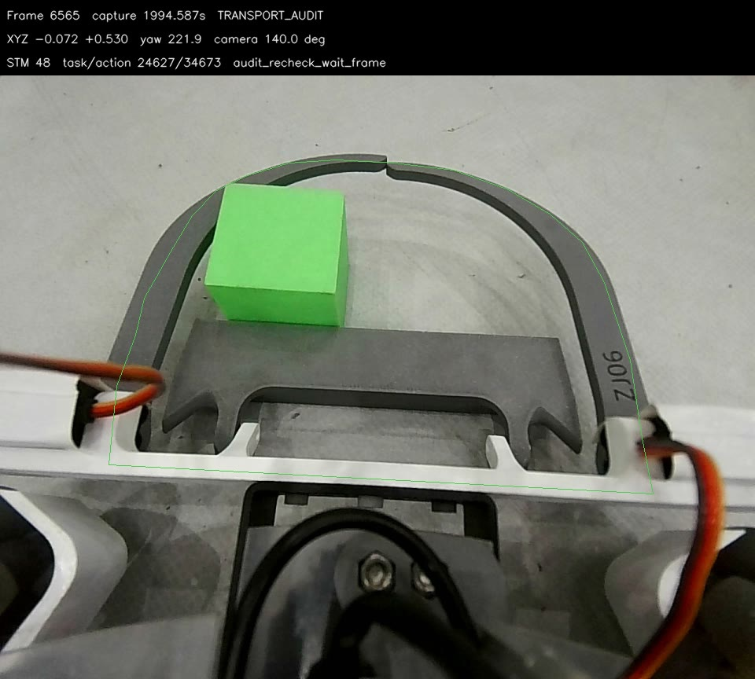

# 最后两局：闭爪漏框等待与安全区内目标误追

2026-11-16。本轮仅分析，未修改业务代码、模型、ROI或下位机，未启动设备。漏框由用户尝试补数据集；本端重点处理等待过长。下文的改法是方案，不是已实施。

## 实跑身份与证据

- 前一局：传感器目录 `rescue_map/runtime/history/competition_wheel_input/20261116_154249_competition_wheel`；业务日志位于 `rescue_map/runtime/history/20261116_155030_competition/`，此业务目录名是下次启动归档名。实际开赛单调时刻1309904982818ns，红方2区、进攻。
- 后一局：传感器目录 `rescue_map/runtime/history/competition_wheel_input/20261116_155030_competition_wheel`；业务日志本轮读取自 `rescue_map/runtime/competition_events.jsonl` 和 `competition_detections.jsonl`。实际开赛1816777909754ns，红方2区、防守；不是预热默认的红方1区。
- 两局元数据 upper均为750aafae5b4ff33bb4e0ff52f394cdaf0b0eb1d1；原始chassis_identity均自报F405 49a4c7525453d738f8cdcfd0f8139a1986fa45f1、dirty=1、NormalRun/TASK。源码按此提交核对，实际dirty差异未知。
- 以下秒数从各局实际开赛计。`selected_raw_records.jsonl`保留相关原记录及原路径；图片直接抽取对应原录像帧，未改原日志/录像。回放是抽样录像，未录到的帧以业务检测记录补证，不能用抽样无框宣称全程从无框。
- 两局 `pre_grab_advance_enabled=False`，不能把本轮现象归因于新增合爪前50mm补进动作。

## 1. 绿色留在左爪，程序却长时间等框

| 实跑位置 | 实际证据 | 退出情况 |
| --- | --- | --- |
| 后一局171.578–183.444秒 | 已在170.192秒通过合爪后审核。运输复查录像0004第44帧（视觉6565）绿块完整留在左爪内，模型无框；不是有框被ROI排除。 | 等11.87秒；182.879秒检测记录有绿框，183.351秒真实两次审核稳定，183.444秒恢复对准。不是凭空恢复或永久锁死。 |
| 后一局275.746–280.79秒 | 合爪前已见绿色；刚合爪后复查无框。录像0008第94帧（视觉8816）仍能看见左爪内绿块。 | 约5.04秒后恢复；280.385/280.562秒录像记录重新有绿框。 |
| 前一局323.144–331.503秒黑色核心 | 复查等8.36秒。录像0007第45帧（视觉8135）未见可明确辨认的黑块；第54帧黑块从上方进入画面，第55帧在右爪内有框。 | 有真实黑框后331.503秒审核通过。这段不能直接说成“左爪黑块始终在但模型漏检”，也不能只凭画面断定是人工放回。 |
| 后一局337.474–352.531秒黑色核心 | 抽到的录像0009第56帧（视觉10352）未见可辨认黑块，复查持续无框。 | 15.06秒后下位进入mode24，354.853秒上位回SEARCH。不能把此段与绿色在爪内的画面混为一因。 |

### 为什么要等这么久

上位 `state_machine.py::_audit_observation_wait`：闭爪全零结果不直接判定为空爪，先请求复看；后续继续发非稳定占位（`load_empty_gap`/`audit_recheck_wait_frame`），等真实合法框。该选择避免漏框就扔货，但没有短复看后继续已确认运输的出口。此前修的mode48“真框间歇重现仍不累计”已保留样本，不能解决一直无框的情况；mode23刚合爪审核本来没做同样改动。

F405该提交 `Main/Inc/app_config.h`：每轮审核窗口3500ms、微调动作400ms、回140°稳定250ms、全状态审核出口15000ms。`Task.c::task_process_transport_audit`最多两次±2°微调；两次之后仍在等审核，最终靠 `task_audit_watchdog` 的15秒出口。`task_process_post_grab_audit`也有主/低/高三轮等待。并非模型一次推理耗了十几秒，也不能简单把它叫成进程退出。

核对源码：
- https://github.com/kkkkkkkkkkkkkkkk222222/F407-Rescue-Robot/blob/49a4c7525453d738f8cdcfd0f8139a1986fa45f1/Main/Src/Task.c#L7682
- https://github.com/kkkkkkkkkkkkkkkk222222/F407-Rescue-Robot/blob/49a4c7525453d738f8cdcfd0f8139a1986fa45f1/Main/Inc/app_config.h#L488

### 本轮方案与用户选择

用户已选择：**合爪后已真实确认载荷、途中未开爪，仅运输复查漏框时，短复看仍无框就继续送已确认载荷。接受真掉落时可能空跑一趟的代价。** 合爪后从未确认成功的情况另走放下、重新搜索，不能套用运输资格。

建议只缩短闭爪持续无框这一分支：一次原有相机微调复看，包含动作及采图在内总共约2秒；真实结果先到就立即处理，不等满。2秒是待落地核对的建议参数，不是已实测最佳值。不新增高频监控、重复握手或普通异常全车停机。

两端必须一起改：上位保留“最后真实通过的载荷”与“本轮没有检测结果”的区别；下位结束当前无框复查后接原运输动作。不能把旧数量冒充当前帧新审核通过，不能只把15秒改短使仍夹着的绿色被自动丢弃。首绿已见黑色、危险/混装等真实矛盾仍应处理，不能被漏框通行规则清除。具体复用接口需在实施前核对，不在本轮发布未授权的下位实现任务。

## 2. 安全区内橙块为什么又被追

后一局可明确定位到420秒这一段（目标471）：

1. 420.176秒SEARCH还记录`INSIDE_SAFE`拒选。
2. 420.284秒锁定橙色。临近的420.315秒检测帧12027只有橙框，没有红区框。
3. 420.445秒帧12030同时检测红区 `[18,131,607,112]` 与橙块 `[491,163,92,56]`，橙框完全在红区框内，满足当前排除规则。
4. 420.691秒上位又发正常靠近；421.189秒发定距接近。422.104–423.454秒多张图仍同时出现红区及区内同一橙块，期间没有结束旧靠近，422.924秒转入定距结束后的抬相机交接，423.869秒进入抓前审核。
5. 控制定位记录421.35秒约(0.354,0.111)m，423.61秒约(0.410,0.569)m，说明记录中存在向红区方向约46cm的位移，不只是锁框显示。定位不是独立地面真值；后段未取得对应完整录像，不能据此声称车体究竟越过了安全区边界多少。

代码已同时检查safe_red/safe_blue，不是只禁止对方或只禁止己方。漏洞有两层：安全区框一缺失，原目标又被认为合法；目标被排除时，靠近流程把它和普通漏框一样处理，可能暂留旧瞄准点。有限前进命令一旦已有，`_range_approach_output`在重新检查目标之前就继续原命令。因而后续看到它在安全区里，也没有明确撤销该次接近。

最小修复方向（尚未实施）：双方安全区规则一致；明确看到目标在安全区内，就结束该目标，不走普通“短暂漏框继续追”。同一连续跟踪目标保留已确认的区内身份，不能红/蓝区框下一张缺失就重新放行；不要跨转头直接复用旧屏幕矩形，也不要仅凭可能串号的ID永久封禁。若下位已接受有限前进，必须走可确认结束旧前进的原动作出口，再搜别处，不能只在上位删框。完全未识别过安全区的情形仍需另补看全安全区，不能宣称这一个修补覆盖全部场景。

## 3. 观察点增加10厘米

当前①/③在场地中心X±0.30m、Y0。用户要求增到±0.40m，两点间直线距离由60cm变80cm。仍保持①↔③、运送后直返来源点、进攻转尾倒车到①；不恢复②/④或中间绕行。该参数是上位 `post_delivery_return_offset_m`，不需要新增下位协议；实际往返增加的距离随车的位置不同，不能说每趟必多20cm。本轮只记录，未改。

## 4. 当前橙色优先级

首件正式投送仍先绿；首绿完成后，绿/黑/橙共同按近远选，不优先橙色。距离来源依次用同帧共同可用的地面距离、105°/120°分区距离、框底边估计；同距离再按底边更低、面积更大、编号更小。已锁定后不按新优先级反复切目标。

若改为优先伤员，建议只在重新选目标时改，并优先考虑“距离相近时橙先、明显更近的其它合法块仍先”，避免为远处橙块放弃眼前近块。距离相近的范围及是否采用绝对橙优先仍需用户决定；不能用未经确认的分值/耗时比直接改策略。安全区内目标和危险目标的排除应在颜色排序之前。
