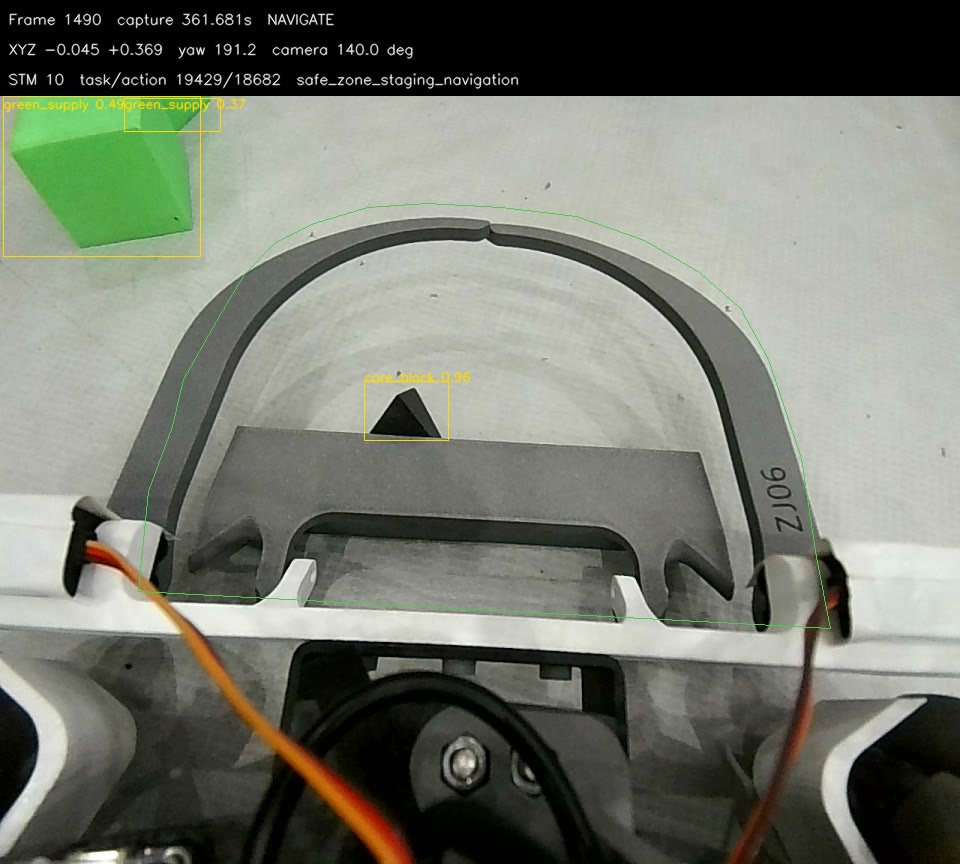
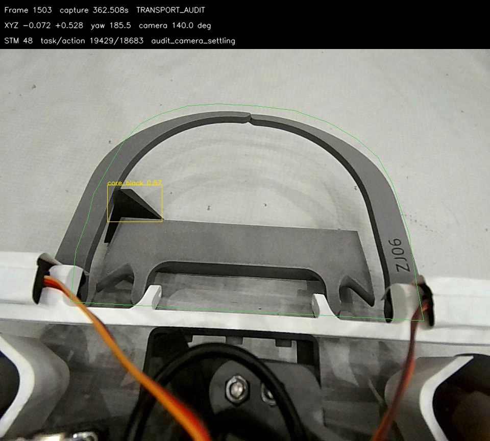

# 21:28实跑：首绿滤除后的运输高度核查

本轮用户要求先帮助下位机定位“大舵机82°被保持、黑块运输掉落”，再继续安全区禁入、首绿后单橙优先和靠近目标续接。这里只分析原记录，不修改或烧录下位机。

## 结论及边界

**这局记录不支持把现场直接定为“滤除中断后残留82°”。** 首次滤除由mode50正常进入mode22，并报同task/action完成；第二次及后两次也是如此。整局5182组有效状态回包没有mode47。按实际身份对应的6b05d94源码，正常滤除完成前必须调用恢复运输85°的函数。

这不证明真实机构已经到85°：原回包只报告相机角度，没有S1大舵机目标/PWM/实测角度。身份仍为dirty1，不能以Git源码等同全部运行二进制；下位另已报告板端镜像匹配其留存构建。

**录像确实看到早期黑块从爪内中间滑到左侧，但该片段没有证明它完全掉出爪子。** 361.681秒拍摄时黑块在中间，362.508秒拍摄时贴到左爪，之后仍有真实黑框并继续投送。不能把横移、漏框或位置变化直接写成已证实掉落，更不能据此反推S1=82°。

## 会话身份

- 原目录：`rescue_map/runtime/history/competition_wheel_input/20261116_212809_competition_wheel`。
- SDK会话：`426b589b73353ea4edca1f835c0963f9`；红方起点1。
- 上位：`1dc8286215ade0670dfa6c3746a28480a13ad85e`。
- actual下位：`6b05d9450b740848bf9436e63b6e9da10a293579` / dirty1 / NormalRun / TASK。
- actual镜像身份：`8f2ce629deab61a03f97dc2d284c585b68d15028d5d3530b61e2ee52829eee7f`。
- 时间均为原日志单调时钟秒数，**不是开赛后秒数**。比赛业务events不完整，采用原UART回包、录像及配套JSON，不替换成19:20局。

## 原始回包时间线

| 时间 | 原UART行号 | 实际回报 | 意义 |
| --- | ---: | --- | --- |
| 317.716406 | 24460 | task19426/action18650，mode50，cmd18，status1 | 首绿审核后滤除执行中 |
| 318.915966附近 | 见证据JSON | 同动作mode50，flags由86变82 | 仅电机活动位清除；**flags82是十进制位集合，不是82°** |
| 318.975371 | 25640 | 同动作mode22，status3 | 首绿滤除正常出口，ACCEPT+DONE |
| 319.036929附近 | 25700 | action18651，mode10，cmd3 | 接受运输导航 |
| 340.756128 | 45586 | task19427/action18664，mode50 | 后续单橙滤除执行中 |
| 341.777020 | 46452 | 同动作mode22，status3 | 第二次滤除正常完成 |
| 359.596附近 | 62315 | task19429/action18680，mode8，cmd2 | 后续首个黑块合爪 |
| 361.513附近 | 63927 | action18681，mode22，cmd18，status3 | 黑块抓后审核通过，未进入mode50 |
| 361.634附近 | 64042 | action18682，mode10，cmd3 | 黑块运输导航被接受 |
| 362.475附近 | 64742 | action18683，mode48 | 黑块到点复审；录像显示黑块贴左爪 |

全局四段mode50分别为317.716→318.975（1.259秒）、340.756→341.777（1.021秒）、535.688→538.628（2.940秒）、581.471→582.788（1.317秒），均直接退出至mode22。前两段相关回包最大间隔分别61.3/65.7毫秒以内；没有记录到恢复状态或过滤中途换任务。状态序列能证明程序走了正常出口，不能代替舵机和地面测量。

原记录提取见[已解析状态](filter_status_evidence.jsonl)及[原始0x1E/0x17报文](filter_original_packets.jsonl)。每条保留原UART行号、接收单调时间和原十六进制帧；按现有协议检查帧尾与CRC后提取，没有重新合成现场报文。整份混合串口扫描有14次候选帧校验/包络失败，不能把全部字节扫描称为零错误；上述窗口的有效状态连续性单独核对。

## 可直接定位的录像

- `safe_zone_replay_0002.avi`第80帧／视觉1490：拍摄361.681秒，黑块仍在爪内中间，导航中。
- `safe_zone_replay_0003.avi`第8帧／视觉1503：拍摄362.508秒，黑块已移到左侧，到点复审。
- 后续该段仍按黑块运输；下一批task19430另有混装复审/分离，不能混作首绿滤除事件。此前报告的task19431黑189顶隔板也是另一个问题。

## 对下位机修复的核对与建议

已读对端固定入口及`df7e8cccd30afb5042ddfed08fe6b9690fd74bb4`补充记录。对端`2666b31`在普通合爪入口补`Lift_SetTravelPosition()`，修复了其夹具确实复现的“滤除中断→恢复→抓黑块仍沿用82°”路径；本端认可这是有效缺陷修复，**不将其当成本局根因已经闭环**。对端报告已构建、未烧录，本端未部署。

对应actual源码：

- [Task.c 3446起](https://github.com/kkkkkkkkkkkkkkkk222222/F407-Rescue-Robot/blob/6b05d9450b740848bf9436e63b6e9da10a293579/Main/Src/Task.c#L3446)：滤除只适用于首绿或单橙；phase0写82°，phase2轮程后退100mm成功后写运输85°，phase3后才进入WAIT_NAVIGATION/mode22。负载矛盾也先恢复85°再复审。
- [mechanism.c](https://github.com/kkkkkkkkkkkkkkkk222222/F407-Rescue-Robot/blob/6b05d9450b740848bf9436e63b6e9da10a293579/Main/Src/mechanism.c)：恢复函数直接调用S1设角，不依赖上位另发恢复角度指令。
- 原普通合爪入口976行未重新写运输姿态，对端新修复已补；本局两次正常滤除和投送退出恢复不应被描述成已中断。
- 原`task_stop`确实可能清故障再进mode47，但本局连mode47也未见，不能仅凭FAULT0认定发生过这条恢复路径。

下一步请下位结合其已留存、与板端匹配的ELF/二进制核对正常mode50→22路径中的S1设角，以及之后的舵机写入来源；先查正常完成链，不再只用人工注入MOTOR故障说明现场。现有记录缺S1现场PWM，若源码/镜像仍不能确定，需把“程序目标85°、输出PWM是否85°、机构实际高度是否到位”分开；不在本轮自动新增高频遥测或动作测试。

没有调整82°/85°、舵机偏移、运动速度、等待时间，没有改报文，也没有要求对端新增测试系统。对端可据上述原始证据接受、调整或继续调查；发布不等于对端已读取或现场修复通过。
