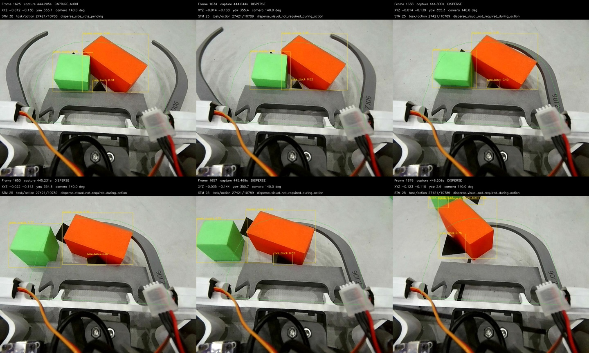
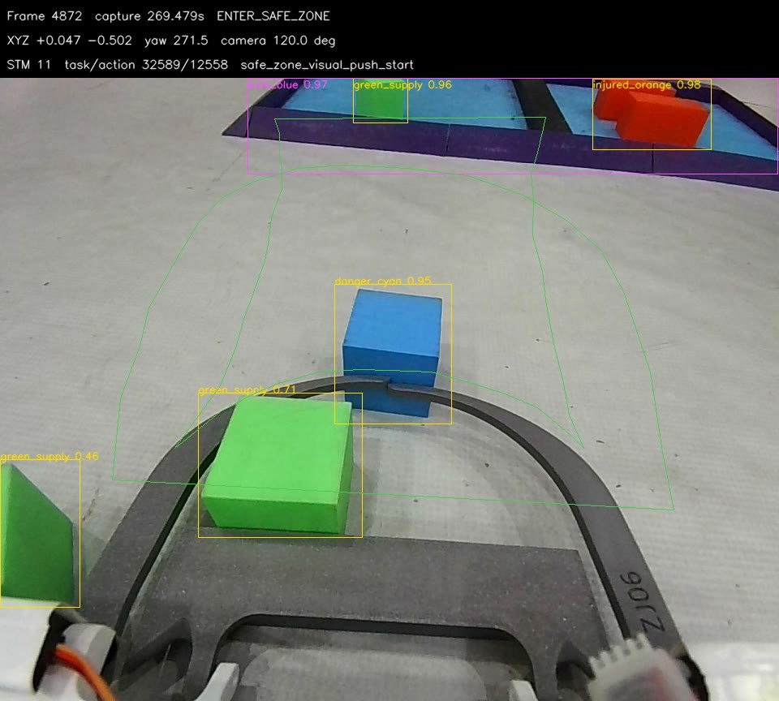

# 00:48局：橙块分离、远处橙块反复对准、蓝块未触发扫障

本次仅分析，未改运行代码、人工标定或下位固件，未启动设备。下述改法为待讨论方案，不是实施交接。

## 会话与证据边界

- 2026-11-18 00:48蓝方1区；上位7d3d956，模型1117。开赛单调时间96.339384951秒。
- 实际UART身份：F405 113649271cbbb081f8f01c7d20620a834f8a79df/dirty1，firmware_id=3b725a4c6daa2920dc567227bfa9d5c66d2c1f8647b38dbf08465d9e8a8ee0f4。已读取该提交Task.c、mechanism.c、app_config.h、vision.c及固定交接。源码已有V2的82°分离、单橙82/材料88；不能继续以旧b1cfe66“不支持8200”解释本局。dirty差异及实际舵机角没有独立证据。
- 本局业务源为rescue_map/runtime/competition_events.jsonl及competition_detections.jsonl；定位/回包/录像为history/competition_wheel_input/20261118_004831_competition_wheel。evidence.json保存相关原记录、原行号、CRC正确的上下文及状态回包、选取的原控制位姿。
- 本局录像只有6段安全区附近片段，没有208–226秒分离过程或361–391秒远处对准的原图；这些时段不能假装看到了爪与物体的接触。另只读对照同版本00:39局现存分离录像，明确区分两局。
- 解析跳过的坏JSON行记录在evidence.json；control_pose有1条坏行。没有补造帧或将坏行当空场景。

## 1. 橙块分离失败

### 最后一局实际发生了什么

开赛约112秒（单调208.309）：真实审核左单橙157、右单黑159，上位明确保左。task32587/action12520于208.343接受DISPERSE、210.502回mode35/DONE，无该动作拒绝。随后210.704发真实空爪审核，211.166回搜索。

这里“空爪”不等于模型没认到橙：同一个橙157始终还有框，但从爪内移到了前方画面上缘：

| 单调秒 | 原帧 | 橙框(x,y,w,h) | 说明 |
| --- | --- | --- | --- |
| 208.331 | 3378 | 411,76,268,395 | 保左分离刚开始 |
| 208.555 | 3384 | 419,73,268,387 | 仍近原位置 |
| 208.771 | 3390 | 574,50,436,383 | 橙框已明显向右移/姿态改变 |
| 208.998 | 3397 | 870,66,353,401 | 移至画面右侧 |
| 210.648 | 3446 | 729,0,231,67 | 只剩前方上缘的一截，退出爪内范围 |

208.34–209.20控制航向约351.76–351.95°，相机回报保持140°；约209.5后才明显转向。故橙块先横向移出，并非仅由后续底盘转头造成；最符合单侧收爪/另一侧释放时把物块挤走。没有该段原视频，不能进一步断言具体哪根爪尖先接触，或把Servo命令角当实测夹紧力。

对照开赛约127秒（223.424）另一批：右侧橙175+黑177，保右分离action12529于223.461接受、225.921完成。分离后黑退出爪内，橙仍有真实爪内审核，226.251进入合爪，后续返航。说明并非所有保橙动作都失败，也不是统一选错侧。

### 对应代码确实怎样动

[Task.c固定源码](https://github.com/kkkkkkkkkkkkkkkk222222/F407-Rescue-Robot/blob/113649271cbbb081f8f01c7d20620a834f8a79df/Main/Src/Task.c#L3013)、[机构代码](https://github.com/kkkkkkkkkkkkkkkk222222/F407-Rescue-Robot/blob/113649271cbbb081f8f01c7d20620a834f8a79df/Main/Src/mechanism.c#L232)：

1. 上位按画面左右和真实类别选择保留侧；选择“左/右”不证明物体已被该侧机械夹稳。
2. 新8200请求先走大舵机82°。随后机构在同一个周期分别把保留爪收向指定角度、另一爪打开，不是先用双爪夹住橙再释放另一侧。
3. 明确单橙保留侧才有原基础角+10°；同侧橙黑作为UNKNOWN真实混装，仍走基础软收5°，没有单橙+10°。这与既定实现范围一致，不能称该10°功能完全没实现。
4. 随后原退弯动作：预退20mm，再后退转弯，目标10°/弃三件15°，弧段轮程上限250mm（重试300mm）、尾退70mm、整段上限430mm。后退目标300/500mm/s、侧移命令为0。实际会受原提前结束条件限制，不能把430mm说成每次真实走满。
5. 动作完成才重新审核；运动中并不根据橙是否已滑走提前改变分离轨迹。

### 上一局录像提供的机械证据

仅作为同版本对照：00:39局单调444.4–447.2秒，右侧橙黑、左单绿，确有U8200保右请求。原图能看出黑在橙的内侧/下方、橙斜压着黑。开侧和后退中，橙黑仍挤在一起，最后都退出爪内，446.781走空爪审核。不是靠抬到82°就把黑与橙自动分开。

因此至少有两个机械问题：单侧收爪不能保证留下橙；橙黑同侧、前后压叠时，原“留一边、放另一边”动作也不具备把同一边两块拆开的保证。不能只修改选侧排序或继续增大次数。

### 建议范围，未实施

- 左右确实能分开的组合：优先研究“先把橙收进可夹住的位置，再放另一侧”的机构顺序；不能仅拿画面左半边就当左爪已夹住。是否先双爪收拢、如何避免把黑也锁住，需要按实际夹持几何确认。仅把两个舵机命令先后交换，在另一爪本来已经全开时并不能建立支撑。
- 橙黑同侧压叠：不建议继续同一个单侧退弯。候选是结束本次夹持、放下脱离，换能露出橙一端的方向重抓；具体换位/退距需用户确认，不能擅自固定角度或恢复旧抽障动作。
- 上位负责区分可左右分开的组成和当前分离意图；下位负责相应机构动作。没有机械位置反馈时，软件审核不能证明夹紧力。保留真实审核和合法载荷接续，不放宽混装运输。

## 2. 远处橙块反复摆头

单调361.7–390.8（开赛约265–294秒），CRC正确回包显示12个靠近action反复20→24→3，均未到52测距或53有限前进；全程相机回报120°。这次主因发生在测距之前，不是距离表算短、有限直行没启动或分离审核慢。

代表性橙336：365.056框(1148,0,109,84)；365.460变(987,0,94,40)；365.862变(796,0,88,17)；366.219仅旧跟踪(750,0,79,11)、misses5；366.567已无框。橙335、339重复类似过程。真实检测框在车头对准过程中不断被画面顶边截短，最后消失，尚未到水平中心容差。

上位先短暂保留原目标坐标，再因无框发HOLD；下位原500ms丢目标恢复进24，随后回3。搜索又旋回有框的方向，再锁一个新编号重试。原失败记录虽会排掉部分候选，不能消除“在这个视角下转正就看不到”的原因。没有证据把这些不同编号全断言为同一实物；同一编号内部的上述变化已经足够证明循环。

原“顶端远目标分段走”只在mode52已经对准后起效，这批12次没有到52，所以已有aux1保护没有机会执行。现有105°观察aux3也只允许已转正的52入口，不能不改下位就直接拿来处理mode20中途失框。

建议在仍看到贴顶、严重截短目标时，先停转并把相机改105°，再继续这次目标的对准和原标定测距；不等待它完全消失再按普通失败恢复。上位触发条件、同一目标换角接续及下位20阶段停轮换角入口需要一起确定。不要靠延长丢框等待、盲目按旧坐标前进，或把所有贴顶目标永久排除来掩盖。当前没有实施。

## 3. 运绿时蓝块一起被推入

单调269.526决定推入；task32589/action12559于269.593接受ENTER，273.073完成。原帧4872有高置信蓝框(550,339,192,229)，框底边中点(646,568)。直接使用录像保存的扫障区域复算，该点在区域外；安全区框(407,0,871,158)没有把该蓝框脚点覆盖进去。当前规则按底边中点，不按蓝框与区域重叠，故判为无障碍。

画面中蓝块已紧贴爪前沿，人工区域近端沿爪边向上收，蓝框底边落在被排除的近爪区域。不是模型没有看到蓝，也不是下位擅自开始扫障或忽略已接受的扫障任务。本局没有为这次蓝块发起扫障。

待讨论：基于原图修改近端人工边界，或仅对明确蓝色采用不同的接触范围判断。后者改变既有“底边中点”规则，不能擅自改成整框相交；盲目扩大全类别区域还会重新引入爪内橙/黑被误当障碍的问题。人工ROI及扫障范围本轮均未改。
