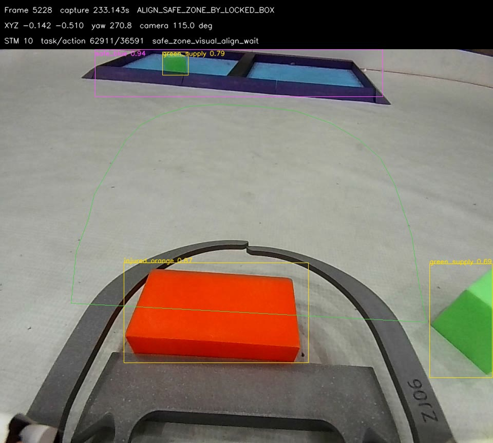
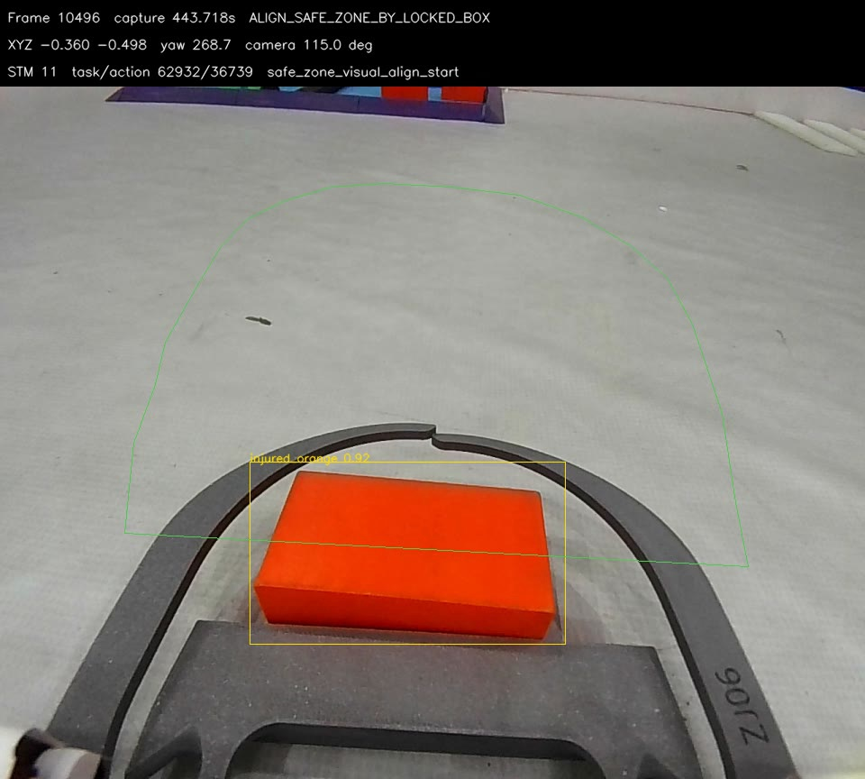

# 最新一局：前段较准、末段搜索点和安全区前都偏

2026-11-18，只分析，不修改业务/定位/下位代码，不启动设备。用户确认末段搜索点与安全区前都偏，并确认发车约310秒后曾拿起车。以下主统计止于307秒，剔除拿起后的明显倾斜和大幅轨迹变化；不能用末尾整段零纠偏或T265跑出场地证明行驶故障。

## 真实会话及证据边界

- 定位日志：`rescue_map/runtime/history/competition_wheel_input/20000101_080236_competition_wheel`，SDK session `7a521126b9880a2c1112933d698067c1`。目录日期异常，依实际会话配对，不能按目录日期认定是旧测试。
- 上位实际 `519fb578ce8a7e869baf6e57461d2bc2c19553c8`；UART真实身份下位 `f1567079ad73fb2fca63f7373dc617c4293d1542 / dirty1`，不以metadata的unconfirmed代替实际回包。
- 业务日志是本次`rescue_map/runtime/competition_events.jsonl`，任务62903起。**同名history/20000101_080236_competition中残留的是另一轮任务287xx日志，不属于此局，未使用。** 本报告evidence.json保存当前关键业务原记录，避免下次runtime覆盖后混局。
- 起点参考单调时刻149.423017624秒，round token `2609b058ed00c5492fa666a9fafdbab3`；下文秒数均减此起点。
- 最新末尾文件不完整、无session_complete；只读完整JSON记录，不修补或覆盖原日志。
- `localization.conf`与上一局081300逐字节相同，SHA256 `71918759382e0bf4279dae6534a860fdd81be9c9492c4990c615b955ad5f1a36`；worker实际`experimental_robust_localization=false`。下位版本变了，不能据此排除所有底盘差异，也不能把已有未提交实验当成这局正式启用。

## 结论：共同的位置估计已经偏，末次往返缺乏雷达纠正

末次载荷在279.24秒启动回安全区，282.96秒程序判到预备点，303.88秒开始回搜索点，306.71秒判到搜索点开始扫描。雷达最后一次Y轴纠正在278.942秒；此后直到本报告截止307秒，没有一次Y修正。Y正是本场朝己方安全区前后运动的方向。

279–307秒的276次雷达计算，仅11次能改X、0次能改Y，265次两个方向都没改。不能把“还偶尔有X纠正”说成整车位置一直被雷达管住。这期间先后依靠轮式位置后备、按原安全区策略禁轮时的T265位移、退出后恢复的轮式后备。两者都只是运动估计，缺少围栏绝对位置纠正后，原有误差或运动累计误差会继续影响两个导航目标。**这条失去约束的机制已证；具体多少误差来自T265、轮滑或先前某次错误墙匹配，还不能凭这份日志唯一分摊。**

视觉有独立佐证，非仅相信地图坐标：

| 同为115°、夹着单橙、对准己方安全区 | 较早一趟 | 最后一趟 |
| --- | --- | --- |
| 发车后时间 | 83.72秒 | 294.30秒 |
| 程序位置X/Y | -0.142 / -0.510m | -0.360 / -0.498m |
| 航向 | 270.8° | 268.7° |
| 蓝安全区框宽（原1280图） | 746px | 587px |
| 原视频/帧 | clip2 / 30 | clip7 / 35 |

程序报的前后位置仅差约1.2cm，末次画面中的安全区却明显更小、更远，框宽缩小约21%。左右位置和视角有小差别，框顶部也有裁切，因此不能把比例直接换算成精确地面误差；但原图与用户“到安全区前的位置偏了”的观察相符。

## 雷达当前情况

| 发车后时段 | 扫描计算次数 | 至少一个方向可纠偏 | 两个方向同时可纠偏 |
| --- | ---: | ---: | ---: |
| 0–60秒 | 599 | 60.27% | 48次 |
| 60–180秒 | 1199 | 25.85% | 62次 |
| 180–270秒 | 894 | 37.92% | 20次 |
| 270–307秒 | 366 | 19.40% | 0次 |
| 末次往返279–307秒（上行子集） | 276 | 3.99%，全部仅X | 0次 |

0–307秒总体至少一轴35.35%，双轴仅130/3058次，即4.25%。不是一路均匀变差，有时恢复一部分方向，最后一次往返尤其弱。与前次同口径的开局30秒相比，这次37.79%，高于前两局约7.67%/14.33%，但明显低于较早20:03/23:29约98.65%/94.67%；不能因为比最差时好一点就认定雷达已经正常。

末次往返期间：

- 物理点数175–179，中位177；约每秒10次计算。连接日志只有一次成功连接，无断连/重连记录，原禁轮也没有关闭雷达。
- 233/276次还能抽出3条候选直线，但270/276次仅能关联到同一面X方向围栏`wall_id=1`；其余6次一面也关联不上。**抽出了线不等于它能用来确定车的位置。**
- 259次含`wall_residual`：按当前车头角度摆放后，点到该墙的偏离超过现3.5cm要求；这一时段拟合残差中位5.36cm。60次另有`enclosing_arena_contradiction`：按候选位置放回地图，有足够多线点落到场地围栏外。两项可同时出现，不相加算总次数。
- 原样例dynamic_localization第2833行（284.147秒）：点177、线3，只关联wall1，拟合残差5.215cm，X被拒；Y根本没有可关联墙，并非已经算出了可靠Y却被到点容差挡住。
- 源码`diagnostic.py:fixed_yaw_position`先要求墙方向相差不超过12°、墙到预测位置偏差小于20cm，再做3.5cm残差和场地包围检查。`dynamic.py:solve_lines_position`已给独立轴修正传入无限修正步长，并有相对两墙/重定位入口。本局不是旧“最多只改10cm”或导航到点就停止修正的证据。
- 20cm属于“先认出是哪面墙”的条件，不是最终纠偏步长限制；如果位置已偏到无法关联墙、又凑不齐相对两墙或二维重定位证据，确实可能接不回来。但本局没有保存这一段原始点云和逐条候选线，不能断言Y缺墙一定由这个20cm条件造成，或断言某物块被认成围栏。最后dynamic_status点云属于已拿起之后，不能拿它反推地面这段。

因此不建议先把3.5cm放宽到5–6cm；若匹配对象就是错的，这会直接采用错位置。下一步应核对实际候选线对应哪面围栏、为何没有Y墙，先分清可见性、方向/距离关联和错误线段，再选最小修复。若需下次保存少量原始点/拟合线，应先明确采集范围及成本；本轮未新增诊断采集或门控。

## T265、轮式和上次修复的核验

1. **禁轮恢复这次已生效。** 原生接收记录与上位发送匹配，共25条阶段策略。7次投送回搜索点均出现SEARCH_TRANSFER恢复normal_motion；末次上位453.366930456秒（发车303.944秒）发出/原生收到恢复，worker453.405539451秒切回WHEEL_FALLBACK。正常搜索不再继承上一轮禁轮。303.88–304.08秒控制位置相邻步最大1.83mm，没有恢复时跳一大段的证据。本局没有扫障路线，不能据此宣称新扫障出口也已实跑验收。
2. **本局大部分时间不是纯T265。** 0–307秒的雷达采样点中，2069次WHEEL_FALLBACK、672次T265_PHASE_NO_WHEEL、317次T265_WITH_WHEEL_TAIL。开局1.225秒即因T265与轮式位移差超过5cm切后备；中间多次满足旧条件后恢复，279.612秒再次切后备。位移不一致证明两路意见不同，不自动证明轮子或T265哪路真错。
3. T265在20.262秒有约6.5cm单步、216.758秒有约21.1cm/5ms单步。第二次前后正式控制输出仍是WHEEL_FALLBACK，相邻步最大0.138mm（control_pose第42598–42627行），并未把原始21cm跳动直接传给导航。不能用这次原始跳动直接解释最后返程偏移。
4. 启动回读：内部建图1、重定位0、跳变0、地图保留0、动态校准1，与当前要求一致。配置关闭pose jumping不等于输出绝不会不连续。
5. 末次入区前稳定朝向时，T265原始姿态投到场地与主航向相差约0.35–0.7°（285/295/300秒抽查），没有发现相差几十度的证据；转动瞬间不把不同采样时刻直接当机械误差。`localization_debug.csv`里的gyro_pose_sync_error是T265自身姿态/角速度内部对比，不能冒充独立主陀螺验证。
6. 拿起后大角度倾斜、原始T265越出场地、最后持续无墙约束，均从地面原因判断剔除。末次正常入区前仍存在无Y纠偏及视觉偏远，故问题也不能全归于人工拿车。

## 保留的未确定项

共享位置误差已经由两目标的现场观察和同角度画面对比支持；雷达缺轴/大量拒绝、运动来源切换和禁轮恢复有原始记录。尚缺这一段真实地面位置、原始雷达点/候选线，无法精确区分轮滑、T265缓慢漂移、错误墙匹配或墙可见性。这次没有足够证据归因于灯光、机械安装或某个下位提交，也不能保证只调一个阈值能解决。

可复核数值见[evidence.json](evidence.json)，只读复算入口[analyze.py](analyze.py)。业务当前日志换局后脚本会拒绝混用；已保存的证据摘要不替代原始完整日志。
