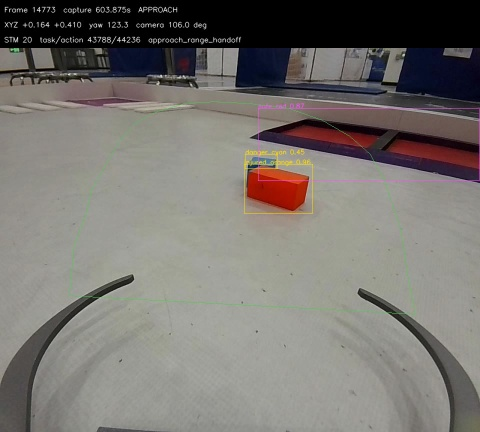
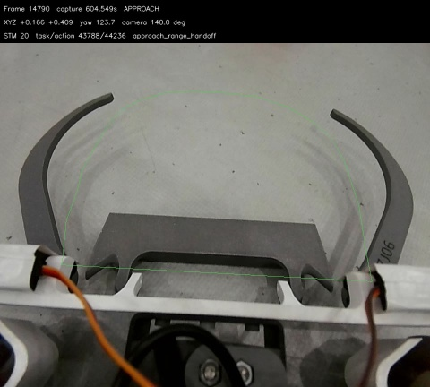

# 蓝方2号，橙88、门口停顿及快速重发核对

上位c7561c6，F405 UART版本e8d5a2d。SDK会话c93a8c3ade78717766fafd0a8dd7b115，定位目录20000101_080052_competition_wheel。业务原始记录取本局runtime/competition_events.jsonl，以下时间用同一系统的单调秒数。仅分析，实施待人确认。

| 场景 | 原始记录和解释 |
|---|---|
| 橙88和蓝90 | clip10录到发出的opcode9，A500/B10500/U0，源帧14732。相邻帧14733橙框中心约210px，落入105°的B2，当前表B2是500mm暂定值。602.450下位进入有限前进，603.890开始低头。编码器前向积分+49.2cm；这段T265投影位移约31cm，两者有差异，无法单独认定打滑或地面距离。段末录像显示橙仍在张爪前面，低头过程中移出画面上沿。 |
| 低头后退出 | 604.850下位mode21/140°；604.88上位抓前分区查不到目标，发HOLD。604.88–608.90保存的检测帧没有框，604.85–608.87前向轮程为0。608.870下位mode24，随后轮反馈前向约−30.5cm，611.270回搜索。图见下方。另一次615.68橙99抬105°后触发区内取消，615.68–616.94前向不足数毫米。 |
| 蓝绿可分时仍退 | 任务15598，344.715下位mode38；接连接受三个抓前补进动作24738/39/40，各回38/DONE。345.26采样左蓝绿、右绿，组成随后有变化。348.675最后一次回38，348.73上位仅开始保留侧投票；下位348.734接受审核opcode18，348.856转mode24，未见该段接受分离或双开。与下位抓前共用4000ms时限吻合，回包没有细分逃逸原因。单蓝中途出现与已走完只剩蓝必须分开；单蓝独立触发后退的现场链尚未坐实。 |
| 门口约5s | 12次运输审核0.557–0.771s，中位0.670s。全局7次UVC恢复，5次发生在门口转正阶段，相机均报120°；约3秒设备节点才重新出现。例406.405审核通过，406.585读取失败，410.782恢复识别，412.417请求推进。另有补位磨时，514.866与先前一次都出现对准后重新补位。应用日志不能区分供电、线束或USB驱动原因。 |
| 短3重发 | 532.365人工STOP，544.141只记一次有效resume请求。定位544.148登记重发参考，544.331比赛程序恢复，保留8次投送。544.370下位mode1，544.391出现大于0.08m/s轮反馈，549.950回搜索。按键层30ms防抖、长3约1秒归预热、组合键与STOP序号均影响是否走入start。当前缺少两次物理按压的分类记录，不能判定第一次漏读、被忽略或已生效。 |
| 重发围栏航向 | 用原始扫描、匹配scan_id的拟合、主gyro/轮反馈复用离线wall_angles。分别按两次field_reference_set分段、排除STOP摆车区间与末次STOP之后数据。首发后前8s有12个低运动双墙样本，中位+2.68°；重发后前8s有5个，中位+1.23°，这5个含重发起步后样本。其后至末次STOP的197个样本中位+1.27°（10–90%约+1.04至+1.49°）。两次地点参考都是(1.321,1.321)m/45°；记录显示确实重新绑定参考。不同摆放与墙段会影响差值，不能把两次角度差直接当成陀螺漂移。 |

讨论中的最小方案：对105°橙块B2长段先同角复测再决定是否低头，蓝绿已有明确可分侧时先处理原分离而非重复补进；约束单蓝退爪所用的实际行程完成证据。保留原批次的物理退出与分离次数语义。快速重发按键如需继续定位，只记录按键事件及处理结果；快速重发加双墙yaw需核对上下位场地航向一致性。均待用户确认。
