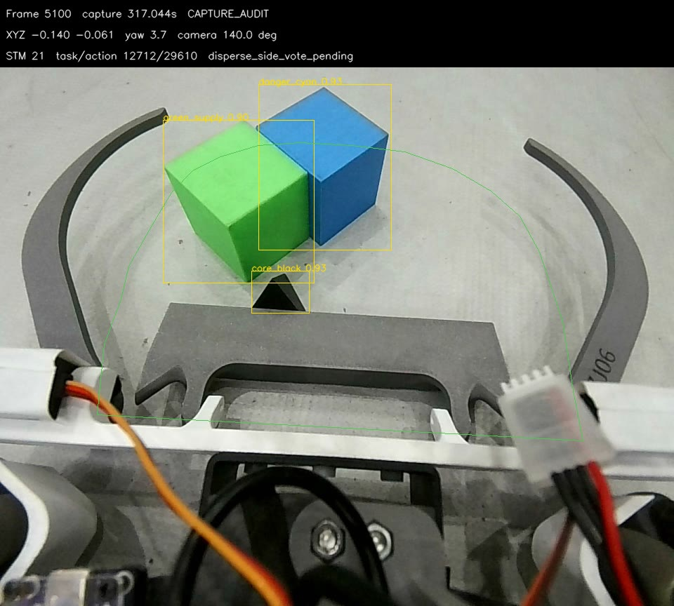

# 最新一局：门口停顿的构成与同侧混蓝放弃方案

本轮仅分析/方案，未改运行代码或下位固件，未启动设备。用户要求解释门口审核，并分析“一侧蓝＋有用物块、另一侧空时，不分离而放弃、后退、回寻找点”的改法；具体新动作尚未实施。

## 真正实跑会话

本局上位d92f45183a9136a4e1dc7585123013f3b99fefbe，actual F405 f1dd0464d7de72b8f3489edef66dc1c3f6da4848/dirty1，firmware_id=cfa4a40c0e5747dd6ff0edd79c2f88802570f5879bcb52f9adf61f7dc98b01eb，蓝方1区，开赛单调59.581943213秒。当前session.json指向history/competition_wheel_input/20000101_080057_competition_wheel，sdk_session_id=1bc6425991deaba1bea5bc0ccfbefad7。日期前缀异常不代表旧比赛；已按会话指针、运行提交、启动事件及UART实际身份确认。原始日志不改名、不覆盖。

业务源为rescue_map/runtime/competition_events.jsonl及competition_detections.jsonl；本目录evidence.json保存相关事件原行号、审核/恢复区间、识别记录及CRC正确的UART上下文/状态。已读取对应下位Task.c、app_config.h和交接文件；该版本已有aux4入口且橙分离额外角常量为0，不能继续用旧1136492未配套的状态描述本局。并非因此宣称所有新功能已实测通过，dirty差异亦不可从Git还原。

## 门口不是一直在审核：主要长停发生在审核之后

13次通过的运输审核，开始到确认耗时0.590–0.808秒，中位0.678秒。另有一次首绿复审确实看到了绿＋黑而转入分离，不计入这13次正常通过统计。

本局9次相机读取错误，每次从camera_error到首帧恢复为4.177–4.281秒，合计38.085秒。其中8次在transport_audit_confirmed之后0.047–0.305秒发生。日志报GStreamer poll/read error，随后相机重开报by-id节点暂未出现；这段上位走原camera_recovery PAUSE，不能把它算成载荷仍未审核通过。

原重试顺序为立即重开失败→约1秒后重试仍失败→再约2秒后重试→打开耗时约1.1秒→新图恢复。4.2秒是整个恢复过程，不证明设备物理掉线持续了4.2秒；原日志没有节点实际重新出现时刻。故障与140°看爪后转120°看安全区高度相关，但尚不能唯一确定线缆牵拉、供电、USB/驱动等哪一种物理原因，不能据此直接判定舵机或模型故障。

典型区间（均由事件相减，审核包含原上下位交接）：

| 载荷/区间 | 门口过程 | 其中载荷审核 | 相机故障恢复 | 额外补位 |
| --- | --- | --- | --- | --- |
| 首次橙，150.376→157.598 | 7.222秒 | 0.721秒 | 4.258秒 | 无 |
| 黑材料，295.006→304.388 | 9.382秒 | 两次合计1.310秒 | 4.209秒 | 有 |
| 绿黑材料，325.057→335.687 | 10.630秒 | 两次合计1.269秒 | 4.221秒 | 有 |
| 材料，272.440→276.852 | 4.412秒 | 两次合计1.338秒 | 无 | 有 |

这些门口过程从第一次运输审核开始，到发起ENTER为止；不是全部静止或同一状态。其余时间包括转正、视觉找区/横移及补位。全局5次前后补位中，4次普通运输重走140°复审；清障找回单橙那次沿已有免重复审核资格继续。定位回报要求补位不证明地面车身一定偏了同样距离。

## 当前详细流程与审核内容

1. 带已抓载荷导航到围栏前600mm预备位置。下位报导航完成，上位进入运输复审；当前已确认单橙找回的复用分支除外。
2. 保持合爪，停底盘，相机看140°爪内。下位每次mode48入口清本次审核，并走原250ms观察准备；即使进入时相机已是140°，也没有自动省去这一步。上位按原准备完成/图像交接承接，未额外新加等待。
3. 看人工爪内ROI中实际可见载荷的类别、件数、左右组成和识别质量，不只看原锁定编号。首绿只允许一个绿；之后允许单橙，或绿黑总计1–3件。蓝、橙材料混装、多个橙、超量和未知组合不直接运输。真实混入新类别会撤销旧许可。
4. 用原至少两次、采样间隔/跨度100ms的稳定审核，并等待下位实际READY/VALID和本次上下文接受。漏框和真实矛盾分开处理；已经确认闭爪且未释放的载荷，持续漏框另走原短复看/2秒续运出口，不伪造本帧有物。
5. 合法后更新实际载荷及材料/伤员目的地，再核对当前定位半区。实际载荷改变导致目的地变化时重新到对应预备点；非法则分离/释放。本局首绿到门口看到绿黑混装就是一次真实复审拦截。
6. 相机120°，先定位朝向对准，再连续3帧锁本方安全区，横移对准7/24材料位置或17/24伤员位置。无框0.5秒后按原流程抬115°找区。这里在看安全区，不是在继续数爪内物块。
7. 横移后复核前后位置：定位结果偏出原±5cm容差则保留横向修正、前后补位，再对准；普通载荷补位会重新进入140°审核。因此会看到同一批物体在门口审两次。
8. 到点、转正和横移完成后，才按115/120人工扫障区域判断前方物块；蓝色中心、其他类别底边中点。无障碍才ENTER；需扫则原清障/找回。推入后的视觉投送确认是另一阶段，也不是门口载荷审核。

对应上位：state_machine.py的_begin_transport_audit/_transport_audit_output、_audit_observation_wait、_audit_valid及预备点补位分支；run_competition_rescue.py相机错误恢复主循环。下位[固定提交Task.c](https://github.com/kkkkkkkkkkkkkkkk222222/F407-Rescue-Robot/blob/f1dd0464d7de72b8f3489edef66dc1c3f6da4848/Main/Src/Task.c#L8197)保持250ms准备及两样本审核。代表原回包：151.048为task12705/action29506 mode48审核DONE；151.109已接受ALIGN并报相机120°；151.312才相机读取错误，明确是通过后的故障。

优化建议首先处理相机读取故障与节点短暂消失，下一步可人工核对140→120时线缆牵拉、接头/供电和USB证据，不能把硬件候选直接写成根因。若另考虑减少补位后的重复审核，应明确同次闭爪、无矛盾情况下怎样沿用许可及少一次复审的代价；此项仍是待讨论优化，不借本轮分析直接删审。

## 同侧混蓝：现场确有“保住这一侧”而保不住有用块

- 单调98.168（开赛38.586）第750帧，稳定审核形成右侧两绿＋一黑＋一蓝、左空；98.520仍要求保右分离。原UART task12704/action29475于98.549接受、100.529完成，随后又进行下一次分离。此例包括首绿阶段，并非只在后期发生。
- 单调368.551（开赛308.969）第6241帧，右侧绿457框(685,109,234,162)、蓝458框(670,252,265,234)，左空；368.573上位保右分离，task12718/action29638于368.607接受、370.586完成。分离后第6292/6293帧只剩蓝框，370.845再请求双开。该段没有原视频，不能把检测结果说成独立接触力/实物位置测量。
- 也有成功对照：317.149原帧5100/视频7，左侧绿＋黑＋蓝、右空。317.248接受action29611，320.067完成；320.610复审剩合法绿黑并继续运输。因此同侧不是绝对分不开，新方案是放弃部分成功机会以减少低收益反复尝试。

现有_side_is_disperse_candidate在有蓝时，只要该侧还含绿/黑/橙等有用物块，就允许该侧作为分离尝试对象；没有要求另一侧非空，也没有单独排除蓝与有用物在同一侧。_start_danger_release据此进入保侧分离。左右是现有140°人工分区归属，不能等同于机械已经能把该侧内部不同物块拆开。

## 按用户方向的最小方案，待确认动作细节

触发：沿现有完整稳定140°审核，一侧有蓝且有绿/黑/橙等可抓类别，另一侧确为空、没有未分侧物体；左右对称。不把普通画面远处蓝框当爪内混装，也不以一帧漏框当另一侧已空。放在真正发起分离前，覆盖抓前、抓后及运输复审，首绿正常抓取也适用；开局进攻非空搬堆没有进入正常分离的例外不因此改写。

建议过程：明确结束这批→张开双爪放下→保持原朝向后退脱离→直返本次来源观察点①或③→沿原到点朝中心/搜索规则重新找。回的是本次来源点，不擅改成另一点或固定回①；结束批次不计投送、不消耗前三轮找新载荷次数，不改变下一目标优先级。途中不重新抢刚放下的那一堆。

两端必须核对实际出口：现f1dd046普通非法RELEASE_BOTH进入mode24的task_process_capture_escape，已自带张爪、后退300mm/300mm/s；未达到原两次分离阈值时，还会固定转90°再SEARCH。不能假定RELEASE_BOTH只有张爪，也不能再叠一段额外后退，更不能伪造“已经分离两次”来跳过90°。

最小建议先沿用现有300mm脱离段，对这一个明确放弃原因省掉后面的固定90°；后退完成才把空爪归属交回上位，接原step13直返来源点及到点搜索。下位需要单独承接这个退出原因、保留真实完成/取消和旧批预算清理；协议标识及源码改动应在实施时两端核对，不能只改上位选侧。**退让距离是否继续用现有30cm尚需用户确认**，不要借进攻10cm参数或另自选距离。其他分离动作不改。

边界：蓝与有用物分别在左右两侧，或另一侧已有可合法保留的载荷，继续原策略；仅同侧混蓝且另一侧空才触发本方案。该规则会主动放弃仍可能拆开的绿/黑/橙，换取更可控的离开时间；回观察点也有路程成本，不宣称每种场景都更快。
