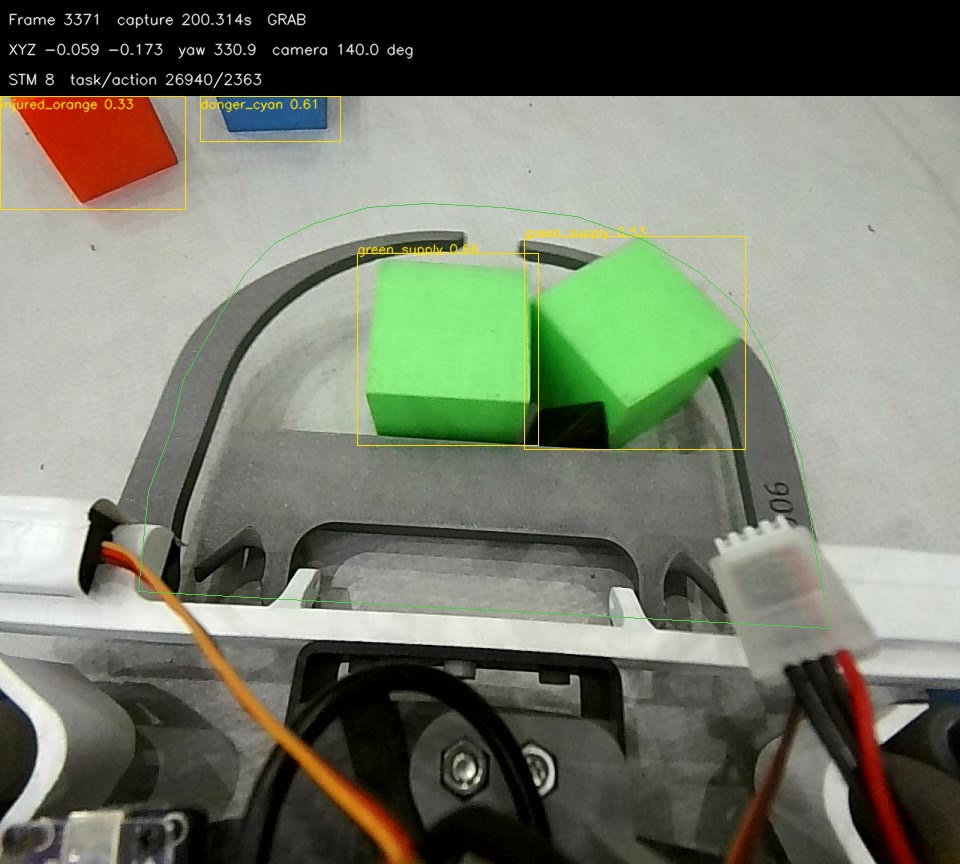

# 最近两次定位支撑变弱与两绿一黑长审核

本轮只读分析，未修改运行代码、参数、原始日志、人工ROI或下位固件，未启动设备。结论不以当前未提交实验、旧文档或请求版本代替实际运行身份。

## 会话和代码对比

最近两次均上位ebca61cabcbf6013d680b4eb11af1e88ca1a9cc0、actual F405 f1dd0464d7de72b8f3489edef66dc1c3f6da4848/dirty1、蓝方1区：

- 前一次：20000101_080121_competition_wheel，sdk_session_id=8219ca5f5b8986c3f9d0dc3278f4251f，开赛单调84.059516100秒。业务已归档到history/20261118_034119_competition。记录只到开局进攻返程，缺正常停止结尾，不按目录的2000年日期判作旧比赛。
- 最后一次：20261118_034119_competition_wheel，sdk_session_id=9141d2e228976545403c3d07c75327c0，开赛59.607084544秒，人工停止约299.742秒。本轮业务源为runtime/competition_events.jsonl和competition_detections.jsonl。
- 基准：此前已分析的20000101_080057_competition_wheel，上位d92f451，下位同f1dd046/dirty1。本局不是“定位绝对正确”的地面真值，只作可比软件/日志基准。

三局UART回报firmware_id均为cfa4a40c0e5747dd6ff0edd79c2f88802570f5879bcb52f9adf61f7dc98b01eb。保存的localization.conf逐字节相同，SHA256=71918759382e0bf4279dae6534a860fdd81be9c9492c4990c615b955ad5f1a36。轮速SDK配置相同；T265最终回读均建图1、重定位0、跳变0、地图保留0、动态校准1。worker_started均experimental_robust_localization=false、primary_yaw_phase_ms=0。

d92f451→ebca61c的可见上位提交只涉及业务、相机恢复、检查和文档，没有修改localization模块。当前磁盘定位程序/库mtime分别为11月17日15:30和00:29，早于这些测试；没有每局独立ELF/so哈希，故不能以mtime绝对证明所有未记录部署都没发生。工作区仍有未提交实验，已保留；日志明确实验开关关闭，不能把这些文件的存在当作实验已上车。270～400横移也不能按书面交接认定已烧录，三局实际固件标识相同。

## 定位最明确的变化：雷达提供的有效坐标约束显著减少

统计从正式参考建立后开始保存的雷达定位记录，到本局停止为止；正式发车前绑定参考的约0.2秒也在这些记录内。末局人工停止后的巨大位置变化不计入赛程结论。

| 会话 | 已保存雷达定位记录 | 无可采用轴 | 仅X | 仅Y | X/Y同时 | 至少修正一轴比例 |
| --- | ---: | ---: | ---: | ---: | ---: | ---: |
| 之前基准局 | 4021 | 2186 | 573 | 913 | 349 | 45.64% |
| 最近前一次短局 | 222 | 212 | 4 | 6 | 0 | 4.50% |
| 最后03:41局 | 2393 | 2055 | 69 | 264 | 5 | 14.12% |

两次并非没有收到雷达：每次参与处理的原始点数中位仍约177，扫描时间跨度中位40.75ms，与基准一致。提取到的线数中位由3变2；大量候选轴报wall_residual或enclosing_arena_contradiction，即线与所假设围墙不吻合、或某些点无法落进同一个3×3米场地。不能把“收到了雷达”说成“雷达有效纠偏”。

两局启动后分别约85.268、69.711秒切入WHEEL_FALLBACK，原因是T265与轮程位移不一致；这在基准局也发生过，不是这轮新加的行为。之后可用围墙约束变少，轮式后备/运动估计的误差便更难被拉回。末局只有5次X/Y同时可采用，不能把T265高置信度当作位置已经准确。

雷达重新找到约束时仍会产生明显坐标变化：前一短局84.011秒、刚绑定参考后Y被修正约17.85cm；末局129.170秒在寻找橙色时，经相对围墙重新约束Y约30.04cm，158.691秒另一次约27.42cm。它们是定位坐标的修正，不是车在地面瞬移，也不能仅凭变化量就判定修正方向错误。evidence.json保存对应原扫描记录和采用轴。

**能确认的是约束大量缺失及坐标修正跳动；还不能唯一确定雷达几何为什么恶化。** 现有摘要不含每次被拒绝时的完整原始点云，无法在离线复算中分清现场遮挡/扫到物块、朝向或安装偏差等具体物理原因，也无独立地面真值量化“实际偏了多少”。不能直接放宽围墙阈值、把可疑线硬当墙。

## 旧阶段切换缺口仍然存在

LocalizationWheelPolicy在安全区阶段暂停轮速输入/轮式后备，原意是接触推送时避免打滑轮程带偏；但其恢复判断主要覆盖旧RETURN/NAV流程，没有完整覆盖当前step13/14回搜索点和后续普通搜索、抓取。

末局145.378秒进入T265_PHASE_NO_WHEEL后，直到173.698秒下一次运输NAV才恢复；期间已经送完、回搜索点、再次抓取/分离。183.409→210.539秒也如此。实际native_motion_events和dynamic_localization均能确认，不只是根据状态名猜测。基准局亦有同一缺口，所以是旧问题继续暴露，不能写成本次相机提速新引入。

可讨论的最小修复：确认离开接触推送阶段、空爪退出并进入现有搜索转移流程时，恢复原普通轮式后备/比较；安全区推入和接触扫障保留各自处理。该入口本身已有阶段策略通道，先核对真实完成归属，不引入新的时间门或全局停车，不恢复整包归档融合。本轮没有实施。

## T265瞬跳与时间记录核对

按实际运行窗口读取pose_motion相邻记录，三局都未见投影XY单步超过4cm（基准83141条、短局5595条、末局47976条；不含人工停止后的数据）。这不排除平滑累计漂移或比例误差，不能当精度通过，但不支持把本次解释为旧的“5ms飞出2米”。末局停止后27次phase_SDK_coordinate_jump_bridged及数米/十几米异常不用于解释运行中偏差。

另核对了前次系统校时、末局SDK时间换算回退约228ms。原始pose_motion里有46条估算时间不递增，但实际motion接收层已有receive_monotonic_ns兜底，dynamic记录的last_raw_pose_ns仍推进；不能仅凭原始估算时间就声称丢了46帧或把它直接定为定位主因。本轮不新增时间检查。

## 两绿一黑：约8秒等待来自框重叠规则

定位到最后一局task26940：抓前原审核确认为两个绿色270/273和一个黑色281，三件合法。197.877秒下位接受合爪，200.398秒进入mode23抓后审核。随后直到208.797秒才进入mode50，210.356秒才mode22完成；上位210.434发起返航。

| 单调秒 | 发生的事 |
| --- | --- |
| 197.877→200.398 | 合爪动作，约2.52秒 |
| 200.398→208.797 | 抓后审核被遮挡规则挡住，约8.40秒；203.937相机138°、207.837相机142°，各回140°复看 |
| 208.797→210.356 | 两绿触发原mode50滤除机械流程，约1.56秒；不是仍在等待合法审核 |
| 213.082→213.621 | 到预备点再审，约0.54秒；此时识别到两绿，黑不再计入 |

当前三件规则确实生效，问题不是把三件一律判非法。本段没有camera_error，不能套用前一局4.2秒相机断流原因。

连续原记录的capture_observation_reason=claw_targets_occluded。两个绿及黑都被人工爪内ROI纳入；例如3382帧，黑框(658,399,127,69)约92.8%的面积落在右绿框(628,168,277,295)里，3536帧仍约90.5%。这是**识别框彼此重叠**，不是黑块落在爪内ROI外。模型还在给三块出框，上位却把整帧审核结果置为不可用，发送非STABLE占位，无法累计合法审核。

第二次相机142→140复看后，3565帧黑框被绿框覆盖比例约81.5%，低于原85%阈值，审核才开始累计并通过。两次3.5秒原复看窗口解释了主要等待。原“漏框2秒后已确认载荷续运”没有解决这类情况，因为这里是有框但被判遮挡，且处于抓后初次确认阶段。

源码在run_competition_rescue.py:1057附近：任意两框一方覆盖比例≥85%触发遮挡；明确多目标的例外只允许mode21/35/37/38，不包含抓后mode23及运输复审mode48。git blame显示85%判断及这组模式例外来自10月16–17日，非最近恢复提速修改。近期三件运输放开后，合法拥挤载荷更容易碰到这个旧限制；抓前认可三件、抓后又因同样框重叠阻断，规则未完整衔接。

建议最小方向是让抓后/门口也能把这些真实独立绿黑框送入原类别/数量审核，复用已有明确多目标例外的条件；不把“遮挡”直接等同“合法”，不补造漏检物块、不取消三件上限，不把蓝/橙混装放行。需要先确定允许条件及异常边界；上位是主要修改点，下位继续原真实稳定审核与两绿滤除流程，无需为此新增等待。本轮仅提出方案，未改代码。
