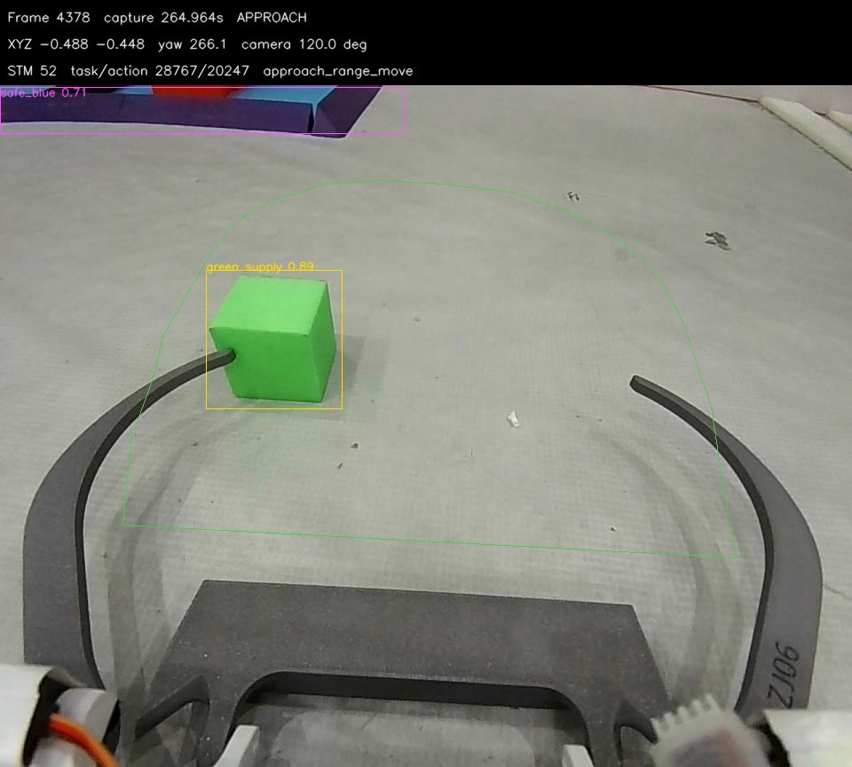
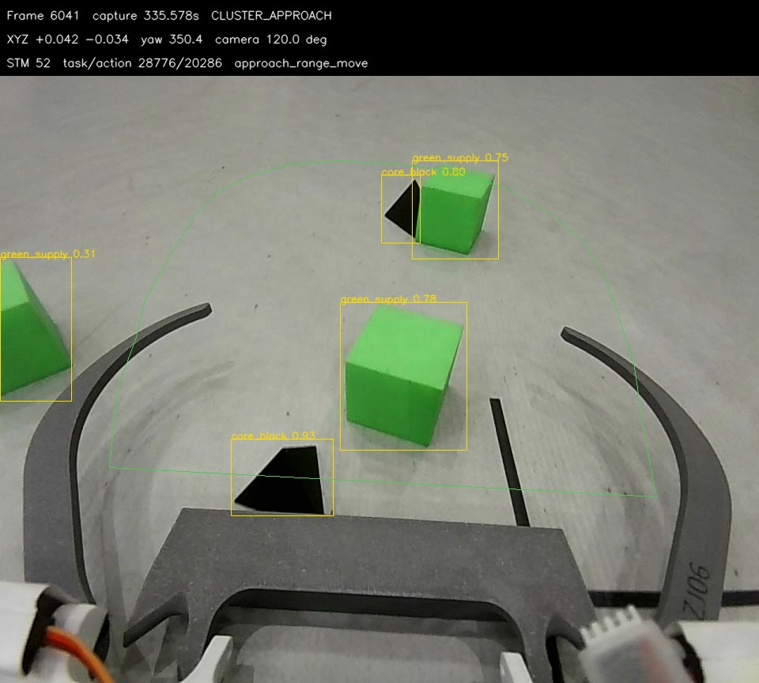

# 最近两局定位与定距完成后等待5秒再搜索

本次仅分析、离线复现和记录，未修改运行代码、定位参数或下位固件，未启动设备。

## 实跑身份与窗口

最近两次均上位fd1fea8b1bfdc44bde1a52e479cf4d46dd03870c，actual下位f1dd0464d7de72b8f3489edef66dc1c3f6da4848/dirty1；firmware_id仍为cfa4a40c0e5747dd6ff0edd79c2f88802570f5879bcb52f9adf61f7dc98b01eb。没有以交接中的270～400或新退出要求当作已烧录。

- 前局：history/competition_wheel_input/20000101_081057_competition_wheel，sdk_session_id=be1e36b0cef44814c8784c9b1e8309ad。业务归档为history/20000101_081300_competition。开赛单调68.700315479，业务保存到约99.672，仅约31秒开局片段。
- 末局：history/competition_wheel_input/20000101_081300_competition_wheel，sdk_session_id=5ac77fc3184b934ff310024ee8047039。业务为当前runtime/competition_events.jsonl/competition_detections.jsonl，开赛55.479940859，末条约496.150。
- 两局均无完整正常退出尾声，保护原始日志，不把后续定位记录擅自当完整比赛过程。日期2000年是未校时目录，已用实际身份和会话关联确认顺序。

## 1. 定位：重新核对后仍有明确异常，不能直接宣称地面误差值

两局localization.conf的SHA256均71918759382e0bf4279dae6534a860fdd81be9c9492c4990c615b955ad5f1a36，与此前对照相同；worker实验开关关闭，原配置和阶段逻辑没有因fd1fea8材料重叠修复改变。当前存量未提交实验未动，也不能把它们存在当已启用。

按正式参考建立后保存的雷达记录，截至各局业务末条统计：

| 会话 | 雷达定位记录 | 无可采用轴 | 仅X | 仅Y | X/Y同时 | 至少一轴可采用 |
| --- | ---: | ---: | ---: | ---: | ---: | ---: |
| 最近前局 | 311 | 288 | 4 | 18 | 1 | 7.40% |
| 最近末局 | 4172 | 3637 | 54 | 477 | 4 | 12.82% |

即接收到了雷达，并不等于位置正被雷达持续修正；尤其X方向约束很少。前一短局还没到安全区，不能用“离区禁轮恢复遗漏”解释它：该段主要已记录问题是雷达约束不足、轮式后备运行，以及开局运往进攻点时87.167秒Y约41.67cm修正（原Y=-.153→.263）。末局最大单次约28.19cm的X修正发生在353.063秒，另有多次约16～20cm修正。它们是控制坐标变化，可能在纠正先前偏差，也可能含错误墙匹配；没有地面真值不能断言实际车身偏了同样距离或雷达这一下必错。

末局另有已核实的旧阶段问题：245.741秒安全区阶段抑制轮式后备后，直到284.448秒下一次运输NAV才恢复，期间包括投送退出、回观察点、重新接近及失败恢复；316.985→352.731也如此。有的RETURN出口能恢复，有的未接上，原判断未完整覆盖新step13/14返观察点。雷达又大量不可用时，长时间沿用该状态会减弱定位的纠偏能力。

两局运行记录中的T265投影轨迹相邻步均未超过4cm（前局6187条，末局83427条），不支持本次是“瞬间飞出几米”；不等于平滑漂移不存在，也不是精度验收。定位问题仍需优先讨论阶段恢复入口，并核对失败时的实际墙线/点云、朝向参考与现场遮挡。现有摘要不够唯一判定具体物理根因，不能只调容差或强行放宽围墙阈值。

## 2. 定距后卡住：原始回包证明完成了，上位仍停在旧请求

末局确认4段相同现象；前局只有短开局记录，未把其中所有丢目标都归成这一原因。

| 目标 | task/action | 下位本段完成52/DONE | 进入恢复 | 等待 |
| --- | --- | ---: | ---: | ---: |
| 单绿301 | 28767/20247 | 264.270 | 269.251（UART） | 4.981秒 |
| 聚堆绿368，黑也在爪前 | 28776/20286 | 335.618 | 340.658（UART） | 5.040秒 |
| 黑482 | 28781/20332 | 429.037 | 434.018（UART） | 4.981秒 |
| 黑526 | 28784/20351 | 471.937 | 476.999（上位观察到mode24事件） | 约5.06秒 |

evidence.json保存CRC正确的0x1E上下文与0x17状态、原行号及对应业务事件。完成指的是本段轮程/动作完成，不代替卷尺证明实际地面距离精度。

前两段有原录像。第4378帧目标301仍可见，框(310,277,203,209)，下位mode52/action20247/status3；上位仍重发A460/B12000/U1/source_frame4313。第6041帧目标368和近处黑369均可见，下位mode52/action20286/status3；上位仍重发A460/B12000/U1/source_frame6002。没有到140°抓前观察，也不是模型没有框。

## 3. 已离线复现的直接代码原因

run_competition_rescue.py::CompetitionPlanner._output_for_cycle有52/53提前分支，直接把原StmSnapshot传给_range_approach_output。load_stm未填写context_matches，因此默认False；虽别处能计算当前task/action是否相等，这条分支没有把结果传进去。

state_machine.py::_range_approach_output接受aux1分段DONE时，明确要求context_valid、context_matches、本次APPROACH命令及DONE。现场task/action实际相等、下位也已经完成，但context_matches始终False，导致该函数在读取后续目标画面之前就返回旧range_command。于是画面有框也不会重新测距/对准，旧460mm请求也不会成为新的行程——下位按原同action幂等只确认，不重跑。

[reproduce.py](reproduce.py)只读取原帧4378/6041，调用当前正式planner入口，未开线程/相机/串口：[复现结果](reproduction.json)均为approach_range_move，range_epoch不变。对照仅按实际相等的task/action填回匹配结果，再调用同一个既有处理函数，旧range_command被清掉、epoch加1，正常进入下一张图测距等待；并非删检查或强行接受任意DONE。

下位固定f1dd046的[Task.c](https://github.com/kkkkkkkkkkkkkkkk222222/F407-Rescue-Robot/blob/f1dd0464d7de72b8f3489edef66dc1c3f6da4848/Main/Src/Task.c#L3151)在aux1本段走完后回52，保持测距角并置DONE；APP_APPROACH_RANGE_WAIT_MS=5000，等不到后续新action就进入24，再回3。这正对应约5秒等待。不是下位没完成轮程，也不是定位侧判断没到目标点。

## 4. 相机应该怎样接续，最小修改方向

- 普通最终接近段aux0：轮程结束后，原下位转140°，再进入原抓前观察/有限补进流程。
- 框贴顶且最远B1的aux1：本次只是一段接近；走完先保持120°（若原105则保持105），上位用新图重新对准/测距，最终段完成后才140°。不是每走完460mm都直接低头抓，否则会恢复“远目标只走一段就提前抓”的旧问题。

最小修法应在正式52/53分支按当前task/action传递真实匹配结果，拒绝/重新接管上下文后也重新计算；保留旧action不能完成新段的检查。必要验证应覆盖真实planner入口、普通/聚堆、匹配DONE续段、旧DONE不推进及aux0原140°交接，而不是只测试_range_approach_output并手工预置context_matches=True。此处是上位衔接修复，下位现有aux1流程已按原记录完成，无需先改距离表、增加等待或改成强制140°。本轮按用户要求仅分析，未实施。

## 后续授权修复

用户明确批准最小修复。本次只在正式52/53快捷入口处理可能的拒绝/上下文接管后，重新按当前protocol_task/protocol_action与真实回包比较，使用replace(stm,context_matches=matches)传给既有_range_approach_output。原测距/相机流程未改，无新等待、握手或下位字段。

6项必要检查通过：冻结原帧4378/6041在正式planner入口完成交接、同一DONE不重复推进、像素回正后新最终段aux0、任务/动作任一不匹配仍不推进、相机恢复期间不发新距离，以及原标定/140°交接/分段边界检查。测试位于tests/test_range_handoff_match.py；reproduction.json和reproduce.py保留为dab3ab8时的原故障证据，后者的旧行为断言不代表修复后预期。未启设备，地面待实测。
