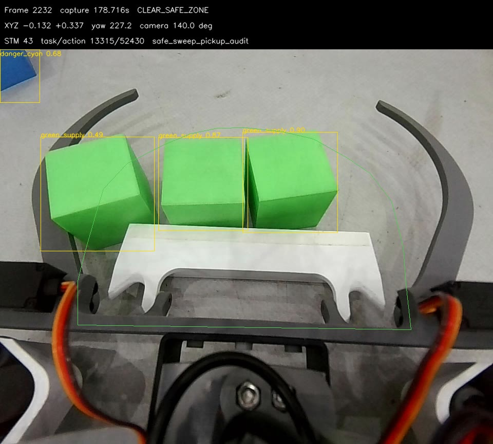
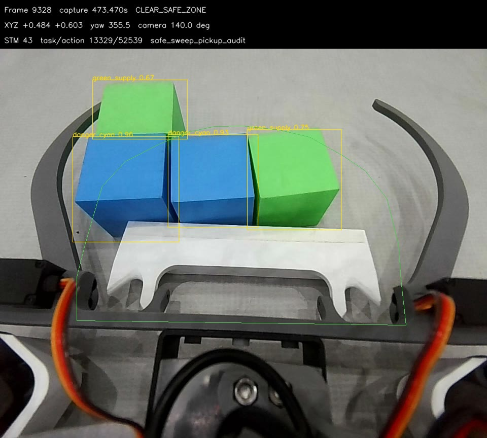

# 最近一次正式运行：分离、清障与搜索卡住的取证

2026-11-13。本轮只分析并等待用户选择，不改代码/配置，不启动设备、电机，不清日志，不发布新的下位实施任务。

## 实际会话

- 业务：rescue_map/runtime/competition_events.jsonl及competition_detections.jsonl；已停止，尚未移入history。
- 传感器：rescue_map/runtime/history/competition_wheel_input/20261113_134947_competition_wheel/。
- round_token=e28f8bf75c837ce56809f4f86759513f，SDK=5a856eb6443d1616be03a22277968b7e。
- 开赛单调时刻84285779798ns；本文时间均减去该时刻，和图片头部的开机单调秒数不同。
- 上位a88b031；chassis_identity.json实际下位13b5cc7/dirty1、NormalRun/TASK、921600。
  本轮只读核对该提交Task.c blob=6bb899d1566358ce071b7fc775ae16247cff550c；dirty烧录内容未知。
  对端main比该提交多一个平移最低请求改200的提交，回执明确未烧录，不能当成本次实际参数。
- 最近134858/134931/134947历史业务目录是未开赛预热，不能用它们解释本轮实车。
- 825.639s程序停止，770.841s已记录人工停止；投送计数不是实车得分/合规证明。

## 1. 第一趟绿色卡住：主要在安全区视觉ALIGN，并非一直没过合爪审核

12.485s开局藏堆已GRAB，13.229s已去藏点；首个正式绿色37.141s允许合爪，37.818s已去预备点。
42.448—43.310s运输复审后进入ALIGN，44.657—85.588s却一直处于视觉横移对准，耗40.931s。
capture_decision反复在safe_zone_visual_box_missing与safe_zone_visual_align_wait之间切换。
同区间留存330个检测帧，188帧没有safe_red；这是留存样本，不等于完整50Hz流。

state_machine.py:6506附近在无安全区框/被过滤/相机角度不符时发送PAUSE并保留横移动作；
恢复后继续实时像素，故会出现“爪内有绿但反复不动/动一点”的表现。
本段不能简单归咎“绿色数量审核太多”，更不能用删除首次单绿规则替代定位。

85.634s才转入CLEAR_SAFE_ZONE，原因明确是“保留此前漏检的green_supply阻挡”。
首件前把独立过道绿色算阻挡本来符合只送一件的要求；但当前记忆是旧图像bbox，
make_vision_snapshot会把已退出tracker的recent_corridor_obstacle作为visible=False重新加入候选，
候选又可反写下一帧记忆，直到特定状态/视角切换清除；没有因车移动而重新投影该旧像素框。
因此历史框可以继续触发扫障，不能说此刻仍看到同一位置障碍。触发帧没有保存所记ID，
不能武断断言被扫的是爪内绿色或某个指定旧ID；用户观察到的独立过道绿色与早期原帧记录相符。

## 2. 三绿不分离：清障取物只审核目标一个，确有代码/原图证据



第一段回放safe_zone_replay_0001，frame2232，约94.430s：三个绿色均有检测框，
track205/212/214均visible；当前mode43，命令为CARGO_AUDIT，total_count=1、left_green=1、sweep_pickup=true。
随后94.71s板端进入mode39，上位记录pickup_grab_started=true，未走正常DISPERSE。
这不是“模型没识别到其他两块”，也不是正式运输规则被放宽到了三件。

run_competition_rescue.py:966—989：

```text
sweep_capture只保留capture内track_id等于sweep_target的一项
recovering_original=False → 不恢复整爪计数
audit_from_cargo(sweep_capture) → 给下位机发送只含这一项的清障审核
```

正常抓取及找回原载荷会审核整爪；清障取障碍另走一套筛选，所以“先夹进来再正常分离”并未覆盖这条路径。
实际板端Task.c的sweep审核又以nonempty判断，不能假设只改上位计数就会自动转到普通分离。
若修复，需要明确整爪观察、锁定障碍身份与合法分离三者的职责，以及mode43到已有分离的两端衔接。

## 3. 蓝色为何有时放弃、有时一起抓：两套分支不一致

- 普通CAPTURE/AUDIT或DISPERSE发现danger_present时，优先转_start_danger_release，
  而不是继续普通选择性分离。蓝色独占一侧才释放该侧，同侧混合/无法确认纯蓝侧时会RELEASE_BOTH；
  若cargo_recheck_pending，当前合同路径还直接要求both。
- 本轮449.233s释放左、528.167s释放右；510.460s蓝绿同侧则“无法可靠分侧，强制RELEASE_BOTH”。
  不是蓝色检测必然让程序永久停止，而是这条策略会放掉可取得的绿色。
- 清障却专门允许把蓝色作为取物目标，且仍只审核锁定的那一个；
  约389.184s，frame9328，两蓝与绿色并存，mode43发布的是单蓝total_count=1/sweep_pickup=true。
  同一机制让人看到“平常不抓，有时又整堆蓝绿抓进去”，并非一套分离逻辑反复随机选择。



## 4. 本轮旧清障对投送的实际结果

| 触发 | 开始s | 原物资找回失败s | 耗时s |
| --- | --- | --- | --- |
| 历史绿色阻挡 | 85.634 | 120.920 | 35.286 |
| 蓝色阻挡 | 377.294 | 437.625 | 60.331 |

两次共95.617s，均以mode46/原物资200mm内未找回、放弃该趟返中结束。
可确定这两次没有完成原载荷投送，不能据此断言障碍物在物理上完全没被移动。
是否停用/替换旧清障由用户决定；关闭后遇真实过道物块怎么办也须一并确定，不能直接忽略障碍盲推。
“推土机”/侧边投送并未实施，本轮不恢复这些候选为当前任务。

## 5. 最后长时间转圈：新RETURN误接旧完成，新动作被拒后也未纠正

UART原始记录经现有MixedStream离线解析，相关段CRC/格式错误0；实际状态变化保存在evidence.json。

1. 690.008s旧返程task13340/action52658已完成，mode3搜索。
2. 697.514s上位两圈搜索后发起新的返中，分配action52659。
3. 上位697.549s已再次声称返中完成，进入SEARCH并要求相机120°；未等到新动作回执就接回旧52658。
4. 697.575s板端明确rejected_action_id=52659，仍保留旧RETURN52658的完成状态；上位没有纠正此交接。
   日志697.51/698.05的request/action对照支持上述归属变化；不能把35ms之前的误交接说成拒绝包先触发。
5. 实际板端仍在mode3/105°，未出现本次返中mode17。698.001—769.499s主yaw从4805.700到10283.807，
   累计约5478.107°（15.2圈）；这是主yaw参考，不是独立地面角度真值。

源码闭环对应：runner的_is_recovery_observation对RETURN_CENTER+mode3只看accepted opcode/accepted位，
没有要求当前请求action匹配，就可_adopt_recovery_context并把context_matches强置true。
状态机随后把旧RETURN当本次已接受/完成，进入return_search_frame_gate等待120°。
下位SEARCH_WAIT_RETURN会持续慢转，等真正的RETURN；两端因此互相等。
拒绝52659的具体板内子条件未在线输出，不能据干净源码冒称已确定；已确定的是上位错误接纳旧完成回执。
应先修这个动作归属/拒绝交接，不新增握手、时间门或计时停车来掩盖；跨半区搜索策略本轮明确暂不改。

## 建议次序，尚未实施

先讨论清障场景恢复整爪真实审核及多物/蓝绿转既有分离，修复“看见三块却只审一块”；
同时单独保留旧RETURN冒充新完成的确定错误。两者不是要求整包重写。
首件外绿不能直接忽略；安全区框断续与障碍记忆如何复核、旧清障要保留还是替换，再由用户选最小范围。
本轮未改变ROI、模型、类别/数量政策、定位、执行速度、下位固件或导航/扫障行为。
