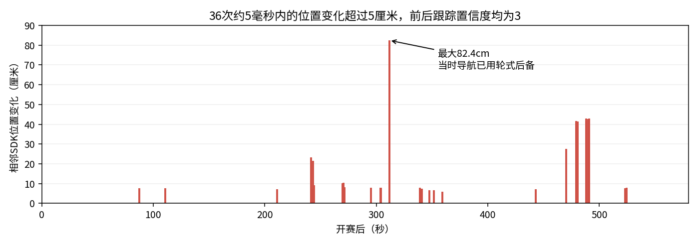
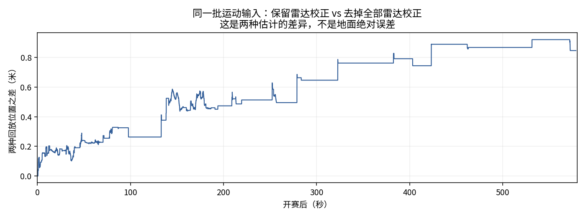

# 2026-11-16 正式局定位复查

本目录分析的实跑SDK会话为93c57952c02faa592f0049fdd592409b，上位ad4415f，来源是20261116_010954_competition_wheel。开赛227812178704ns，人工停止806419043338ns，比赛约578.607秒；不将停止后继续采集的轨迹当自动比赛行为。

## 原始SDK突跳与控制位置分开

`raw_steps.json`包含原日志散列及36条原始记录。115602条比赛Pose中，36次相邻记录平面变化超过5cm，全部相邻帧号连续、约5ms间隔、前后tracker_confidence=3。这不是物理地面运动的证明，而是SDK坐标明显不连续的证据。

最大一次在311.652秒：SDK投影到车体中心的平面位移82.415cm；原始SDK三维位置同期变化83.545cm，原始速度梯形积分仅2.069mm。误差已在SDK原始位置中出现，不能归为上位坐标转换单独造成；但没有鱼眼和重定位通知证据，不能指定某个SDK内部事件是唯一根因。

同一时刻前后各0.2秒的78条实际控制记录全部为WHEEL_FALLBACK，最大相邻控制位置变化2.490mm。**SDK跳82cm不等于导航坐标跳82cm，更不等于车辆实际移动82cm。** 这说明当时后备有作用，不代表轮式后备对抗打滑时也可靠。

## 本轮SDK设置

用户选择保留内部建图，关闭重定位/跳变；地图保留维持关闭。设置代码d9ee27e及雷达修补03dde0b已交付。SDK动态校准默认开启，项目没有关闭，本轮仅补启动回读。T265原始IMU由上位机同一SDK进程直接读取这一来源已确定，当前采流与WIO实现未完成。

`sdk_deployment.json`记录完整工作区快照构建的产物散列、旧程序备份和源码清单位置。工作区原实验保留但默认未开启；未启动设备、未改下位机。需要完整重启正式父入口才能加载，不把部署文件当作实车生效。

## 去掉雷达的离线对照

两组都使用提交版正常定位内核，归档大融合关闭；输入来自同一真实会话，截止人工停止。一组保留原749次墙坐标校正，另一组不输入这些校正。57881个共同轮反馈记录上，两条估计轨迹的差：中位64.65cm、P95及最大92.04cm、结束84.65cm。最大差首次在551.339秒附近。**这证明当前估计很依赖雷达，但不是“实车偏了92cm”的地面真值结论。**

保留雷达组与实际控制记录按时间插值比较，差的中位0.031mm、P95 43.15mm、最大247.11mm、末端约零。中途不是逐笔完全复现：现有离线工具用SDK处理完成/墙计算完成作输入到达近似，并用原始姿态/安装偏移重算局部速度；保留墙候选也来自原轨迹，没有完整原点云重新拟合。不能把中途差全算为定位算法错误，或宣称新雷达算法已经用全场原点云验过。

无雷达组失去了墙坐标纠正和墙证据参与来源选择；保留原SDK融合Pose，不可能离线重演“轮速注入改变后设备内部会输出什么”或车随新导航改变动作。此对照只是在相同已记录运动输入下检查外层定位的雷达依赖。原始文件大小/修改时间保持，输入散列见summary.json。

`summary.json`与`comparison_2hz.csv`是精简结果；完整本地回放保留在同目录native_replay.json、trajectory.csv、wall_corrections.csv、source_events.jsonl及replay_source.py，不将复制的旧实验工具当作本次运行实现。离线快照中的age字段来自回放执行时钟，不能用于解释历史运行延迟。

后续仍需：原始T265 IMU采流/WIO、对抗打滑时的轮式可信度，以及补齐各阶段SDK连续性。当前没有实车雷达断线测试或独立地面真值；不启动设备来补这项，也不恢复整包归档融合。
