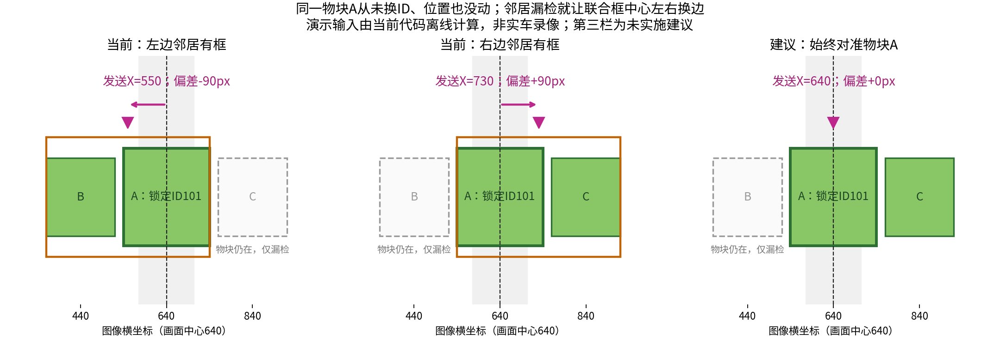

# 单轮受阻、回正停滞与聚堆摆头：本轮解释

2026-11-12。只分析，不修改控制、定位、ROI或配置，不启动车辆或清日志。
上位核对至13f9971；下位只读main与c7a9e7a相同，最新实跑自报c7a9e7a/dirty1。
未提交固件内容未知；下述源码分析不能替代实际烧录字节。

## 单轮受阻为什么会破坏横移

三轮底盘没有多余的驱动自由度。运动分解式并未因卡料而变错；是某轮实际速度不能跟随目标，
原来相互抵消的前后、旋转分量不再抵消。锁角控制再改变三轮目标，可能连仍能转的两轮也压慢。
因此，三轮计数近零不能直接证明三轮都缺力，也不能仅据此认定触发了堵转保护。

按当前F405统一反馈符号，M1右、M2左、M3后：

```text
w1 = -sqrt(3)/2 * forward - left/2 + q
w2 = +sqrt(3)/2 * forward - left/2 + q
w3 = left + q
forward = (w2-w1)/sqrt(3)
left = (2*w3-w1-w2)/3
q = (w1+w2+w3)/3
```

各速度单位mm/s，left向左正；q是轮空间旋转切向量，不能直接当主gyro的角速度。
未用未经标定的旋转半径推算精确角速度，未更改gyro正方向。
下例是假定轮地正常滚动的说明，不是本次实际受阻轮/PWM的测量：

| 情况 | 三轮目标mm/s | 假设三轮实际mm/s | 模型左移mm/s | 模型q mm/s |
| --- | --- | --- | --- | --- |
| 正常左移120mm/s | −60/−60/+120 | −60/−60/+120 | 120 | 0 |
| 假设后轮完全卡住 | −60/−60/+120 | −60/−60/0 | 40 | −40 |
| 锁角又叠加+60旋转分量 | 0/0/+180 | 0/0/0 | 0 | 0 |

第三行说明一种可能的控制平衡，不保证实际控制器必然到达这个数值。
如果卡的是前轮，可能先斜走并偏航；哪一轮卡住会改变表现，不能用后轮例子反推现场。
在后轮锁死且不打滑的模型下，要同时保持yaw不变就不能保持纯横移；改变方向有时能动，
但不能靠改运动分解或摄像头轴向恢复任意三自由度运动。轮地滑动时，上述理想约束也可能不成立。

本轮原轮计数的离线统计：

| 比赛相对时间s | 样本数 | M1/M2/M3单轮零增量比例 |
| --- | --- | --- |
| 142.50—151.95 | 945 | 98.9% / 99.4% / 86.9% |
| 298.64—300.46 | 182 | 99.5% / 96.7% / 83.5% |

已有回放表明这些区间多次仍请求非零横移，但没有各轮目标/PWM日志。
实际M3反而有更多非零计数；不能据此把本次受阻轮认定为M3，或断言已证实上述平衡过程。
用户提供的底盘卡物块现象与轮反馈不跟随一致，摩擦、硬卡及控制补偿各占多少仍未知。

## 对“先回正”的修正说明与可选处理

前次建议解决的是偏航时把透视误差当横差，不是机械脱困。严格先回正再横移，遇硬卡仍可能不动。
只移动判断顺序，不能称为已修好卡料；回正也需要实际驱动力。

实际源码的两条边界必须分开：

- app_config.h:97的APP_ENABLE_LOCAL_MOTOR_FAULT_STOP=0，motor.c:1612的普通堵转/反转停机分支当前未启用。
- Motor_TurnAngle仍有APP_MOTOR_TURN_TIMEOUT_MS=10000；motor.c:1115超时置TURN_FAULT并停输出。
  Task.c:3622调用turn_to，失败会task_stop(TASK_FAULT_MOTOR)。所以机械前移这个调用，可能把横移卡料变成旧定角超时停赛。

推荐分层讨论，不把它们打包为已授权实施：

1. 有限阻力、尚能转动：可审查把现有Fine按各轮目标/实测速差补偿与Heading同时用于视觉横移。
   现视觉MoveAngleHeading走普通路径，未继承Fine；STAGE已有Fine。复用比全局提高速度/PWM更有针对性，
   但要核对锁角与补偿不互相覆盖。保留现输出上限，不承诺解除硬卡；减慢速度本身未必能克服静摩擦。
2. 真正硬楔住：需要改变接触关系，可能退一点或向场内斜移；具体方向取决于卡料位置，不能统一保证。
   这是新的运动行为，尚未选择/实现。若退让改变了距安全区的纵向距离，必须恢复原投送起点，
   不能退后直接沿原固定ENTER 670mm推进，否则会改变投送终点。
3. yaw优先实现应审查同一ALIGN内的连续控向，避免把每次偏航恢复都变成独立、可超时FAULT的定角任务。
   不因此新增堵转锁存、时间门或握手；也不在本轮擅自删除其他既有异常分支。

当前只修订配套审查说明。Fine/Heading组合、硬卡脱困及既有定角超时处理都须向人讲清影响，不能由另一端AI机械扩张。

## 锁了ID，为什么仍会左右摆头

现代码流程不是每帧全局重选目标，而是：

```text
找到锁定物块A
  → 找这一帧A附近所有可见物块
  → 用这些框的最左/最右边界组成联合框
  → 把联合框中心发给下位机转向
```

对应competition_rescue/state_machine.py的_cluster_target_for_vision、_cluster_members_for_target、
_items_bbox、_cluster_approach_command。锁ID只锁了寻找这堆的锚点，未锁实际转向的物理参考。
联合中心不是数量多数或加权平均；一个最外侧框漏检，就可能明显改变一侧边界，中心随之移动一半。



此图是调用当前函数的受控演示，非实车录像：画面中心640；A(ID101)一直在640且从未漏检。

| 当前可见框 | 当前实际函数发送X | 相对画面中心 | 候选同锚点发送X（未实施） |
| --- | --- | --- | --- |
| A和左邻B | 550 | −90px，向左对准 | 640 |
| A和右邻C | 730 | +90px，向右对准 | 640 |
| 又变成A和B | 550 | 又向左对准 | 640 |

物块没有移动，锁定ID也没变，但下位收到的目标左右换边。车身转动后整幅图像移动，
邻居又可能被遮挡/出画/重现，形成“改转向点→转车→可见集合再变→再改转向点”的循环。
下位只收到X/Y，不知道上位是因为邻居变化换了点；它按收到的新点纠正，并非凭空犹豫。

还有两个叠加因素：

- 对准按联合框，_range_approach_output却按_target_for_batch选中的单个锚点测距，
  因而“对谁转正”与“按谁决定前进距离”并不一致，可能刚交给测距又被要求回去对准。
- F405普通单目标已有近中减旋/改用原始X，但Task.c:1863用!cluster_target_active排除了聚堆。
  聚堆仍有滤波X、40px交接范围及最低60mm/s轮切向旋转请求；滞后/最低输出可能放大越中心后的摆动。
  它们不是本轮量得的内部电机延迟，也不能仅靠调滤波消除上位目标本身换边。

## 实际日志证据与不能下的结论

- 57.355—66.592s首绿，主yaw跨度31.31°、净2.63°；实际7次进mode52，其中6次回mode20，最后进53。
  task/action不变证明流程反复，但不能单凭它证明物理ID未变。
- 本轮10Hz留存检测帧离线重算：37.021→37.141s锚点142移动19px，联合中心改变105px。
- 280.372/280.546/280.649s用同一橙色619作重建锚点，其X约64不变；邻居626出现/消失使联合中心79→197→80。
  此处锚点是重建假设；留存帧不是完整约50Hz发包记录，不能声称这些值已逐包发给下位。
- 另见橙色802同ID可见仍越中心/返回对准；所以并非所有摆头都由邻居漏检造成，
  还包括真实转动、允许的空间重关联、下位近中控向及流程交接。详见FOLLOWUP.md的原帧与状态。

## 推荐的最小聚堆修法（本轮未实施）

对准与测距统一使用同一个锚点A；联合框继续服务群体/分离判断，不直接作为转向点。
锁的是同一物理目标，绝不是冻结第一帧像素；车动时A的当前像素仍正常更新。
真正失去A时再沿既有空间关联处理，不为邻居漏检新增确认帧、延时或握手。
代价是可能先靠近这堆的一侧，而非最居中覆盖最多物块；与当前尽快靠近后夹内分离目标更一致。
先消除参考点跳变，再决定聚堆是否沿用已有单目标近中交接；不同时改ROI、模型、载荷政策或安全区边界。

演示输入、当前函数输出、候选值及轮速模型见pile_block_explanation.json。
当前控制/配置/固件均未改变；本文件不是实车通过证明或新增运动行为的实施授权。
