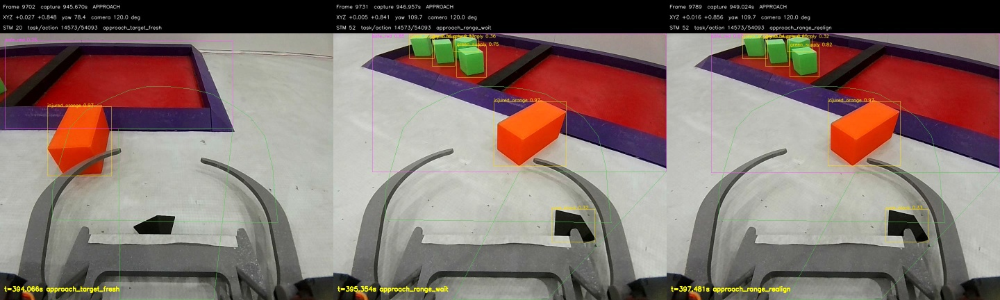
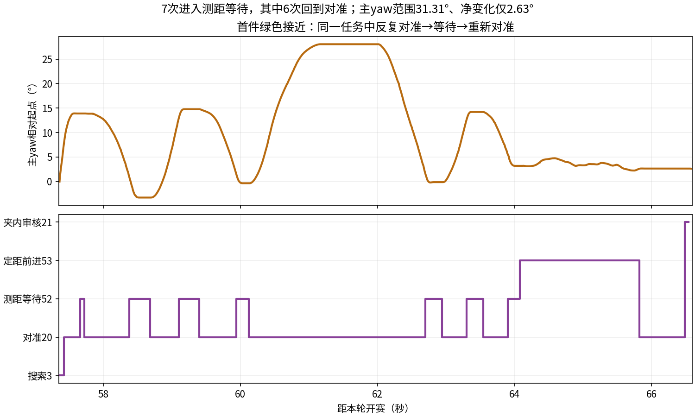

# 安全区1/3修法与接近物块堆摆头：继续分析

后续用户决定：暂不改边界提取，优先“先垂直、再横移并保持法向”，保留原框与比例算法。
下文几何建议暂缓、聚堆候选仍待选；以当前[选定范围](../../SAFE_ZONE_YAW_FIRST_20261112.md)为准，原证据不撤销。

2026-11-12。本轮从ced6b24继续，只分析同一批最新原始日志及当前两端代码，未改控制/配置/ROI/原始记录，未启动设备或动车。
用户新增观察：靠近多个物块/物块堆时左右摆头像在换目标。不能仅按观感把它归因为每帧重新选物块。

## 新证据一：真实围栏外的目标被安全区矩形排除

最新一轮393.727s开始接近伤员，任务14573/动作54093。
394.066s以后回放中可见橙色目标802持续存在；395.2—397.3s上位却持续HOLD，理由是
`approach_range_wait`，文本同时写`range_measured`。即距离表已有结果，不等于规划器还能找到该目标。

395.354s原帧9731：

- safe bbox=(149,0,1129,532)。
- 橙色802 bbox=(616,262,277,247)，脚点约(754.5,509)。
- 橙色框被safe bbox完全包含，现行tracked_cargo算出inside_safe_zone=true。
- 回放画面清楚显示橙色块在紫色围栏外的灰色地面上；安全区倾斜投影的大矩形把这块区外地面也包进去了。
- 用当前CompetitionMission._target_for_batch直接复算，目标返回None；只把这件实物的归属改为区外，原方法即返回802。
  对396.383s/9758帧和397.137s/9781帧复算同样成立，见followup_stats.json。

这是图像几何判定错误的直接输入反例，不是T265误差，也不是该段YOLO没检出橙色。
当前inside判定虽已含脚点，脚点仍拿轴对齐矩形判断，不能分出斜围栏外的地面。
事后回放记录的是最新规划快照，未逐包保存全部视觉输入；397.481s元数据已有realign而对应帧仍会被上述规则排除，
说明相邻源帧/快照不能硬当同一曝光。不能声称2.4s等待的每个周期均已唯一归因，但这三帧的错误排除可直接复现。

## 新证据二：确有对准/测距等待的反复交接

57.355—66.592s的首件绿色APPROACH中，主yaw范围31.31°，净变化仅2.63°。
用原始uart_rx_native重放现有MixedStream解析器得到实际0x17/0x1E状态：

| 进入测距等待52（秒） | 返回对准20（秒） |
| --- | --- |
| 57.662 | 57.722 |
| 58.383 | 58.682 |
| 59.102 | 59.402 |
| 59.942 | 60.122 |
| 62.702 | 62.943 |
| 63.302 | 63.542 |
| 63.903 | 64.082进入定距前进53 |

准确说是7次进入等待、其中6次回对准，不是7次完整往返。
这些往返期间任务14558/动作53987不变；64.082s定距动作变为53988。
同任务不代表物理目标ID一定没变，不能用它替代目标身份日志。

另一个有直接指令回放的例子：394.066—400.528s可见橙色ID802，
395.2s目标已越过画面中心到x≈742/754，上位处于52等待；397.481s发x=755重新对准，
398.063s目标又回到x≈530，之后再次调整。可见摆动并非都需要更换物块才能发生。

## 物块堆额外的不稳定来源

当前state_machine.py:4750附近确实有cluster_target_track_id锁定与空间重关联；
有框时不是全局重新挑一次“最优物块”。但4835附近实际发送的x/y是
`_cluster_members_for_target`当前可见邻居的联合外框中心，而不是这个锁定物块的中心。
邻居丢失、重现、边缘裁切会改变联合框，即使锚点没动，发送点也会动。

用本轮10Hz留存检测帧重算现有函数，可复现：

- 280.372/280.546/280.649s，假定跟随同一橙色锚点619，它的X均约64px；
  邻居626出现/消失时，联合框X中心79→197→80px，来回变化约118px。
- 37.021→37.141s同一绿色锚点142只移动19px，联合框中心却改变105px。
- range阶段又改用_target_for_batch选中的锚点计算距离；于是对准按区域中心、测距按单个目标，参考也不完全一致。

以上是抽样输入的离线重算，未保存的约50Hz帧及真实初始锚点无法补造，不能写成这些像素值已经逐包实际发送。
它证明当前算法存在该机制；具体摆头段还叠加了真实转动、ID重关联与控制响应，不能全算成选错目标。

## 两端当前实现差异：不能重复下旧任务

本次仍读到F405固定入口；Task.c/app_config.h与实跑自报c7a9e7a基线的blob一致，dirty烧录内容仍未知。

- 普通单目标的近中心减旋已经在Task.c:1861—1890实现：近中心用原始X，避免滤波及斜坡继续追过头；
  APP_APPROACH_TRACK_CENTER_TOLERANCE_PX=64，在128→64px范围把旋转请求由约60降至30mm/s。
  不能再次把“实现单目标减旋”当成尚未做的全新配套。
- 该分支显式要求`!cluster_target_active`，聚堆不使用它。聚堆仍按滤波X、40px交接范围及最低60mm/s原地转动。
  当前0.55坐标滤波与转向斜坡会带来响应滞后，但不能仅凭常量声称已量出了电机内部延迟。
- 上位_range_approach_output先要求新帧/角度/距离等usable，之后才检查明显横差，
  因而“有横差可纠正”也被绑到“先取得距离”之后；区内误排除时会HOLD。
  该入口还保留0.30s等视觉时间条件，本轮未新增、未批量删除，也不能把本次等待全部怪到这些条件。
- 新视觉横移仍为普通MoveAngleHeading，未用STAGE的Fine补偿；这点与前一份报告相同，不重复发成已批准实施任务。

## 推荐修法与取舍（尚未实施）

### 先修安全区几何，统一1/3目标与区内外归属

推荐把YOLO框降为“在哪里寻找安全区”的区域提示；用围栏前沿、侧边/区内地面确定真实四边形。
物块脚点相对真实前沿及区域判断区内外，保留确实区内物料的排除；人工爪内ROI和类别/数量审核不变。
若四角可得，按平面透视关系把区域展开，再取物资1/3、伤员2/3，投回原图；
不直接等分裁切矩形，也不把“前沿线段图像上1/3”冒充任意斜视角下的真实长度1/3。
几何是在同帧安全区ROI内处理，不要求改模型类别或新增对端协议。

先沿用主yaw对垂直法向，再锁该航向横移，后续ENTER仍本地轮程直推。
115°是现有可用复看角度，本轮该角有完整框样本；可优先利用它获取边界，
但水平裁切/物体遮挡不保证靠抬5°就能解决，不能把改相机角当完整算法。
下位最小候选是让已有Fine实测速差补偿与绝对锁角同时用于视觉横移；不全局提PWM，也不新增等待/握手/停车判断。

优点是修正真实目标几何，同时解决矩形错排除与错误分区点。成本是增加小范围边线/角点提取，
必须先在已有完整/裁切/遮挡原帧上核对；本轮没有实现或证明自动提边稳定。
若边界仍不可恢复，不能伪造1/3已对准或擅自盲推，也不擅自加无限等待；动作出口需选定实施时再与人决定。

替代小改仅把安全区画面改为115°、平滑bbox或减少横移增益：实施更快，
但矩形包含区外地面、裁切框无法确定真实分区的问题仍在，故不推荐作为最终修复。

### 然后修接近目标与到中交接，减少摆头

1. 聚堆继续原有目标优先级和锁定/空间重关联，但对准、测距都用同一个可取得的锚点。
   联合框只描述邻居和后续分离构成，邻居漏检不立即挪动接近点。爪内有物后沿现有审核/分离，不追求把整堆中心摆正。
   代价是可能先吃到堆的边缘，而非同时覆盖最多物块；更符合先取得物块、再分离的现行目标。
2. 下位聚堆复用已存在的单目标近中心减旋/原始X停止逻辑，讨论统一为已有±64px“差不多即可直行”，
   避免继续最低60mm/s追滤波值；不额外加连续确认帧、计时等待或新的握手。
   单目标现有分支保留，其实际仍摆动的段要结合上位目标/区内归属修复核对，不能承诺仅放宽聚堆阈值就全好。
3. 对仍明确可见、横差大的同一目标，转向纠偏不应先等待纵向距离可用；
   转向与测距条件解耦，到中以后才发原定距指令。同task/action继续，不增加反复握手。
   原定距前进仍不混入定位横移；不恢复边走边对准。

建议顺序：先安全区真实几何候选与原帧核对，再单独选聚堆锚点/近中心交接。
本轮不是整包实施授权；F405改动只作为待审方案，不附新增测试代码任务。

## 必要核对与未完成

- 已解析原始UART7686条状态，107489个有效旧帧、92036个有效扩展帧，混合解析CRC错误2，无部分包超时/缓存溢出；
  这不是新运行监控，也不据此新增任何时间门。
- 已用当前目标选择方法复算三帧错误区内排除；状态与gyro/选帧时间线可对应。
- 抽样联合框复算标明假设；未来未采到的指令与角度/距离真值未补造。
- followup_stats.json、两张图只来自原日志。未实现新几何/控制方案，未做实车验证，未改/清日志或启动模型/SDK/UART。
