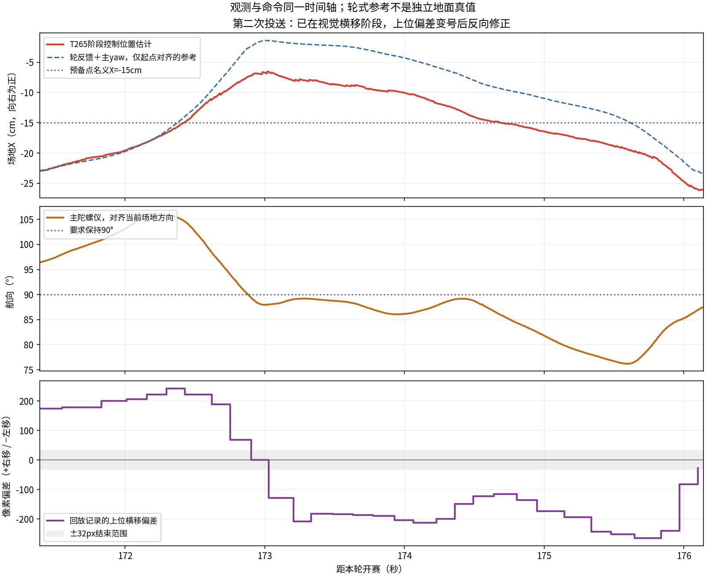
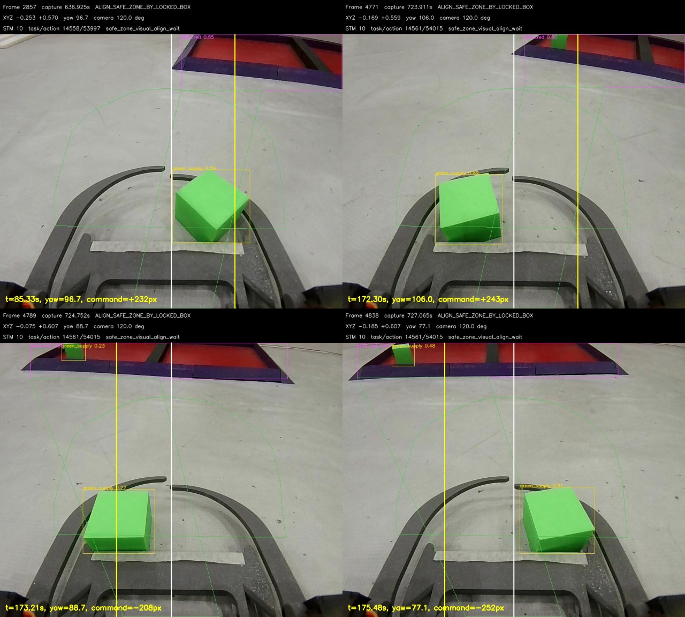

# 安全区到位后往返横移与停滞：2026-11-12只读分析

后续用户决定：保留现有框与1/3算法，先修垂直对正及横移中控向；边界提取、Fine驱动候选均不自动实施。
以下证据保留，原推荐顺序由当前[选定范围](../../SAFE_ZONE_YAW_FIRST_20261112.md)替代。

本轮只分析原始记录、核对两端源码并更新本待办；未修改控制、定位、ROI、配置或原始日志，未开设备或动车。
结论不是“雷达算慢导致继续导航”：最清楚的往返发生在预备点导航已结束后的视觉ALIGN。
上位仍依据随画面变化的安全区框发横移，下位主yaw观测又明显摆动；另有非零横移已接受但三轮计数几乎不变的段。
不能把这些段全部归为定位漂移，也不能把物理卡住、驱动力不足和控制器问题凭现有记录唯一分开。

## 实际基线与日志配对

- 本仓库HEAD及最新一轮metadata：42d668b53f41d90c534af86d90befbee029d784b，codex/gamepad-teleop。
  state_machine.py本轮开始时无未提交改动；原有定位/ROI等未提交文件全保留，没有回退或重套补丁。
- 最新实跑chassis_identity.json：c7a9e7a4e03af5516e130839d06c7349375c6020 / source_dirty=1，
  NormalRun/TASK、921600。metadata中的unconfirmed是初始占位，不拿它盖过独立实际回包。
  dirty来源无法从干净Git源码确认，下面的下位代码判断是该自报基线的可核对实现，不保证等同全部烧录字节。
- 下位main较bbb719c新增的c7a9e7a仍只改文档，运行源码沿用0d52ef8。
  Task.c blob=dff0959ae3dcb1fe4cb7c2ab1715674ecf5853d1；
  motor.c blob=d0717d7ad017f64adae20fa332c7c75664dd564b；
  app_config.h blob=6a7ee6c6502e5ac28cd3f43a31ac1aca570b5774。

日志归档名不可靠：业务目录可能用结束时刻命名，重启未校时还会出现20000101；传感器目录是预热会话起名。
下表用vision_prewarm_ready.session_token与metadata.round_reference_token配对；不能按同名文件夹硬配。
以下均为history下的业务目录，传感器目录位于history/competition_wheel_input下：

| 实际顺序 | 业务目录 | 传感器目录 | 开赛→停止/完整性 | 本问题覆盖 |
| --- | --- | --- | --- | --- |
| 1 | 20261112_161739_competition | 20261112_161636_competition_wheel | 28.181s，有停止；上位800ea44 | 尚未到预备点 |
| 2 | 20000101_080032_competition_02 | 20261112_162802_competition_wheel | 114.850s，有停止；上位42d668b | 尚未到预备点 |
| 3 | 20261112_164708_competition | 20261112_164547_competition_wheel | 22.501s，有停止 | 尚未到预备点 |
| 4 | 20261112_165025_competition | 20261112_164708_competition_wheel | 无停止，events第50行截断；49行完整事件仅到开赛29.959s，后续diagnostics到113.514s | 不能当完整比赛或完整动作清单 |
| 5 | 20261112_165601_competition | 20261112_165225_competition_wheel | 185.488s，有停止，0次投送完成 | 2次NAV、1次视觉ALIGN |
| 6 | 20261112_165835_competition | 20261112_165601_competition_wheel | 102.238s，有停止，0次投送完成 | 1次NAV、1次视觉ALIGN，停在扫障 |
| 7（最新） | 20000101_080033_competition_04 | 20261112_165835_competition_wheel | 429.619s，有停止，程序记录5次投送完成 | 主要证据，非得分/实际入区验收 |

另有本次16点时段的7个仅7行预热日志，没有competition_started，不算7次实跑；完整目录见inventory.json。
当前runtime中的未开赛预热同样不能覆盖上面的最新实际比赛。

最新业务绝对路径：
`/home/sunrise/RDK_X5/shijue_fangan/rescue_map/runtime/history/20000101_080033_competition_04/`

最新传感器绝对路径：
`/home/sunrise/RDK_X5/shijue_fangan/rescue_map/runtime/history/competition_wheel_input/20261112_165835_competition_wheel/`

本轮开赛单调时刻551695416199ns；round_token=12b5290e86516a7104484d6f3f81d644；
sdk_session_id=bf294c5163bd0f708b4a0fd64aa277f4。下文秒数全部相对开赛。
读取业务events/detections、control_pose、motion_feedback、7段回放与对应帧元数据；
原始UART未见可用的TD_*驱动输出记录，两处字节匹配实际是二进制帧巧合，不能当PWM证据。

## 最新一轮的安全区动作

| 投送 | 预备点NAV | 视觉ALIGN | 主要现象 |
| --- | --- | --- | --- |
| 1 | 70.500—74.369s | 75.483—90.182s（81.210短暂进走廊后又返回） | 先向右、后向左；主yaw范围70.14—105.63° |
| 2 | 120.354—137.639s | 141.619—176.141s | 34.522s；先停滞，再横移往返，主yaw75.00—106.14° |
| 3 | 225.067—228.323s | 230.119—259.595s | 29.476s；回放末段大量缺框PAUSE，并有位移异常 |
| 4 | 290.868—294.523s | 297.430—303.398s | 5.968s；两段非零横移时三轮绝大多数采样为零 |
| 5 | 341.035—346.835、351.309—352.795、357.726—358.910s | 366.469—368.192s | 多次复审/分离后才推进；115°观察，视觉1.723s |

本表NAV列不是逐条命令统计。第五次的三段NAV是重新审核/分离后的继续导航，不编成三次独立投送。
最终停在WAIT_SEARCH_RECOVERY，events记录投送完成5次，其中1次为原视觉超时完成出口；不等于人工确认全部入区。

## 往右又拉回：指令和反馈均可对应

第一次预备点结束时，控制位置约(-0.161,+0.495)m，目标(-0.150,+0.540)m。
横差11mm、纵差45mm，旧X±60/Y±50mm和新X±100/Y±50mm都已到位。
75.483s安全区锁定分区点727px，对图像中心640产生+87px，超出64px启动范围，上位主动开始向右横移。
随后：

- 75.487—81.209s：控制X由-0.159到+0.029m，即估计向右18.9cm。
  同段轮反馈＋主yaw积分向右22.4cm，支持存在运动，不能说只是地图点闪跳。
- 81.210s视觉短暂满足结束，81.251s新画面又触发原视觉横移。
  至90.179s，X由+0.049到-0.204m，即估计向左25.4cm；轮反馈参考向左28.6cm。
- 这一往返期间不是0x03 STAGE继续追预备点，而是0x04视觉ALIGN；没有逐采样>2cm的位置突跳。

第二次更有完整视频/指令证据：task14561/action54015已接受，mode10/status1。
171.39—172.75s，X估计向右13.6cm，轮反馈参考向右16.6cm；回放上位偏差+174一路到+243px。
172.75—175.97s，上位偏差变为-129/-208等负值，X估计向左14.8cm，轮反馈参考向左14.4cm。
对应主yaw先到106°，又到约77°，要求保持的法向却是90°。
这证明上位视觉偏差与下位航向/运动形成来回纠偏；不能只用XY定位偏差解释。

轮式曲线只在局部起点对齐，采用实测轮速度与主yaw积分；轮速又是T265 SDK的既有依赖，
且无独立地面真值，不能拿两条曲线相近自证距离/方向绝对准确。

## 上位与下位分别有什么问题

### 上位：裁切框与摆动航向一起改变“要对准的点”

state_machine.py:4315按当前safe bbox的x+width/3计算物资分区点，伤员按2/3，未区分框是否被图像边界裁切。
例如回放85.333s，bbox=(676,1,602,208)，右端1278已贴1280图像边；
172.298s同样右裁切，框为(679,0,599,197)。把可见部分的1/3当完整安全区的1/3，几何依据不足。
主yaw摆动时，框边界/透视同步变化，上位依然将它全部当横向误差，并持续更新同一横移动作。
81.210→81.251s的41ms内，刚结束又被新偏差重开；这是原c907be0走廊复看逻辑，不是800ea44的STAGE重开。

白线=图像中心，黄线=该回放检测框重算的物资1/3点；文字command取回放中的上位请求，
可能属于前一个视觉源帧，因此不能要求黄线数值与文字逐帧完全相等。
回放原有Pose是入队时最近的规划快照，不是曝光严格同步或地面真值。

### 下位执行：需要保持的航向没有保持住，横移又未采用STAGE的Fine补偿

Task.c:3591附近的safe_align_lateral_active分支把像素量换为110—180mm/s，
调用Motor_MoveAngleHeading(speed, pixel>0 ? -90 : +90, 法向航向)。正负方向与本轮实测轮反馈一致，
未发现简单把左右写反的证据。横移时由内部heading PI保持航向，外层不再执行原定角到法向分支。
本轮主yaw最大偏离法向约16°，说明这一运行条件下航向保持效果不足；
究竟是负载/卡料、轮速跟随、PI输出还是dirty构建差异，现有记录没有PWM及控制器内部目标，不能唯一判定。

motor.c:2562的Motor_MoveAngleHeading调用普通Motor_MoveAngle，fine_correction=false；
STAGE的Task.c:3370附近则走Motor_MoveAngleFine。
因此新增视觉横移并没有继承STAGE的0.5mm/s轮零带及最高150‰实测速差静摩擦补偿。
它仍有原来的斜坡、PI及后轮小死区，不能写成完全没有控向/驱动补偿，
也不能只凭6mm/s轮死区解释整个110—180mm/s平移不动。

### 不动：有明确驱动没跟随，也有上位因缺框主动PAUSE

- 142.50—151.95s，上位回放非零0x04偏差多为+116至+131px，下位对应动作已接受；
  三轮delta同时为0占85.5%，轮反馈积分仅约1.9mm，控制XY约6.7mm变化。
  41个回放帧中12个确实发缺框PAUSE，其余29个仍是非零横移。不是全段都被上位暂停。
- 298.64—300.46s：12个回放帧全部非零视觉横移，偏差约+121至+127px，
  三轮全零占81.3%，轮参考仅约5.4mm；301.10—302.60s仍全为非零横移，
  全零占83.3%，轮参考仅2.7mm。此类段符合用户所述底盘卡物块后驱动力需求增大，但日志无法证明卡料发生的具体瞬间。
- 254.72—259.42s：33帧中28帧主动PAUSE，属于看不到安全区的另一类停顿。
  同时未与轮式对齐的T265投影车中心也有单5ms约2.4/2.2cm变化，轮参考与T265纵向位移相差约11cm，不能全部当真实车体移动。

## 与上次修改的关系 / 定位与延迟

800ea44只改变STAGE横向到位区域及18cm内未超限轴归零；D=0到位锁存保留，未改0x04、驱动、定位或ENTER。
第一趟新旧到位条件都满足，仍发生往返，是它不能独自解释故障的直接反例。
第二趟确实在X≈-0.248m交接，横差约98mm，新条件接受、旧条件不接受；
这会把更多横差交给视觉，可能放大视觉问题，但离线不能证明旧版在真实车辆上一定更快/更好。
42d668b只加窗口按钮，不改运动链。更直接的回归关联是c907be0＋下位0d52ef8新增的实时视觉横移与运动执行，
目前日志证明其闭环表现不稳；不能在没有前后同场对照及dirty内容的情况下声称唯一责任已经锁死某一行。

本轮所有预备点NAV的控制source是WHEEL_FALLBACK，未见XY围栏约束；
视觉段则为既有T265_PHASE_NO_WHEEL，暂停轮式传播/SDK发送，保留T265既有历史影响。
第一段切换附近XY仅约1mm变化，不是一次大跳把车“传送”到右边；
第二趟137.63—141.62s转向阶段控制Y改变-11.2cm、轮参考-16.8cm，不能把全部变化当纯定位误差。
这些传感器限制影响预备点的实际物理到位，但视觉0x04期间并没有用全局XY指令向右拉车。

前两段视觉检测capture→publish中位约112/113ms，P95约164/160ms；
按最高0.18m/s只折合约2—3cm的该部分响应距离（不是全链总延迟）。
原同步日志写盘中位0.69/0.76ms。不能用“雷达积压”解释整个约20cm往返或数秒几乎零轮运动。
本轮未为了分析新增实时计时、年龄门、握手、等待或停车判断。

## 推荐下一小步（尚未实施，先由人选择）

1. 优先修视觉对准目标与控向的耦合：完整安全区/入口边线确定分区点，不能直接用裁切框的比例点；
   同时核对横移航向保持，让旋转造成的画面偏差不被当成横移偏差持续追逐。
   不能以简单取消视觉对准或添加固定等待来掩盖问题，也不直接回退已生效STAGE容差。
2. 下位如需修改，最小范围是已有视觉横移的锁角与实测速差驱动：评估把STAGE已用的Fine补偿复用于横移，
   保留主yaw法向和原正负方向；不要全局抬PWM。代价是负载解除后的响应/过冲也会变，需要人决定。
   当前只发布证据供审查，不要求新增测试程序、遥测、ISR、新握手或年龄限制，也未授权改/烧录下位机。
3. 上位位置不稳与物理卡料分别保留未完成项；现有数据不支持修改T265安装、比例或恢复大融合任务。

## 新扫障TODO：推土机（仅登记）

旧C的有限取障/成对寄存候选不采用。新方向按用户要求：放掉爪内物块，左爪最大张开，
统一车头朝右沿围栏扫；不按安全区左右半区反向，考虑左侧雷达扫完后更有利于定位。
爪前端越过围栏内壁，但轮子不得进安全区。
用户尺寸：爪最外缘距对称轴23cm，轮外缘距对称轴15cm。
在两者都可投影为围栏法向距离的俯视假设下，车对称轴到内壁的名义几何范围是15—23cm，只有8cm窗口；
这不是已经选定的导航距离，尚未扣除围栏厚度、爪角、定位误差和实际轮/爪投影。
实施前再对齐“朝右”的场地参考、贴墙距离、放货/拾回位置、扫到哪里结束与两端动作接口。
本轮不改变正式现有扫障行为、不实施新策略，也不恢复其他未选TODO。

## 附件与边界

- inventory.json：近期实跑/预热配对及完整性（不完整轮保留损坏行号，原文件未修写）。
- metrics.json / focused_metrics.json：阶段与重点区间统计；累计轮参考是同gyro方向参考，不是独立测量。
- replay_evidence.csv：569个回放元数据快照，可按task/action与源frame追查；不是所有50Hz指令的完整逐包重放。
- 两张图只由既有日志生成；没有启动设备、修改源代码/参数/ROI、重启比赛或清理任何日志。
